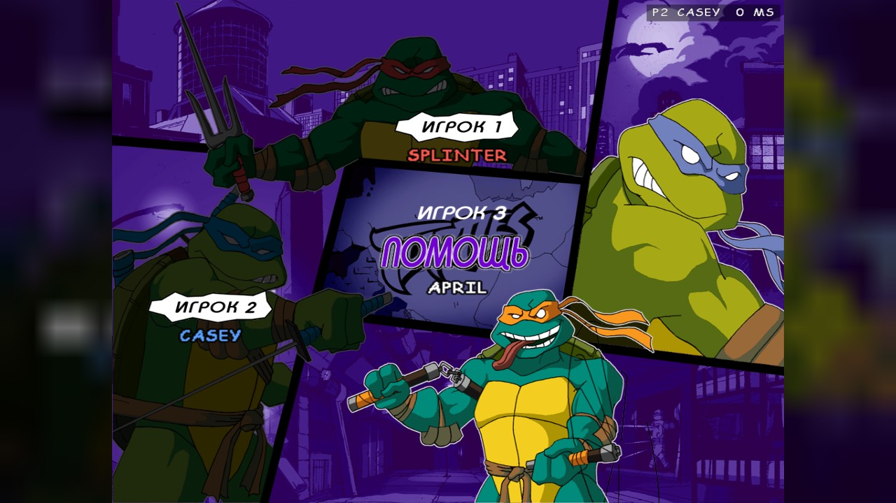
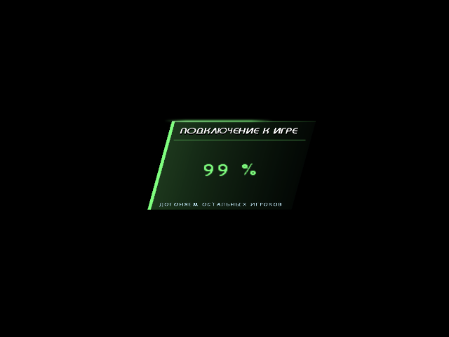
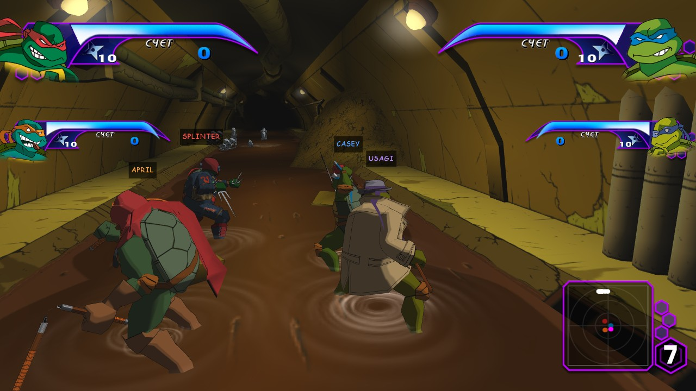
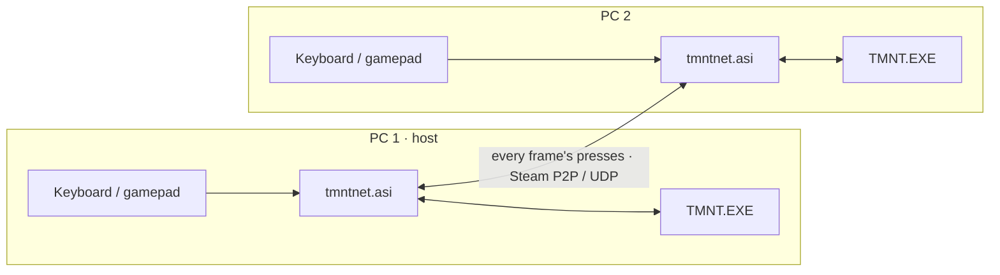

<div align="center">

# TMNT 2003 Co-op · tmntnet

**Online co-op for up to four players in Teenage Mutant Ninja Turtles (Konami, 2003, PC)**

One file · everyone has their own copy of the game, their own screen and their own camera · Steam, LAN or IP · wide screen

<a href="docs/en/LAUNCHER.md"></a>

<a href="https://github.com/int3re/TMNT-2003-COOP/releases/latest/download/tmntnet-launcher.exe"></a>

One file, about 7.7 MB: the mod's installer is inside the launcher. It installs the mod, updates it and itself, sets up the game and starts it.

[](../../releases/latest)


[](../../releases)

[Русский](README.md) · **English**

</div>

**tmntnet** is a mod for the original PC release of *Teenage Mutant Ninja Turtles* (2003). The
game has co-op for two players on one computer only. The mod adds network play: the story mode
for two, three or four players, each on their own PC, with their own picture and their own
camera. The games run frame for frame (lockstep): only button presses travel over the network,
so any connection will do and the picture is never a video stream.

The mod is operated **from the game's own menus**, in the game's own font and look: the main menu
gets a **СЕТЕВАЯ ИГРА** (Network game) item, the option pages get new rows. Graphics, sound and
keys can also be set before the game starts, in the [launcher](#the-launcher).

> The mod contains no game files and does not change `TMNT.EXE` on disk: every change is made in
> memory at start-up. You need your own copy of the game.

> [!NOTE]
> The mod's in-game text and its launcher are in **Russian**: it was built for the
> Russian-localised release of the game. On-screen names are quoted here as they appear, with an
> English gloss. The whole documentation is available in English: **[docs/en](docs/en/README.md)**.

The same kind of mod for other games: [TMNT 2: Battle Nexus](https://github.com/int3re/TMNT-2-BATTLE-NEXUS-COOP),
[The Incredibles: Rise of the Underminer](https://github.com/int3re/INCREDIBLES-RISE-OF-THE-UNDERMINER-COOP).

## Contents

- [Quick start](#quick-start)
- [The launcher](#the-launcher)
- [What the mod adds and changes](#what-the-mod-adds-and-changes)
- [The mod's menus](#the-mods-menus)
- [Features](#features)
- [In a network game](#in-a-network-game)
- [Controls](#controls)
- [What you need](#what-you-need)
- [Documentation](#documentation)
- [Versions and compatibility](#versions-and-compatibility)
- [Not done and not verified yet](#not-done-and-not-verified-yet)
- [Building from source](#building-from-source)
- [How it works](#how-it-works)
- [Contributing and bug reports](#contributing-and-bug-reports)
- [Credits and legal](#credits-and-legal)

## Quick start

1. **Download [`tmntnet-launcher.exe`](https://github.com/int3re/TMNT-2003-COOP/releases/latest/download/tmntnet-launcher.exe)**
   and run it. One file; it does not install itself anywhere, keep it wherever you like. All
   versions are on the [Releases](../../releases) page.
2. **Press УСТАНОВИТЬ МОД** (Install the mod). The launcher finds the game folder itself. The
   installer is inside it, so no network is needed.
3. **Press ИГРАТЬ** (Play). The game's main menu now has **СЕТЕВАЯ ИГРА** (Network game).

<table>
  <tr>
    <td align="center" width="50%"><br><b>1. Install</b><br><sub>The installer is already inside: one button, no download</sub></td>
    <td align="center" width="50%"><br><b>2. Play</b><br><sub>The launcher tells you when a new version is out</sub></td>
  </tr>
</table>

> [!NOTE]
> The launcher is not code-signed, so Windows may show "Windows protected your PC". Press
> **More info → Run anyway**. The SHA-256 of every file is in each
> [release](../../releases/latest)'s notes. Without the launcher the mod is installed by
> `tmntnet-setup.exe` from the same release: [Installation and removal](docs/en/INSTALL.md).

Playing together:

| | Host | Everyone else |
|---|---|---|
| 1 | starts Steam and the game | start Steam and the game, stay in the main menu |
| 2 | **СЕТЕВАЯ ИГРА → ПРИГЛАСИТЬ ДРУГА** (Network game → Invite a friend) | accept the invite in Steam (or **СЕТЕВАЯ ИГРА → ВОЙТИ К ДРУГУ**, Join a friend) |
| 3 | waits until everybody is **ГОТОВ** (Ready) | press **Я ГОТОВ** (I'm ready) |
| 4 | **НАЧАТЬ ИГРУ** (Start the game) | the character select opens for everyone by itself |
| 5 | picks the level on the map | each player picks a turtle and a costume in turn |


The players must be Steam friends. Without Steam the game runs over a LAN, a VPN or by IP. In
detail, with pictures and every mode: **[How to play over the network](docs/en/PLAY.md)**.

> [!IMPORTANT]
> All players must have the same network protocol of the mod and the same `TMNT.EXE`; otherwise
> the mod refuses the connection and says why. Which versions play together:
> [Versions and compatibility](#versions-and-compatibility).

## The launcher

`tmntnet-launcher.exe` is the window a player starts from. It shows which version of the mod is
in the game folder and which one is the latest on GitHub, tells what is new in it, updates the
mod with one button, and its settings hold the game's graphics, sound and keys.

| What it does | How |
|---|---|
| **Finds the game** | by the game installer's entry in Windows, or in its own folder; if it cannot, it asks where `TMNT.EXE` is |
| **Installs the mod with no network** | the mod's installer is inside the launcher; the game's files are not changed |
| **Updates with one button** | the new version is downloaded from GitHub, checked by SHA-256 and installed; settings, keys and saves stay |
| **Tells whether you can still play with friends** | under the versions it says whether the new version has the same network protocol: "you can play with friends on the version before" or "everybody must update" |
| **Updates itself too** | at its start it downloads a newer launcher, checks its SHA-256, takes its place and restarts; the mod in the game folder is left alone |
| **Sets up the game** | the Graphics, Sound and Controls pages: picture, volume, keys and mouse buttons, before the game starts |
| **Waits while the game is open** | the install begins by itself once the game is closed |
| **Works when GitHub is hard to reach** | installing and playing need no connection; for update checks there is a proxy setting, the system's or your own |
| **Removes the mod** | two presses in its settings: exactly what was installed is removed |
| **Nothing extra** | no autostart, no background process, no registry writes |

<table>
  <tr>
    <td align="center" width="33%"><br><sub>A new version: what is new and whether friends can still play</sub></td>
    <td align="center" width="33%"><br><sub>An update: download, SHA-256 check, install</sub></td>
    <td align="center" width="33%"><br><sub>The launcher takes its own new version at its start</sub></td>
  </tr>
  <tr>
    <td align="center" width="33%"><br><sub>Graphics: the same rows as the game's graphics options</sub></td>
    <td align="center" width="33%"><br><sub>Sound: volumes, movies, the intro</sub></td>
    <td align="center" width="33%"><br><sub>Controls: keys and mouse buttons, layouts</sub></td>
  </tr>
  <tr>
    <td align="center" width="33%"><br><sub>Settings: updates, proxy, the log, removing the mod</sub></td>
    <td align="center" width="33%"><br><sub>No connection to GitHub: the mod installs from the launcher itself</sub></td>
    <td align="center" width="33%"><br><sub>Four headband colours to pick from</sub></td>
  </tr>
</table>

Everything about the launcher: **[docs/en/LAUNCHER.md](docs/en/LAUNCHER.md)**. With no window, from
the command line, the installer does the job: `tmntnet-setup.exe /quiet /host "game folder"`.

## What the mod adds and changes


<p align="center"><sub>The same moment of the game: as the original draws it, and with the mod.</sub></p>

| | In the original game | With the mod |
|---|---|---|
| **Co-op** | two players at one computer | up to four, each on their own PC: Steam, LAN, IP |
| **Story mode** | 1 player, 2 players | ТРИ ИГРОКА (Three players) and ЧЕТЫРЕ ИГРОКА (Four players) added |
| **Camera** | one for all, an "invisible wall" keeps the players together | each player's own in a network game, you can part ways |
| **A fallen player** | loses a heart, then is out | lies stunned, a teammate revives them |
| **Pause in a network game** | — | anyone's Esc, for everybody at once |
| **Dropping out mid-level** | — | the player comes in again and catches up in seconds |
| **Costumes** | unlocked by progress, a secret button and the calendar | all six unlocked, picked on the character select screen |
| **Screen** | 4:3 only | wide screen, a borderless window over the whole monitor, anti-aliasing up to 8x |
| **Mouse** | mouse buttons cannot be bound | bound in the game's own key table |
| **Saving** | at the end of a chapter, with a question | after every level, no questions |
| **Intro** | louder than the whole game | its own volume, can be skipped |
| **Main menu** | the game's own items | СЕТЕВАЯ ИГРА (Network game) added |
| **Installing and updating** | — | one file: the [launcher](#the-launcher) installs the mod, updates it and starts the game |

Every menu and every screen in order, with a note on each new row:
**[What the mod adds and changes, in pictures](docs/en/TOUR.md)**.

## The mod's menus

The mod is operated from inside the game. In the screenshots the **orange outline** marks what
the mod added; everything else is the game's own. (The interface is Russian.)

<table>
  <tr>
    <td align="center" width="33%"><br><sub>Main menu: the new СЕТЕВАЯ ИГРА (Network game) item</sub></td>
    <td align="center" width="33%"><br><sub>The host's page: players, readiness, ping</sub></td>
    <td align="center" width="33%"><br><sub>Inviting Steam friends from inside the game</sub></td>
  </tr>
  <tr>
    <td align="center" width="33%"><br><sub>A guest's page: ready, waiting for the start</sub></td>
    <td align="center" width="33%"><br><sub>Story mode: three and four players</sub></td>
    <td align="center" width="33%"><br><sub>Turtles picked in turn, with the players' names</sub></td>
  </tr>
  <tr>
    <td align="center" width="33%"><br><sub>The costume step: all six unlocked</sub></td>
    <td align="center" width="33%"><br><sub>The level map: the whole team</sub></td>
    <td align="center" width="33%"><br><sub>The shared pause of a network game</sub></td>
  </tr>
  <tr>
    <td align="center" width="33%"><br><sub>Coming into a running game</sub></td>
    <td align="center" width="33%"><br><sub>Graphics options: eight new rows</sub></td>
    <td align="center" width="33%"><br><sub>Other options: four new rows</sub></td>
  </tr>
  <tr>
    <td align="center" width="33%"><br><sub>Sound: the movies' volume and the intro</sub></td>
    <td align="center" width="33%"><br><sub>Controls: the РАСКЛАДКА (Layout) row</sub></td>
    <td align="center" width="33%"><br><sub>The key table: mouse buttons go into it too</sub></td>
  </tr>
</table>

## Features

### Network play


- **up to 4 players on different PCs**. Only button presses travel over the network, no picture
  is sent: there is no video delay, the game runs frame for frame on every PC;
- **Steam with no port forwarding**: an invite is sent to friends from inside the game, friends
  see the open game and join it; without Steam there is LAN, a VPN or IP;
- **a lobby with readiness**: every player shows ГОТОВ / НЕ ГОТОВ (Ready / Not ready) and a ping;
  the host presses НАЧАТЬ ИГРУ (Start the game) and the character select opens for everybody at
  once, with no restart;
- **coming back into a running game**: a player who dropped out or left comes in again and
  catches up, three minutes of play in about five seconds; the others keep playing meanwhile;
- **a shared pause**: anyone's Esc pauses every game; from the pause the whole team can go back
  to the menu, or one player can leave;
- **the host's progress**: everybody plays with the host's progress and difficulty; the guests'
  own saves are left alone and come back after the game;
- **the input delay is chosen from the ping by itself**; long waits are shown on the screen: who
  was waited for and for how long.

<br clear="right">

### Co-op



- **the story for three and four**: the ТРИ ИГРОКА (Three players) and ЧЕТЫРЕ ИГРОКА (Four
  players) modes the game never had, with their own life panels and everyone on the level map;
  works at one PC as well;
- **each player's own camera**: you see the world around your own turtle and can walk as far
  from the others as you like; there is no "invisible wall" between the players;
- **players' names** over the turtles, on the character select and on the level map;
- **team rules**: a fallen turtle does not die but lies stunned; a teammate revives it by holding
  a button. The level is lost only when everybody is down;
- **all six costumes** of every turtle are unlocked from the start and picked on the character
  select screen;
- **the dojo is played by the whole team**, not by player 1's turtle alone;
- **autosave** after every cleared level, no questions.

<br clear="right">

### Screen and picture


- **wide screen with no stretching**: more is seen at the sides (Hor+), the interface keeps its
  proportions, the players' panels stand in the corners, menu backgrounds reach the edges;
- **a borderless window over the whole monitor** or an ordinary window: Alt+Tab is instant,
  Steam's and Discord's windows open on top, a network game does not freeze;
- **any resolution of the monitor**, anti-aliasing up to 8x, sharp textures at an angle (16x);
- field of view, the size of the panels, a frame limit, vertical sync;
- **every setting is in the game's own options** and on the launcher's Graphics page; each
  player has their own, and they do not affect the network game.

<br clear="right">

### Controls


- **mouse buttons** go into the game's own key table like any key: left, right, middle and both
  side buttons;
- **the "Two players" layout**: two at one keyboard with one row; your own keys are kept and
  come back;
- **gamepads for players 3 and 4** at one PC;
- both players' keys can be set **in the launcher**, without starting the game.

<br clear="right">

## In a network game

- **The game waits for everyone.** If somebody's game stalls (a bad connection, a busy computer),
  the others' picture stands still and waits. After more than 10 seconds that player drops out
  and the others play on.
- **The host leads the menus.** Only the host drives the main menu, the story menu and the level
  map; each player picks their own turtle and costume.
- **To revive a teammate,** stand next to them and hold "shuriken change" (Left Shift for player
  1 by default) for 4 seconds. You cannot attack meanwhile.
- **Movies end for everybody at the same moment.** Players 1 and 2 can skip a movie.
- **The pause is shared.** The pause menu is led by the player who paused; **ВЕРНУТЬСЯ В МЕНЮ**
  (Back to menu) obeys the host only, **УЙТИ** (Leave) closes only the game of the player who
  chose it.
- **The game's window can be minimized**: in the borderless mode the game does not stop in the
  background.
- **Steam shows "Playing Spacewar" for everyone**: that is Valve's free test application through
  which the mod uses Steam's network. Strangers cannot join: the lobby is visible to friends
  only.

In detail: **[How to play over the network](docs/en/PLAY.md)**.

## Controls

The default keys are the game's own. In a network game everyone plays on their own PC with
player 1's keys.

| Action | Player 1 | Player 2 | "Two players": player 1 | "Two players": player 2 |
|---|---|---|---|---|
| Move | arrows | Home, End, Delete, Page Down | W A S D | arrows |
| Jump | Space | Num 0 | Space | Num 0 |
| Weak attack, "select" in menus | F | Num 4 | J | Num 4 |
| Strong attack, "cancel" in menus | D | Num 5 | K | Num 5 |
| Shuriken | S | Num 7 | L | Num 6 |
| Dash | E | Num + | U | Num 1 |
| Special attack | Left Ctrl | Num 9 | O | Num 8 |
| Air juggling | R | Num 6 | I | Num 2 |
| Shuriken change, revive a teammate | Left Shift | Num 8 | H | Num 3 |
| Start | Enter | Num Enter | Enter | Num Enter |
| Pause | Esc | Esc | Esc | Esc |

Keys are changed in the game (**ПАРАМЕТРЫ → ПАРАМЕТРЫ УПРАВЛЕНИЯ → КЛАВИАТУРА**, Options → Control
options → Keyboard) or on the launcher's Controls page; mouse buttons and the layout are set
there too. Gamepads, players 3 and 4, service keys: [Controls](docs/en/CONTROLS.md).

## What you need

- **Windows 10 or 11**.
- **Teenage Mutant Ninja Turtles (2003) for PC.** The mod is verified on the US `TMNT.EXE`
  (SHA-256 `bc49a82c…573093e`) with the Russian localisation; on an unknown file it does not
  break the game: it logs what it could not find and turns the matching features off.
- **For play over the internet: Steam** for every player. The game need not be on Steam and
  nothing has to be bought: the mod uses Steam's network through Valve's free test application
  (Spacewar, AppID 480).
- **Without Steam** a LAN and any VPN work (Radmin VPN, ZeroTier, Tailscale); for play by IP over
  the internet the host opens UDP port `7777`.

## Documentation

| Page | About |
|---|---|
| [The launcher](docs/en/LAUNCHER.md) | one-file install, updates from GitHub, the game's graphics, sound and keys, the proxy |
| [Installation and removal](docs/en/INSTALL.md) | what is installed, updating, installing without the launcher and from the command line |
| [How to play over the network](docs/en/PLAY.md) | host and guests, the lobby, picking turtles, the pause, coming back, play without Steam |
| [What the mod adds and changes](docs/en/TOUR.md) | every menu and screen of the mod in pictures, before and after |
| [Controls](docs/en/CONTROLS.md) | keyboard, mouse, gamepads, two and four players at one PC |
| [Settings](docs/en/SETTINGS.md) | the game's menus and the full `tmntnet.ini` reference |
| [If something goes wrong](docs/en/TROUBLESHOOTING.md) | frequent questions, logs, how to report a bug |
| [How it works](docs/en/ARCHITECTURE.md) | lockstep, determinism, hooks, the protocol |
| [Building and tests](docs/en/BUILDING.md) | MSVC, CMake, the Steamworks SDK, tests without the game, the lab |
| [Version history](docs/en/CHANGELOG.md) | what changed and why |
| [Reverse-engineering notes](re/notes.md) | addresses, structures and findings in `TMNT.EXE` |

The same documentation in Russian: [docs](docs/README.md).

## Versions and compatibility

The mod's version is shown in the launcher and in `tmntnet.log`; the latest one is on the badge
at the top of this page.

In a network game everybody must have a version with the same network protocol number: the game
has to run identically on every PC, so any change in how it runs changes the protocol too. The
mod itself refuses a player with another protocol and says why; the launcher shows the protocol
next to the version.

| Mod versions | Protocol | Play together |
|---|---|---|
| 0.13.8 – 0.15.1 | 12 | yes |
| 0.13.6 – 0.13.7 | 11 | yes |
| 0.13.5 | 10 | only with 0.13.5 |
| 0.13.2 – 0.13.4 | 9 | yes |
| 0.13.1 | 8 | only with 0.13.1 |
| 0.13.0 | 7 | only with 0.13.0 |
| 0.12.0 | 6 | only with 0.12.0 |
| 0.11.13 – 0.11.15 | 5 | yes |
| 0.11.12 and older | — | see the [version history](docs/en/CHANGELOG.md) |

Versions 0.14.0 – 0.15.1 changed the launcher only: the network game itself is the same as in
0.13.9.

## Not done and not verified yet

The story has been played by two, three and four players over Steam in real sessions with
friends; after each of them the problems found were fixed (see the
[version history](docs/en/CHANGELOG.md)).

Not done:

- Only the story mode works. Versus and the challenge mode are not supported in network play.
- A new player joins from the host's main menu; only a player who was already in the session can
  come back mid-level.
- Exclusive fullscreen is unfit for network play: the game freezes on Alt+Tab. The mod sets the
  borderless mode, which looks the same.
- A gamepad cannot pause (the game itself asks only the keyboard for the pause).
- Gamepad buttons cannot be set in the launcher, only in the game's menu.
- The mod's and the launcher's text is in Russian.

Not verified:

- Gamepads of players 3 and 4 on real gamepads.
- The launcher on Windows 7, 8 and 11, and at a screen scale above 100 %.
- Other releases of the game: the mod checks `TMNT.EXE` and on an unknown file turns off what it
  could not find.

## Building from source

```powershell
git clone --recursive https://github.com/int3re/TMNT-2003-COOP
cd TMNT-2003-COOP
powershell -ExecutionPolicy Bypass -File tools/build_asi_loader.ps1
cmake -B build -A Win32 -DSTEAMWORKS_SDK_DIR=C:/sdk/steamworks_sdk
cmake --build build --config Release
```

MSVC and CMake ≥ 3.20 are needed; the platform must be **Win32** (the game is 32-bit). The
Steamworks SDK is downloaded separately and is not in the repository; without it a LAN-only build
is made. Details: [docs/en/BUILDING.md](docs/en/BUILDING.md).

## How it works



- **Nobody streams the game.** Every copy computes the same thing: the same random seed, the same
  presses of all players in every frame. A frame does not begin until everybody's presses have
  arrived.
- Once a second the games compare a checksum of their state. If something has parted, the log
  gets a `DESYNC` line.
- The mod is `tmntnet.asi`: it is loaded by
  [Ultimate ASI Loader](https://github.com/ThirteenAG/Ultimate-ASI-Loader) and places its hooks
  in memory (MinHook) by code signatures, not by bare addresses.
- The launcher is a separate program: it is not injected into the game, it only puts the mod's
  files in place and starts `TMNT.EXE`. A new version arrives as a new launcher: it is downloaded
  from GitHub and checked against the SHA-256 of the release.

The most interesting part, how an old console game was made to compute the same on different PCs
(in it even *drawing* affects the course of the game), is in
[docs/en/ARCHITECTURE.md](docs/en/ARCHITECTURE.md).

## Contributing and bug reports

Bug reports and suggestions go to [Issues](../../issues). Attach `tmntnet.log` (and the
`tmntnet-logs` folder) **from every PC** that took part: without the other side's logs a network
bug usually cannot be found. The log opens from the launcher: settings → «Открыть журнал» (Open
the log). How the code is laid out and how to check changes: [CONTRIBUTING.en.md](CONTRIBUTING.en.md).

## Credits and legal

| Component | What for | License |
|---|---|---|
| [MinHook](https://github.com/TsudaKageyu/minhook) | x86 function hooks | BSD 2-Clause |
| [ENet](https://github.com/lsalzman/enet) | UDP with reliable and unreliable channels | MIT |
| [Dear ImGui](https://github.com/ocornut/imgui) | the client's window and the service window | MIT |
| [SDL2](https://github.com/libsdl-org/SDL) | gamepads in the client | zlib |
| [Ultimate ASI Loader](https://github.com/ThirteenAG/Ultimate-ASI-Loader) | loading the mod into the game | MIT |
| [Steamworks SDK](https://partner.steamgames.com/) | Steam's network (not in the repository) | Valve's license |
| [Dela Gothic One](https://github.com/syakuzen/DelaGothic), [Onest](https://github.com/googlefonts/onest), [JetBrains Mono](https://github.com/JetBrains/JetBrainsMono) | the launcher's fonts | SIL OFL 1.1 |
| [coop-anything](https://github.com/cranebeaker/coop-anything) | ways of testing netplay mods | — |

### License

The mod's code is distributed under the [MIT](LICENSE) license. Third-party libraries are
included as submodules and keep their own licenses (see the table above); the launcher's fonts
lie in [third_party/fonts](third_party/fonts) with the texts of their licenses. The game, its
files and its graphics are not covered by the mod's license.

### Legal

This is an unofficial fan project. It is not affiliated with or endorsed by Konami, Mirage
Studios, Viacom / Nickelodeon. *Teenage Mutant Ninja Turtles* and related names are trademarks of
their owners. The repository and its releases contain no game files: the mod needs your own copy
of the game. Screenshots are shown to illustrate what the mod does. The launcher's look is its
own: it has neither the game's logo nor its characters.

To work through Steam the mod uses the identifier of Valve's test application Spacewar
(AppID 480), so Steam shows the "Spacewar" status during a network game.
