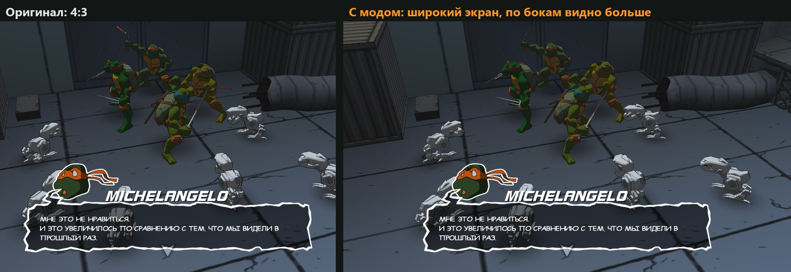
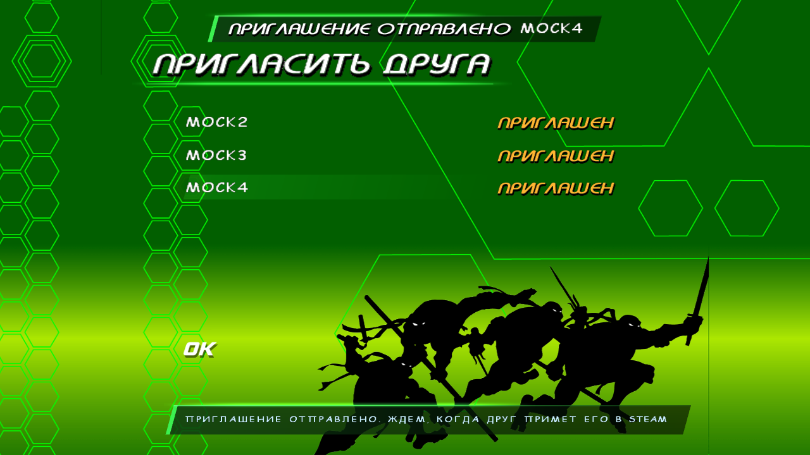

<div align="center">

# TMNT 2003 Netplay · tmntnet

**Online co-op for up to four players in Teenage Mutant Ninja Turtles (Konami, 2003, PC)**

Everyone runs their own copy of the game on their own PC. Connection goes through Steam: no port forwarding, no VPN.


[Русский](README.md) · **English**


</div>

> [!NOTE]
> The mod's in-game text and its full documentation are in **Russian**: it was built for the
> Russian-localised release of the game. This page is an overview in English.

## What it is

The original game has co-op for two players on one computer only. **tmntnet** adds network play:
the story mode for two, three or four players, each on their own PC, with their own picture and
their own camera. The games are kept in step frame by frame (lockstep): only button presses
travel over the network, so any connection will do and the picture is never a video stream.

Everything is set up **inside the game's own menus**, in the game's own look. `TMNT.EXE` is never
modified: the mod works in memory and is removed by its installer with one button.

## Features

| | |
|---|---|
| 🌐 **Online co-op** | Story mode for 2–4 players, the game on every PC. Steam friend invites from inside the game, a lobby with ready states. |
| 🐢 **All four turtles at once** | "Three players" and "Four players" modes the game never had: turtles picked in turn, HUD panels for all, everyone on the level map. |
| 🎥 **A camera of your own** | Each player sees the world around their own turtle and can walk away from the others; the game's invisible leash is gone. |
| 💫 **Team rules** | A turtle out of health is stunned, not dead: a teammate raises it by holding a button. The level is lost only when everybody is down. |
| ⏸️ **Pause and leave** | Esc by any player pauses every game; leave to the menu as a team or quit alone. |
| 🔁 **Come back** | Crashed or left mid-level? Join again and catch up in seconds. |
| 🎭 **Costumes** | All six costumes of every turtle are unlocked and picked in the character select. |
| 🖥️ **Widescreen** | Desktop resolution, Hor+, unstretched HUD, full-width menus, borderless mode, MSAA up to 8x. |
| 🎮 **Controls** | Mouse buttons in the game's own key table, a "two on one keyboard" layout, gamepads for players 3 and 4. |
| 💾 **Autosave** | After every cleared level, no questions asked. |

## What the mod adds and changes

The mod lives inside the game's own menus. In the screenshots the **orange outline** (tagged
«ДОБАВЛЕНО МОДОМ», "added by the mod") marks what the mod added; everything else is the game's.

| Main menu: a new entry, СЕТЕВАЯ ИГРА (Network game) | Story mode: three and four players |
|---|---|
|  |  |

| Graphics options: eight new rows | Other options: four new rows |
|---|---|
|  |  |

**Four players.** HUD panels for players 3 and 4, names over the turtles, a camera of your own:


**Widescreen.** The same moment of the game, as the original draws it and with the mod:



| | The original | With the mod |
|---|---|---|
| Co-op | two players on one PC | up to four, each on their own PC, over Steam or LAN |
| Story mode | 1 or 2 players | plus three and four players |
| Camera | one for all, an invisible leash keeps players together | one each, walk as far apart as you like |
| A fallen player | loses a heart, then is out | lies stunned until a teammate raises them |
| Pause online | — | Esc by anyone, on every PC at once |
| Costumes | unlocked by progress, a held button and the calendar | all six open, picked in the character select |
| Screen | 4:3 only | widescreen (more to see at the sides), borderless, MSAA up to 8x |
| Mouse | buttons cannot be bound | bound in the game's own key table |
| Saving | at the end of a chapter, after a question | after every level, no questions |

Every menu and every screen in order, with a note on each new row (in Russian):
**[The visual tour](docs/TOUR.md)**.

<details>
<summary><b>More screenshots</b></summary>

| Inviting Steam friends | The guest's page |
|---|---|
|  |  |

| Picking turtles in turn | Picking a costume |
|---|---|
|  |  |

| The level map: the whole team | Pause in a network game |
|---|---|
|  |  |

| Joining a running game | Sound options |
|---|---|
|  |  |

</details>

## Quick start

1. **Every player:** download `tmntnet-launcher.exe` from [Releases](../../releases/latest), run it
   and press the install button (**УСТАНОВИТЬ МОД**). The launcher finds the game folder itself and
   needs no network to install; afterwards it tells you about new versions on GitHub and updates
   the mod with one button ([docs/LAUNCHER.md](docs/LAUNCHER.md), in Russian).
2. **Everyone:** start Steam (own accounts, you must be Steam friends) and the game.
3. **Host:** main menu → **СЕТЕВАЯ ИГРА** (Network game) → **ПРИГЛАСИТЬ ДРУГА** (Invite a friend).
   Once everybody has pressed **Я ГОТОВ** (Ready) → **НАЧАТЬ ИГРУ** (Start). Then each player
   picks a turtle and a costume.

> [!IMPORTANT]
> You need your own copy of the game: **no game files are in this repository or its releases.**
> All players must have the same mod version and the same `TMNT.EXE`; otherwise the mod refuses
> the connection and says why.

## Requirements

- Windows 10 or 11.
- Teenage Mutant Ninja Turtles (2003) for PC. Tested with the US retail `TMNT.EXE`
  (SHA-256 `bc49a82c…573093e`) and Russian-localised data. On an unknown executable the mod does
  not break the game: it logs what it could not find and turns those features off.
- For internet play: Steam for every player. The game does not have to be on Steam: the mod uses
  Steam networking through Valve's free test app (Spacewar, AppID 480).
- Without Steam: LAN or any VPN (Radmin VPN, ZeroTier, Tailscale).

## Documentation (Russian)

| | |
|---|---|
| [Visual tour](docs/TOUR.md) | every menu and screen of the mod in pictures, before and after |
| [Launcher](docs/LAUNCHER.md) | one-file install, updates from GitHub, proxy |
| [Install / uninstall](docs/INSTALL.md) | what is installed, updating, silent install |
| [Playing online](docs/PLAY.md) | host and guests, the lobby, character select, pause, coming back |
| [Controls](docs/CONTROLS.md) | keyboard, mouse, gamepads, several players on one PC |
| [Settings](docs/SETTINGS.md) | in-game menus and the full `tmntnet.ini` reference |
| [Troubleshooting](docs/TROUBLESHOOTING.md) | common problems, logs, reporting a bug |
| [How it works](docs/ARCHITECTURE.md) | lockstep, determinism, hooks, protocol |
| [Building and testing](docs/BUILDING.md) | MSVC, CMake, Steamworks SDK, tests without the game |
| [Changelog](docs/CHANGELOG.md) | what changed and why |
| [Reverse-engineering notes](re/notes.md) | addresses, structures and findings in `TMNT.EXE` (**English**) |

## How it works

- Nobody streams the game. Every copy computes the same thing: the same random seed and the same
  buttons of every player in every frame. A frame does not start until everybody's buttons for it
  have arrived.
- Once a second the games compare a checksum. If they ever part, the log says `DESYNC`.
- The mod is loaded by [Ultimate ASI Loader](https://github.com/ThirteenAG/Ultimate-ASI-Loader)
  and hooks the game in memory (MinHook), finding its code by byte signatures rather than fixed
  addresses.

The hard part was determinism. This 2003 console port was never meant for networking, and even
its **rendering changes the game state**: a character's draw function tests whether it is on
screen, and only then draws its shadow, which rolls dice for a water splash and spawns an
object. So two PCs with a different aspect ratio, field of view, camera, a minimized window or
one extra repaint drift apart within seconds. The mod answers the "is it on screen?" question
identically on every PC, swaps each PC's real picture in only for the moment of presenting, and
makes sure the draw pass runs exactly once a frame everywhere. The whole list of such findings
is in [docs/ARCHITECTURE.md](docs/ARCHITECTURE.md) and [re/notes.md](re/notes.md).

## Status

Under active development, version **0.14.0**. The story has been played by two, three and four
players over Steam in real sessions; what broke in each was fixed afterwards (see the changelog).

Known limits:

- Story mode only. Versus and Challenge are not supported online.
- A new player joins from the host's main menu; only a player who was already in the session can
  come back in the middle of a level.
- Exclusive fullscreen does not work for network play (the game freezes on Alt+Tab). The
  installer sets borderless mode, which looks the same.
- No pause from a gamepad (the game itself only asks the keyboard).
- The mod's text is in Russian.

## Building

```powershell
git clone --recursive https://github.com/int3re/TMNT-2003-COOP
cd TMNT-2003-COOP
powershell -ExecutionPolicy Bypass -File tools/build_asi_loader.ps1
cmake -B build -A Win32 -DSTEAMWORKS_SDK_DIR=C:/sdk/steamworks_sdk
cmake --build build --config Release
```

MSVC and CMake ≥ 3.20; the platform must be **Win32** (the game is 32-bit). The Steamworks SDK is
downloaded separately and is not part of the repository; without it an ENet-only (LAN) build is
produced.

## Credits

[MinHook](https://github.com/TsudaKageyu/minhook) (BSD 2-Clause) ·
[ENet](https://github.com/lsalzman/enet) (MIT) ·
[Dear ImGui](https://github.com/ocornut/imgui) (MIT) ·
[SDL2](https://github.com/libsdl-org/SDL) (zlib) ·
[Ultimate ASI Loader](https://github.com/ThirteenAG/Ultimate-ASI-Loader) (MIT) ·
[Steamworks SDK](https://partner.steamgames.com/) (Valve's licence, not included) ·
[coop-anything](https://github.com/cranebeaker/coop-anything) (testing techniques)

## License

The mod's code is released under the [MIT license](LICENSE). Third-party libraries are git
submodules and keep their own licenses (listed above). The game, its files and its artwork are
not covered by the mod's license.

## Legal

This is an unofficial fan project. It is not affiliated with or endorsed by Konami, Mirage
Studios or Viacom / Nickelodeon. *Teenage Mutant Ninja Turtles* and related names are trademarks
of their owners. The repository and its releases contain no game files: you need your own copy.
Screenshots are shown to illustrate what the mod does.
