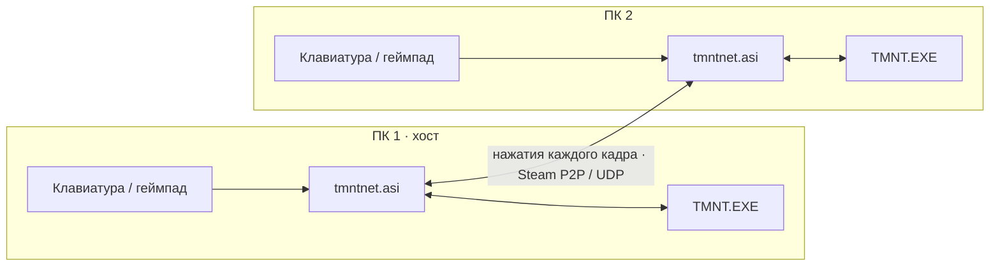

<div align="center">

# TMNT 2003 Netplay · tmntnet

**Сетевой кооператив до четырёх игроков для Teenage Mutant Ninja Turtles (Konami, 2003, PC)**

Каждый играет в своей копии игры на своём ПК. Соединение через Steam: без проброса портов и VPN.


**Русский** · [English](README.en.md)


</div>

## Что это

В оригинальной игре есть кооператив только на двоих и только за одним компьютером. **tmntnet**
добавляет игру по сети: в сюжет можно играть вдвоём, втроём и вчетвером, каждый за своим ПК, со
своей картинкой и своей камерой. Мод сводит игры кадр в кадр (lockstep): по сети идут только
нажатия кнопок, поэтому хватает любого интернета, а картинка не «мылится», как при стриминге.

Всё настраивается **внутри меню самой игры**, в её оформлении: в главном меню появляется пункт
**СЕТЕВАЯ ИГРА**, на страницах параметров — новые строки. Файл `TMNT.EXE` не изменяется: мод
работает в памяти и снимается установщиком одной кнопкой.

## Возможности

| | |
|---|---|
| 🌐 **Кооп по сети** | Сюжет на 2–4 игроков, игра на каждом ПК. Приглашения друзьям Steam прямо из игры, лобби с готовностью игроков. |
| 🐢 **Четыре черепахи сразу** | Режимы «Три игрока» и «Четыре игрока», которых в игре не было: выбор черепах по очереди, свои панели жизни, все на карте уровней. |
| 🎥 **Своя камера у каждого** | Каждый видит мир вокруг своей черепахи и может уходить от остальных; «невидимой стены» между игроками нет. |
| 💫 **Командные правила** | Упавшая черепаха не погибает, а лежит оглушённая: товарищ поднимает её, удерживая кнопку. Уровень проигран, только когда упали все. |
| ⏸️ **Пауза и выход** | Esc у любого игрока ставит паузу у всех; из паузы можно уйти в меню всей командой или выйти одному. |
| 🔁 **Возврат в игру** | Вылетел или вышел посреди уровня — заходишь снова и догоняешь остальных за секунды. |
| 🎭 **Костюмы** | Все шесть костюмов каждой черепахи открыты сразу и выбираются на экране выбора персонажа. |
| 🖥️ **Широкий экран** | Разрешение рабочего стола, Hor+ (по бокам видно больше), интерфейс без растяжения, меню на всю ширину, режим «без рамки», сглаживание до 8x. |
| 🎮 **Управление** | Кнопки мыши в родной таблице клавиш, раскладка «двое за одной клавиатурой», геймпады для игроков 3 и 4. |
| 💾 **Автосохранение** | После каждого пройденного уровня, без вопросов. |

## Что добавлено и изменено

Мод встроен в меню самой игры. На снимках **оранжевой рамкой** обведено то, что добавил мод;
всё остальное — родное.

| Главное меню: новый пункт | Режим сюжета: трое и четверо |
|---|---|
|  |  |

| Параметры графики: восемь новых строк | Прочие параметры: четыре новые строки |
|---|---|
|  |  |

**Игра вчетвером.** Панели игроков 3 и 4, имена над черепахами, у каждого своя камера:


**Широкий экран.** Один и тот же момент игры — как рисует оригинал и как с модом:


| | В оригинальной игре | С модом |
|---|---|---|
| Кооператив | двое за одним компьютером | до четырёх, каждый за своим ПК, через Steam или локальную сеть |
| Режим сюжета | 1 игрок, 2 игрока | + три игрока, четыре игрока |
| Камера | одна на всех, игроков держит рядом «невидимая стена» | у каждого своя, можно расходиться |
| Упавший игрок | теряет жизнь-сердечко, потом выбывает | лежит оглушённый, товарищ поднимает его |
| Пауза по сети | — | Esc у любого игрока, у всех сразу |
| Костюмы | открываются прохождением, секретной кнопкой и по календарю | все шесть открыты, выбираются на экране выбора |
| Экран | только 4:3 | широкий экран, режим «без рамки», сглаживание до 8x |
| Мышь | кнопки мыши назначить нельзя | назначаются в таблице клавиш игры |
| Сохранение | в конце главы, с вопросом | после каждого уровня, без вопросов |

Каждое меню и каждый экран по порядку, с пояснением к каждой новой строке:
**[Что добавлено и изменено — в картинках](docs/TOUR.md)**.

<details>
<summary><b>Ещё скриншоты</b></summary>

| Приглашение друзей Steam | Страница гостя |
|---|---|
|  |  |

| Выбор черепах по очереди | Выбор костюма |
|---|---|
|  |  |

| Карта уровней: вся команда | Пауза в сетевой игре |
|---|---|
|  |  |

| Вход в идущую игру | Параметры звука |
|---|---|
|  |  |

</details>

## Быстрый старт

1. **Каждому игроку:** скачайте `tmntnet-setup.exe` со страницы [релизов](../../releases/latest),
   запустите и нажмите **«Установить мод»**. Папку игры установщик находит сам.
2. **Всем:** запустите Steam (под своими аккаунтами, вы должны быть друзьями) и игру.
3. **Хост:** главное меню → **СЕТЕВАЯ ИГРА** → **ПРИГЛАСИТЬ ДРУГА**. Когда все нажали
   **Я ГОТОВ** — **НАЧАТЬ ИГРУ**. Дальше каждый выбирает себе черепаху и костюм.

Подробно, с картинками и всеми режимами: **[Как играть по сети](docs/PLAY.md)**.

> [!IMPORTANT]
> Нужна своя копия игры: **файлы игры в репозиторий и релизы не входят.** У всех игроков должны
> совпадать версия мода и файл `TMNT.EXE` — если нет, мод откажет в подключении с понятным
> сообщением.

## Что нужно

- Windows 10 или 11.
- Teenage Mutant Ninja Turtles (2003) для PC. Мод проверен на американском издании `TMNT.EXE`
  (SHA-256 `bc49a82c…573093e`) с русской локализацией; на незнакомом файле он не ломает игру, а
  пишет в лог, чего не нашёл, и отключает соответствующие функции.
- Для игры через интернет — Steam у каждого игрока. Игра в Steam не нужна: мод пользуется сетью
  Steam через бесплатное тестовое приложение Valve (Spacewar, AppID 480).
- Без Steam работает локальная сеть и любой VPN (Radmin VPN, ZeroTier, Tailscale).

## Документация

| | |
|---|---|
| 🖼️ [Что добавлено и изменено](docs/TOUR.md) | все меню и экраны мода в картинках, «было и стало» |
| 📦 [Установка и удаление](docs/INSTALL.md) | что ставится, обновление, тихая установка |
| 🕹️ [Как играть по сети](docs/PLAY.md) | хост и гости, лобби, выбор черепах, пауза, возврат в игру |
| ⌨️ [Управление](docs/CONTROLS.md) | клавиатура, мышь, геймпады, двое и четверо за одним ПК |
| ⚙️ [Настройки](docs/SETTINGS.md) | меню игры и полный справочник `tmntnet.ini` |
| 🩺 [Если что-то не так](docs/TROUBLESHOOTING.md) | частые вопросы, логи, как сообщить об ошибке |
| 🧠 [Как это устроено](docs/ARCHITECTURE.md) | lockstep, детерминизм, хуки, протокол |
| 🛠️ [Сборка и тесты](docs/BUILDING.md) | MSVC, CMake, Steamworks SDK, тесты без игры, лаборатория |
| 📜 [История версий](docs/CHANGELOG.md) | что менялось и почему |
| 🔬 [Заметки по реверсу](re/notes.md) | адреса, структуры и находки в `TMNT.EXE` (на английском) |

## Как это работает (коротко)



- Игру **никто не стримит**. Каждая копия игры считает одно и то же: одинаковое зерно случайных
  чисел, одинаковые нажатия всех игроков в каждом кадре. Кадр не начинается, пока не пришли
  нажатия всех.
- Раз в секунду игры сверяют контрольную сумму состояния. Если что-то разошлось, в логе
  появится строка `DESYNC`.
- Мод загружается через [Ultimate ASI Loader](https://github.com/ThirteenAG/Ultimate-ASI-Loader)
  и ставит перехваты в памяти (MinHook) по сигнатурам кода, а не по «голым» адресам.

Самое интересное — как старую консольную игру удалось заставить считать одинаково на разных
ПК (в ней даже *рисование* влияет на ход игры) — в [docs/ARCHITECTURE.md](docs/ARCHITECTURE.md).

## Состояние проекта

Мод в активной разработке, версия **0.13.7**. Сюжет вдвоём, втроём и вчетвером через Steam
проходился в настоящих играх с друзьями; после каждой такой игры найденные проблемы
исправлялись (см. [историю версий](docs/CHANGELOG.md)).

Известные ограничения:

- Работает только режим сюжета. «Поединок» и «Режим состязания» по сети не поддерживаются.
- Новый игрок входит в игру из главного меню хоста; посреди уровня вернуться может только тот,
  кто уже был в этой игре.
- Настоящий полный экран (exclusive fullscreen) не годится для сети: при Alt+Tab игра
  замирает. Установщик ставит режим «без рамки», который выглядит так же.
- Паузу с геймпада поставить нельзя (сама игра спрашивает её только у клавиатуры).
- Надписи мода — на русском языке.

## Сборка

```powershell
git clone --recursive https://github.com/int3re/TMNT-2003-COOP
cd TMNT-2003-COOP
powershell -ExecutionPolicy Bypass -File tools/build_asi_loader.ps1
cmake -B build -A Win32 -DSTEAMWORKS_SDK_DIR=C:/sdk/steamworks_sdk
cmake --build build --config Release
```

Нужны MSVC и CMake ≥ 3.20; платформа обязательно **Win32** (игра 32-битная). Steamworks SDK
скачивается отдельно и в репозиторий не кладётся; без него собирается версия только для
локальной сети. Подробности: [docs/BUILDING.md](docs/BUILDING.md).

## Участие

Сообщения об ошибках и предложения — в [Issues](../../issues). К сообщению приложите
`tmntnet.log` (и папку `tmntnet-logs`) **со всех ПК**, участвовавших в игре: без логов второй
стороны сетевую ошибку обычно не найти. Как устроен код и как проверять изменения —
[CONTRIBUTING.md](CONTRIBUTING.md).

## Благодарности

| Компонент | Зачем | Лицензия |
|---|---|---|
| [MinHook](https://github.com/TsudaKageyu/minhook) | перехваты функций x86 | BSD 2-Clause |
| [ENet](https://github.com/lsalzman/enet) | UDP с надёжным и ненадёжным каналами | MIT |
| [Dear ImGui](https://github.com/ocornut/imgui) | окно клиента и служебное окно | MIT |
| [SDL2](https://github.com/libsdl-org/SDL) | геймпады в клиенте | zlib |
| [Ultimate ASI Loader](https://github.com/ThirteenAG/Ultimate-ASI-Loader) | загрузка мода в игру | MIT |
| [Steamworks SDK](https://partner.steamgames.com/) | сеть Steam (в репозиторий не входит) | лицензия Valve |
| [coop-anything](https://github.com/cranebeaker/coop-anything) | приёмы тестирования сетевых модов | — |

## Лицензия

Код мода распространяется по лицензии [MIT](LICENSE). Сторонние библиотеки подключены как
подмодули и остаются под своими лицензиями (см. таблицу выше). Игра, её файлы и графика
лицензией мода не покрываются.

## Правовая информация

Это неофициальный фанатский проект. Он не связан с Konami, Mirage Studios, Viacom / Nickelodeon
и не одобрен ими. *Teenage Mutant Ninja Turtles* и связанные названия — товарные знаки их
владельцев. Репозиторий и релизы не содержат файлов игры: для работы мода нужна ваша собственная
копия. Скриншоты приведены для иллюстрации работы мода.
