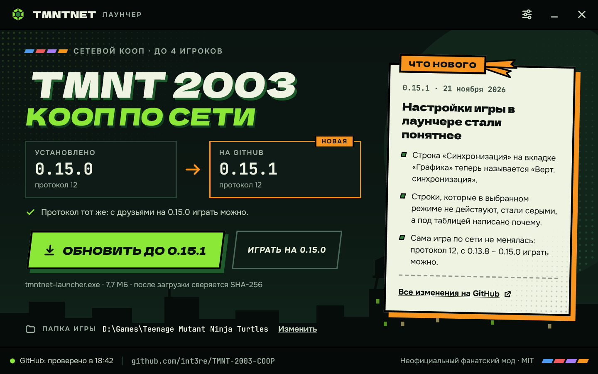
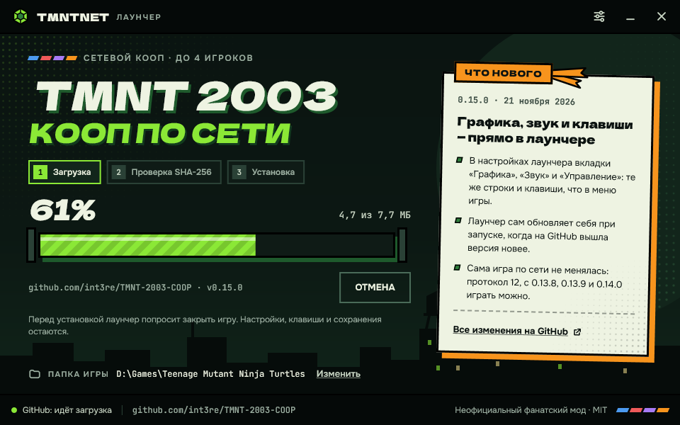
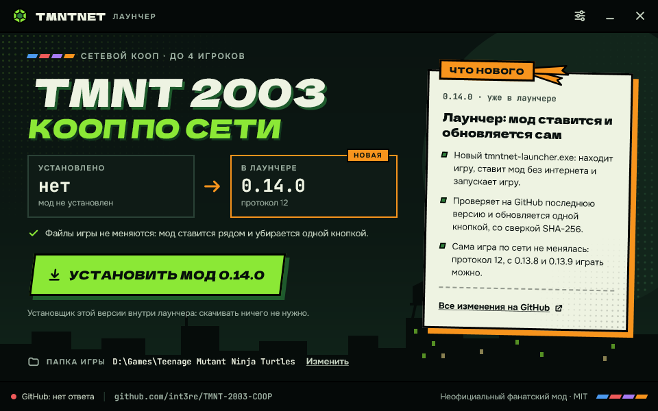
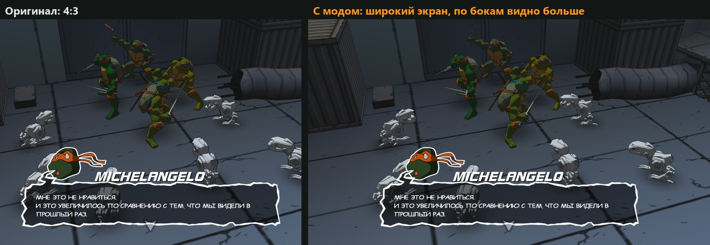
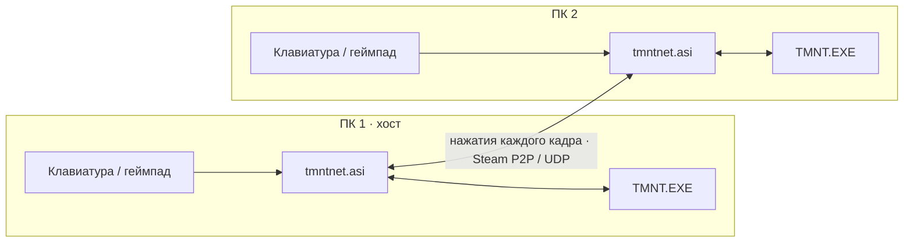

<div align="center">

# TMNT 2003 Co-op · tmntnet

**Сетевой кооператив до четырёх игроков для Teenage Mutant Ninja Turtles (Konami, 2003, PC)**

Один файл · у каждого своя копия игры, свой экран и своя камера · Steam, локальная сеть или IP · широкий экран

<a href="docs/LAUNCHER.md"></a>

<a href="https://github.com/int3re/TMNT-2003-COOP/releases/latest/download/tmntnet-launcher.exe"></a>

Один файл, около 7,7 МБ: установщик мода лежит внутри лаунчера. Он ставит мод, обновляет его и себя, настраивает игру и запускает её.

[](../../releases/latest)


[](../../releases)

**Русский** · [English](README.en.md)

</div>

**tmntnet** — мод для оригинальной ПК-версии *Teenage Mutant Ninja Turtles* (2003). В игре есть
кооператив только на двоих и только за одним компьютером. Мод даёт игру по сети: в сюжет можно
играть вдвоём, втроём и вчетвером, каждый за своим ПК, со своей картинкой и своей камерой. Игры
идут кадр в кадр (lockstep): по сети передаются только нажатия кнопок, поэтому хватает любого
интернета, а картинка не «мылится», как при стриминге.

Всё управление модом — **в меню самой игры**, её шрифтом и в её оформлении: в главном меню
появляется пункт **СЕТЕВАЯ ИГРА**, на страницах параметров — новые строки. Графику, звук и
клавиши можно выставить и до запуска игры, в [лаунчере](#лаунчер).

> Мод не содержит файлов игры и не меняет `TMNT.EXE` на диске: все изменения делаются в памяти
> при запуске. Нужна своя копия игры.

Такие же моды для других игр: [TMNT 2: Battle Nexus](https://github.com/int3re/TMNT-2-BATTLE-NEXUS-COOP),
[Суперсемейка: Подземная битва](https://github.com/int3re/INCREDIBLES-RISE-OF-THE-UNDERMINER-COOP).

## Содержание

- [Быстрый старт](#быстрый-старт)
- [Лаунчер](#лаунчер)
- [Что добавлено и изменено](#что-добавлено-и-изменено)
- [Меню мода](#меню-мода)
- [Возможности](#возможности)
- [В сетевой игре](#в-сетевой-игре)
- [Управление](#управление)
- [Что нужно для игры](#что-нужно-для-игры)
- [Документация](#документация)
- [Версии и совместимость](#версии-и-совместимость)
- [Что пока не сделано и не проверено](#что-пока-не-сделано-и-не-проверено)
- [Сборка из исходников](#сборка-из-исходников)
- [Как это работает](#как-это-работает)
- [Участие и сообщения об ошибках](#участие-и-сообщения-об-ошибках)
- [Поблагодарить автора](#поблагодарить-автора)
- [Благодарности и права](#благодарности-и-права)

## Быстрый старт

1. **Скачайте [`tmntnet-launcher.exe`](https://github.com/int3re/TMNT-2003-COOP/releases/latest/download/tmntnet-launcher.exe)**
   и запустите. Это один файл; сам он никуда не устанавливается, положить его можно где угодно.
   Все версии — на странице [Releases](../../releases).
2. **Нажмите УСТАНОВИТЬ МОД.** Папку игры лаунчер находит сам. Установщик лежит у него внутри,
   поэтому интернет для установки не нужен.
3. **Нажмите ИГРАТЬ.** В главном меню игры появится пункт **СЕТЕВАЯ ИГРА**.

<table>
  <tr>
    <td align="center" width="50%"><br><b>1. Установить</b><br><sub>Установщик уже внутри: одна кнопка, без загрузки</sub></td>
    <td align="center" width="50%"><br><b>2. Играть</b><br><sub>О новой версии лаунчер скажет сам</sub></td>
  </tr>
</table>

> [!NOTE]
> Лаунчер не подписан сертификатом, поэтому Windows может показать окно «Система Windows защитила
> ваш компьютер». Нажмите **«Подробнее» → «Выполнить в любом случае»**. Контрольные суммы SHA-256
> файлов указаны в описании каждого [релиза](../../releases/latest). Без лаунчера мод ставится
> установщиком `tmntnet-setup.exe` из того же релиза: [Установка и удаление](docs/INSTALL.md).

Играть вместе:

| | Хост | Остальные |
|---|---|---|
| 1 | запускает Steam и игру | запускают Steam и игру, остаются в главном меню |
| 2 | **СЕТЕВАЯ ИГРА → ПРИГЛАСИТЬ ДРУГА** | принимают приглашение в Steam (или **СЕТЕВАЯ ИГРА → ВОЙТИ К ДРУГУ**) |
| 3 | ждёт, пока все станут **ГОТОВ** | нажимают **Я ГОТОВ** |
| 4 | **НАЧАТЬ ИГРУ** | выбор черепах открывается у всех сам |
| 5 | выбирает уровень на карте | каждый в свой ход выбирает черепаху и костюм |


Игроки должны быть друзьями в Steam. Без Steam игра идёт по локальной сети, через VPN или по IP.
Подробно, с картинками и всеми режимами: **[Как играть по сети](docs/PLAY.md)**.

> [!IMPORTANT]
> У всех игроков должны совпадать сетевой протокол мода и файл `TMNT.EXE` — если нет, мод откажет
> в подключении с понятным сообщением. Какие версии играют вместе:
> [Версии и совместимость](#версии-и-совместимость).

## Лаунчер

`tmntnet-launcher.exe` — окно, с которого начинает игрок. Он показывает, какая версия мода стоит
в папке игры и какая последняя вышла на GitHub, рассказывает, что в ней нового, обновляет мод
одной кнопкой, а в его настройках — графика, звук и клавиши игры.

| Что он делает | Как |
|---|---|
| **Находит игру** | по записи установщика игры в Windows или в своей папке; не нашёл — спросит, где лежит `TMNT.EXE` |
| **Ставит мод без интернета** | установщик мода лежит внутри лаунчера; файлы игры не меняются |
| **Обновляет одной кнопкой** | новая версия скачивается с GitHub, сверяется по SHA-256 и ставится; настройки, клавиши и сохранения остаются |
| **Говорит, можно ли играть с друзьями** | под версиями написано, тот же ли у новой версии сетевой протокол: «с друзьями на прежней версии играть можно» или «обновиться нужно всем» |
| **Обновляет и себя** | при запуске сам скачивает лаунчер новее, сверяет SHA-256, встаёт на его место и перезапускается; мод в папке игры при этом не трогает |
| **Настраивает игру** | вкладки «Графика», «Звук» и «Управление»: картинка, громкость, клавиши и кнопки мыши — до запуска игры |
| **Ждёт, если игра открыта** | установка начнётся сама, когда игра закроется |
| **Работает, когда GitHub открывается плохо** | играть и ставить мод можно без связи; для проверки обновлений есть прокси — системный или свой |
| **Убирает мод** | двумя нажатиями в настройках: удаляется ровно то, что было поставлено |
| **Ничего лишнего** | не встаёт в автозагрузку, не работает в фоне, не пишет в реестр |

<table>
  <tr>
    <td align="center" width="33%"><br><sub>Вышла новая версия: что в ней нового и можно ли играть с друзьями</sub></td>
    <td align="center" width="33%"><br><sub>Обновление: загрузка, сверка SHA-256, установка</sub></td>
    <td align="center" width="33%"><br><sub>Свою новую версию лаунчер берёт при запуске сам</sub></td>
  </tr>
  <tr>
    <td align="center" width="33%"><br><sub>Графика: те же строки, что в игре, ПАРАМЕТРЫ ГРАФИКИ</sub></td>
    <td align="center" width="33%"><br><sub>Звук: громкость, ролики, заставка</sub></td>
    <td align="center" width="33%"><br><sub>Управление: клавиши и кнопки мыши, раскладки</sub></td>
  </tr>
  <tr>
    <td align="center" width="33%"><br><sub>Настройки: обновления, прокси, журнал, удаление мода</sub></td>
    <td align="center" width="33%"><br><sub>Нет связи с GitHub — мод ставится из самого лаунчера</sub></td>
    <td align="center" width="33%"><br><sub>Четыре цвета повязок на выбор</sub></td>
  </tr>
</table>

Всё о лаунчере: **[docs/LAUNCHER.md](docs/LAUNCHER.md)**. Без окна, из командной строки, мод ставит
установщик: `tmntnet-setup.exe /quiet /host "папка игры"`.

## Что добавлено и изменено



<p align="center"><sub>Один и тот же момент игры: как рисует оригинал и как с модом.</sub></p>

| | В оригинальной игре | С модом |
|---|---|---|
| **Кооператив** | двое за одним компьютером | до четырёх, каждый за своим ПК: Steam, локальная сеть, IP |
| **Режим сюжета** | 1 игрок, 2 игрока | добавлены ТРИ ИГРОКА и ЧЕТЫРЕ ИГРОКА |
| **Камера** | одна на всех, игроков держит рядом «невидимая стена» | в сети у каждого своя, можно расходиться |
| **Упавший игрок** | теряет жизнь-сердечко, потом выбывает | лежит оглушённый, товарищ поднимает его |
| **Пауза по сети** | — | Esc у любого игрока, у всех сразу |
| **Вылет посреди уровня** | — | игрок входит снова и догоняет остальных за секунды |
| **Костюмы** | открываются прохождением, секретной кнопкой и по календарю | все шесть открыты, выбираются на экране выбора |
| **Экран** | только 4:3 | широкий экран, окно без рамки на весь монитор, сглаживание до 8x |
| **Мышь** | кнопки мыши назначить нельзя | назначаются в таблице клавиш игры |
| **Сохранение** | в конце главы, с вопросом | после каждого уровня, без вопросов |
| **Заставка** | гремит громче всей игры | своя громкость, можно пропускать |
| **Главное меню** | родные пункты игры | добавлен пункт СЕТЕВАЯ ИГРА |
| **Установка и обновления** | — | один файл: [лаунчер](#лаунчер) ставит мод, обновляет его и запускает игру |

Каждое меню и каждый экран по порядку, с пояснением к каждой новой строке:
**[Что добавлено и изменено — в картинках](docs/TOUR.md)**.

## Меню мода

Всё управление модом — внутри игры. На снимках **оранжевой рамкой** обведено то, что добавил
мод; всё остальное — родное.

<table>
  <tr>
    <td align="center" width="33%"><br><sub>Главное меню: новый пункт СЕТЕВАЯ ИГРА</sub></td>
    <td align="center" width="33%"><br><sub>Страница хоста: игроки, готовность, пинг</sub></td>
    <td align="center" width="33%"><br><sub>Приглашение друзей Steam прямо из игры</sub></td>
  </tr>
  <tr>
    <td align="center" width="33%"><br><sub>Страница гостя: Я ГОТОВ, ждём начала игры</sub></td>
    <td align="center" width="33%"><br><sub>РЕЖИМ СЮЖЕТА: трое и четверо</sub></td>
    <td align="center" width="33%"><br><sub>Выбор черепах по очереди, имена игроков</sub></td>
  </tr>
  <tr>
    <td align="center" width="33%"><br><sub>Выбор костюма: все шесть открыты</sub></td>
    <td align="center" width="33%"><br><sub>Карта уровней: вся команда</sub></td>
    <td align="center" width="33%"><br><sub>Общая пауза в сетевой игре</sub></td>
  </tr>
  <tr>
    <td align="center" width="33%"><br><sub>Вход в идущую игру</sub></td>
    <td align="center" width="33%"><br><sub>ПАРАМЕТРЫ ГРАФИКИ: восемь новых строк</sub></td>
    <td align="center" width="33%"><br><sub>ПРОЧИЕ ПАРАМЕТРЫ: четыре новые строки</sub></td>
  </tr>
  <tr>
    <td align="center" width="33%"><br><sub>Звук: громкость роликов и заставка</sub></td>
    <td align="center" width="33%"><br><sub>Управление: строка РАСКЛАДКА</sub></td>
    <td align="center" width="33%"><br><sub>Таблица клавиш: в неё ставятся и кнопки мыши</sub></td>
  </tr>
</table>

## Возможности

### Сетевая игра


- **до 4 игроков с разных ПК**. По сети идут только нажатия кнопок, картинка не передаётся:
  задержки видео нет, игра на всех ПК идёт кадр в кадр;
- **Steam без проброса портов**: приглашение друзьям отправляется прямо из игры, друзья видят
  открытую игру и входят в неё; без Steam — локальная сеть, VPN или IP;
- **лобби с готовностью**: у каждого игрока видно ГОТОВ / НЕ ГОТОВ и пинг; хост жмёт НАЧАТЬ ИГРУ,
  и выбор черепах открывается у всех сразу, без перезапуска;
- **возврат в идущую игру**: вылетевший или вышедший игрок входит снова и догоняет остальных —
  три минуты игры примерно за пять секунд; у остальных игра не останавливается;
- **общая пауза**: Esc у любого игрока ставит паузу у всех; из паузы можно уйти в меню всей
  командой или выйти одному;
- **прогресс хоста**: все играют с прогрессом и сложностью хоста, собственные сохранения гостей
  мод не трогает и возвращает после игры;
- **задержка нажатий подбирается по пингу сама**; долгие ожидания видны на экране: кого ждали и
  сколько.

<br clear="right">

### Кооператив


- **сюжет втроём и вчетвером** — режимы ТРИ ИГРОКА и ЧЕТЫРЕ ИГРОКА, которых в игре не было:
  свои панели жизни, все на карте уровней; работает и за одним ПК;
- **у каждого своя камера**: вы видите мир вокруг своей черепахи и можете уходить от остальных
  как угодно далеко — «невидимой стены» между игроками нет;
- **имена игроков** над черепахами, на выборе персонажа и на карте уровней;
- **командные правила**: упавшая черепаха не погибает, а лежит оглушённая; товарищ поднимает её,
  удерживая кнопку. Уровень проигран, только когда упали все;
- **все шесть костюмов** каждой черепахи открыты сразу и выбираются на экране выбора персонажа;
- **додзё проходит вся команда**, а не одна черепаха первого игрока;
- **автосохранение** после каждого пройденного уровня, без вопросов.

<br clear="right">

### Экран и картинка


- **широкий экран без растяжения**: по бокам видно больше (Hor+), интерфейс в правильных
  пропорциях, панели игроков по углам экрана, фон меню до краёв;
- **окно без рамки на весь монитор** или обычное окно: Alt+Tab мгновенный, окна Steam и Discord
  открываются поверх, сетевая игра не замирает;
- **любое разрешение монитора**, сглаживание до 8x, чёткие текстуры под углом (16x);
- угол обзора камеры, размер панелей, лимит кадров, вертикальная синхронизация;
- **все настройки — в ПАРАМЕТРАХ самой игры** и на вкладке «Графика» лаунчера; у каждого игрока
  они свои и на сетевую игру не влияют.

<br clear="right">

### Управление


- **кнопки мыши** ставятся в родную таблицу клавиш игры, как обычные клавиши: левая, правая,
  средняя и обе боковые;
- **раскладка «Два игрока»** — двое за одной клавиатурой одной строкой; свои клавиши
  запоминаются и возвращаются;
- **геймпады для игроков 3 и 4** за одним ПК;
- клавиши обоих игроков можно поставить **в лаунчере**, не запуская игру.

<br clear="right">

## В сетевой игре

- **Игра ждёт каждого.** Если чья-то игра замерла (плохая связь, занят компьютер), у остальных
  картинка стоит и ждёт. Дольше 10 секунд — этот игрок выбывает, остальные играют дальше.
- **Меню ведёт хост.** Главное меню, меню сюжета и карту уровней ведёт только он; черепаху и
  костюм каждый выбирает сам.
- **Чтобы поднять товарища,** встаньте рядом и держите «смену сюрикена» (у игрока 1 по умолчанию
  Left Shift) 4 секунды. Атаковать в это время нельзя.
- **Ролики заканчиваются у всех одновременно.** Пропустить ролик могут игроки 1 и 2.
- **Пауза общая.** Меню паузы ведёт тот, кто её поставил; **ВЕРНУТЬСЯ В МЕНЮ** слушается только
  хоста, **УЙТИ** закрывает игру только того, кто выбрал.
- **Окно игры можно сворачивать**: в режиме «без рамки» игра в фоне не останавливается.
- **В Steam у всех статус «Играет в Spacewar»** — это бесплатное тестовое приложение Valve, через
  которое мод пользуется сетью Steam. Посторонние подключиться не могут: лобби видно только
  друзьям.

Подробно: **[Как играть по сети](docs/PLAY.md)**.

## Управление

Клавиши по умолчанию — как в игре. В сетевой игре каждый играет на своём ПК клавишами игрока 1.

| Действие | Игрок 1 | Игрок 2 | «Два игрока»: игрок 1 | «Два игрока»: игрок 2 |
|---|---|---|---|---|
| Ходить | стрелки | Home, End, Delete, Page Down | W A S D | стрелки |
| Прыжок | Пробел | Num 0 | Пробел | Num 0 |
| Слабая атака, «выбрать» в меню | F | Num 4 | J | Num 4 |
| Сильная атака, «отмена» в меню | D | Num 5 | K | Num 5 |
| Сюрикен | S | Num 7 | L | Num 6 |
| Толчок (рывок) | E | Num + | U | Num 1 |
| Особая атака | Left Ctrl | Num 9 | O | Num 8 |
| Финты в воздухе | R | Num 6 | I | Num 2 |
| Смена сюрикена, поднять товарища | Left Shift | Num 8 | H | Num 3 |
| Старт | Enter | Num Enter | Enter | Num Enter |
| Пауза | Esc | Esc | Esc | Esc |

Клавиши меняются в игре (**ПАРАМЕТРЫ → ПАРАМЕТРЫ УПРАВЛЕНИЯ → КЛАВИАТУРА**) или на вкладке
«Управление» лаунчера; там же ставятся кнопки мыши и выбирается раскладка. Геймпады, игроки 3 и
4, служебные клавиши — в [описании управления](docs/CONTROLS.md).

## Что нужно для игры

- **Windows 10 или 11**.
- **Teenage Mutant Ninja Turtles (2003) для PC.** Мод проверен на американском издании `TMNT.EXE`
  (SHA-256 `bc49a82c…573093e`) с русской локализацией; на незнакомом файле он не ломает игру, а
  пишет в лог, чего не нашёл, и отключает соответствующие функции.
- **Для игры через интернет — Steam** у каждого игрока. Игра в Steam не нужна, покупать ничего
  не нужно: мод пользуется сетью Steam через бесплатное тестовое приложение Valve (Spacewar,
  AppID 480).
- **Без Steam** работает локальная сеть и любой VPN (Radmin VPN, ZeroTier, Tailscale); для игры
  по IP через интернет хост открывает порт `7777` UDP.

## Документация

| Страница | О чём |
|---|---|
| [Лаунчер](docs/LAUNCHER.md) | установка в один файл, обновления с GitHub, графика, звук и клавиши игры, прокси |
| [Установка и удаление](docs/INSTALL.md) | что ставится, обновление, установка без лаунчера и из командной строки |
| [Как играть по сети](docs/PLAY.md) | хост и гости, лобби, выбор черепах, пауза, возврат в игру, игра без Steam |
| [Что добавлено и изменено](docs/TOUR.md) | все меню и экраны мода в картинках, «было и стало» |
| [Управление](docs/CONTROLS.md) | клавиатура, мышь, геймпады, двое и четверо за одним ПК |
| [Настройки](docs/SETTINGS.md) | меню игры и полный справочник `tmntnet.ini` |
| [Если что-то не так](docs/TROUBLESHOOTING.md) | частые вопросы, логи, как сообщить об ошибке |
| [Как это устроено](docs/ARCHITECTURE.md) | lockstep, детерминизм, хуки, протокол |
| [Сборка и тесты](docs/BUILDING.md) | MSVC, CMake, Steamworks SDK, тесты без игры, лаборатория |
| [История версий](docs/CHANGELOG.md) | что менялось и почему |
| [Заметки по реверсу](re/notes.md) | адреса, структуры и находки в `TMNT.EXE` (на английском) |

Вся документация есть и на английском: **[docs/en](docs/en/README.md)**.

## Версии и совместимость

Версия мода видна в лаунчере и в `tmntnet.log`; номер последней — на значке вверху страницы.

В сетевой игре у всех должна быть версия с одним номером сетевого протокола: игра на всех ПК
обязана идти одинаково, поэтому любое изменение в её ходе меняет и протокол. Мод сам откажет
игроку с другим протоколом и напишет почему; лаунчер показывает протокол рядом с версией.

| Версии мода | Протокол | Играют вместе |
|---|---|---|
| 0.13.8 – 0.15.1 | 12 | да |
| 0.13.6 – 0.13.7 | 11 | да |
| 0.13.5 | 10 | только с 0.13.5 |
| 0.13.2 – 0.13.4 | 9 | да |
| 0.13.1 | 8 | только с 0.13.1 |
| 0.13.0 | 7 | только с 0.13.0 |
| 0.12.0 | 6 | только с 0.12.0 |
| 0.11.13 – 0.11.15 | 5 | да |
| 0.11.12 и старше | — | см. [историю версий](docs/CHANGELOG.md) |

Версии 0.14.0 – 0.15.1 меняли только лаунчер: сама игра по сети в них та же, что в 0.13.9.

## Что пока не сделано и не проверено

Сюжет вдвоём, втроём и вчетвером через Steam проходился в настоящих играх с друзьями; после
каждой такой игры найденные проблемы исправлялись (см. [историю версий](docs/CHANGELOG.md)).

Не сделано:

- Работает только режим сюжета. «Поединок» и «Режим состязания» по сети не поддерживаются.
- Новый игрок входит в игру из главного меню хоста; посреди уровня вернуться может только тот,
  кто уже был в этой игре.
- Настоящий полный экран (exclusive fullscreen) не годится для сети: при Alt+Tab игра
  замирает. Мод ставит режим «без рамки», который выглядит так же.
- Паузу с геймпада поставить нельзя (сама игра спрашивает её только у клавиатуры).
- Кнопки геймпада в лаунчере не настраиваются — только в меню игры.
- Надписи мода и лаунчера — на русском языке.

Не проверено:

- Геймпады игроков 3 и 4 на настоящих геймпадах.
- Лаунчер — на Windows 7, 8 и 11 и при масштабе экрана больше 100 %.
- Другие издания игры: мод сверяет `TMNT.EXE` и на незнакомом файле отключает то, чего не нашёл.

## Сборка из исходников

```powershell
git clone --recursive https://github.com/int3re/TMNT-2003-COOP
cd TMNT-2003-COOP
powershell -ExecutionPolicy Bypass -File tools/build_asi_loader.ps1
cmake -B build -A Win32 -DSTEAMWORKS_SDK_DIR=C:/sdk/steamworks_sdk
cmake --build build --config Release
```

Нужны MSVC и CMake ≥ 3.20; платформа обязательно **Win32** (игра 32-битная). Steamworks SDK
скачивается отдельно и в репозиторий не кладётся; без него собирается версия только для
локальной сети. Подробности: [docs/BUILDING.md](docs/BUILDING.md).

## Как это работает



- Игру **никто не стримит**. Каждая копия игры считает одно и то же: одинаковое зерно случайных
  чисел, одинаковые нажатия всех игроков в каждом кадре. Кадр не начинается, пока не пришли
  нажатия всех.
- Раз в секунду игры сверяют контрольную сумму состояния. Если что-то разошлось, в логе
  появится строка `DESYNC`.
- Мод — `tmntnet.asi`: он загружается через
  [Ultimate ASI Loader](https://github.com/ThirteenAG/Ultimate-ASI-Loader) и ставит перехваты в
  памяти (MinHook) по сигнатурам кода, а не по «голым» адресам.
- Лаунчер — отдельная программа: в игру он не встраивается, а только ставит файлы мода и
  запускает `TMNT.EXE`. Новая версия приходит как новый лаунчер: он скачивается с GitHub и
  сверяется по SHA-256 из релиза.

Самое интересное — как старую консольную игру удалось заставить считать одинаково на разных
ПК (в ней даже *рисование* влияет на ход игры) — в [docs/ARCHITECTURE.md](docs/ARCHITECTURE.md).

## Участие и сообщения об ошибках

Сообщения об ошибках и предложения — в [Issues](../../issues). К сообщению приложите
`tmntnet.log` (и папку `tmntnet-logs`) **со всех ПК**, участвовавших в игре: без логов второй
стороны сетевую ошибку обычно не найти. Журнал открывается из лаунчера: настройки → «Открыть
журнал». Как устроен код и как проверять изменения — [CONTRIBUTING.md](CONTRIBUTING.md).

## Поблагодарить автора

Мод бесплатный и открытый. Если он вам пригодился и хочется сказать спасибо, можно отправить
USDT на один из адресов — исключительно по желанию.

| Сеть | Адрес для USDT |
|---|---|
| TRON (TRC20) | `TVdy7i7qoF1ZdrnNSZaC5Mgz1ZddaMhw4y` |
| The Open Network (TON) | `UQB-oxQVLLN3hm-YRGfr5-XJ95P0zIAeLFstgG40HiaR8oMz` |
| BNB Smart Chain (BEP20) | `0xA11f8221952FA5f540bC528072213b14F124379B` |

Отправляйте только USDT и только в той сети, которая указана рядом с адресом: перевод другой
монеты или в другой сети не дойдёт. В BNB Smart Chain минимальная сумма — 0,1 USDT; контракт
USDT в этой сети —
[`0x55d398326f99059fF775485246999027B3197955`](https://bscscan.com/token/0x55d398326f99059fF775485246999027B3197955).

## Благодарности и права

| Компонент | Зачем | Лицензия |
|---|---|---|
| [MinHook](https://github.com/TsudaKageyu/minhook) | перехваты функций x86 | BSD 2-Clause |
| [ENet](https://github.com/lsalzman/enet) | UDP с надёжным и ненадёжным каналами | MIT |
| [Dear ImGui](https://github.com/ocornut/imgui) | окно клиента и служебное окно | MIT |
| [SDL2](https://github.com/libsdl-org/SDL) | геймпады в клиенте | zlib |
| [Ultimate ASI Loader](https://github.com/ThirteenAG/Ultimate-ASI-Loader) | загрузка мода в игру | MIT |
| [Steamworks SDK](https://partner.steamgames.com/) | сеть Steam (в репозиторий не входит) | лицензия Valve |
| [Dela Gothic One](https://github.com/syakuzen/DelaGothic), [Onest](https://github.com/googlefonts/onest), [JetBrains Mono](https://github.com/JetBrains/JetBrainsMono) | шрифты лаунчера | SIL OFL 1.1 |
| [coop-anything](https://github.com/cranebeaker/coop-anything) | приёмы тестирования сетевых модов | — |

### Лицензия

Код мода распространяется по лицензии [MIT](LICENSE). Сторонние библиотеки подключены как
подмодули и остаются под своими лицензиями (см. таблицу выше); шрифты лаунчера лежат в
[third_party/fonts](third_party/fonts) вместе с текстами своих лицензий. Игра, её файлы и
графика лицензией мода не покрываются.

### Правовая информация

Это неофициальный фанатский проект. Он не связан с Konami, Mirage Studios, Viacom / Nickelodeon
и не одобрен ими. *Teenage Mutant Ninja Turtles* и связанные названия — товарные знаки их
владельцев. Репозиторий и релизы не содержат файлов игры: для работы мода нужна ваша собственная
копия. Скриншоты приведены для иллюстрации работы мода. Оформление лаунчера — собственное:
логотипа и персонажей игры в нём нет.

Для работы через Steam мод использует идентификатор тестового приложения Valve Spacewar
(AppID 480), поэтому во время сетевой игры Steam показывает статус «Spacewar».
