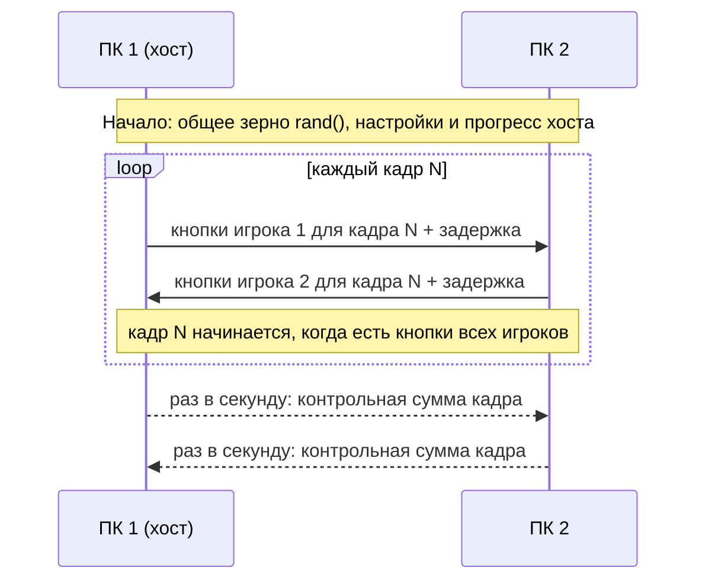

# Как это устроено

[← На главную](../README.md)

Этот документ — для тех, кто хочет понять или изменить мод. Здесь общая картина; адреса,
структуры и ход исследования `TMNT.EXE` — в [re/notes.md](../re/notes.md) (на английском),
сигнатуры — в [re/signatures.md](../re/signatures.md).

**Содержание:** [Что из чего состоит](#что-из-чего-состоит) · [Как мод попадает в игру](#как-мод-попадает-в-игру) ·
[Lockstep](#lockstep-игра-на-каждом-пк) · [Игра только у хоста](#режим-игра-только-у-хоста) · [Детерминизм](#детерминизм-что-пришлось-найти) ·
[Четыре игрока](#четыре-игрока-в-игре-на-двоих) · [Своя камера](#своя-камера-у-каждого) ·
[Меню](#меню-в-оформлении-игры) · [Сеть](#сеть) · [Протокол](#протокол) · [Модули](#карта-модулей) ·
[Как это проверяется](#как-это-проверяется)

## Что из чего состоит

| Файл | Что это | Исходники |
|---|---|---|
| `tmntnet.asi` | мод: DLL, которая загружается в процесс игры | `src/mod`, `src/common` |
| `winmm.dll` | Ultimate ASI Loader: загружает `.asi` при старте игры | `third_party/ultimate-asi-loader` |
| `dinput8.dll` | запасной загрузчик (свой, маленький) | `src/loader` |
| `tmntnet-client.exe` | клиент второго игрока для режима «игра только у хоста» | `src/client` |
| `tmntnet-setup.exe` | установщик: все файлы вшиты в ресурсы | `src/setup` |
| `tmntnet-launcher.exe` | [лаунчер](LAUNCHER.md): версии, обновления с GitHub, запуск игры; установщик вшит в ресурсы | `src/launcher` |

Игра — 32-битный процесс без античита и ASLR, движок RenderWare 3.5 (Direct3D 9), ввод через
DirectInput 8, звук через DirectSound и CRI ADX. Всё собирается под **x86**.

## Как мод попадает в игру

1. **Загрузка.** Игра импортирует `winmm.dll`; рядом с `TMNT.EXE` лежит Ultimate ASI Loader под
   этим именем и загружает `tmntnet.asi`. Вся настройка — в `InitializeASI`, а не в `DllMain`
   (под блокировкой загрузчика нельзя ни ставить перехваты, ни открывать сокеты).
2. **Поиск кода по сигнатурам.** Мод не хранит «голые» адреса: каждое место в коде игры
   находится по шаблону байтов (`patch::find`). Если шаблон не найден или найден дважды, функция
   мода отключается и это пишется в лог — игра при этом работает как обычно.
3. **Три вида правок, все в памяти:**
   - перехват начала функции (MinHook);
   - перенаправление одного вызова (`E8 rel32`) — когда нужно изменить поведение только в одном
     месте или когда функцию нельзя перехватывать с начала;
   - подмена импорта (`GetClientRect`, `IsIconic`).

   Файл `TMNT.EXE` на диске не меняется никогда.

## Lockstep: игра на каждом ПК

Мод не передаёт состояние игры и не стримит картинку. Каждая копия игры считает **одно и то
же**, получая одинаковые входные данные:



- **Один оборот главного цикла игры = один такт логики.** В логике игры нет `dt`: всё привязано
  к кадрам. Это и делает lockstep возможным.
- **Точка встречи** — сразу после того, как игра собрала «маски» кнопок своих игроков
  (`lockstep.cpp`, `hkMasks`). Мод отправляет кнопки своего игрока для кадра `N + задержка`,
  ждёт кнопки всех остальных для кадра `N` и подставляет их игре вместо её собственных.
- **Задержка ввода** (2 кадра и больше) подбирается по пингу при начале сессии: так нажатия
  успевают дойти до того, как понадобятся.
- **Потери не страшны:** каждый пакет несёт кнопки последних 16 кадров.
- **Сверка.** Раз в 60 кадров игры обмениваются хэшем (состояние `rand()` и кнопки). Расхождение
  — строка `DESYNC` в логе.
- **Звезда.** При трёх и четырёх ПК хост пересылает кнопки каждого гостя остальным.
- **Начало сессии.** Все стоят в главном меню. Хост рассылает зерно, свои настройки сложности,
  образ сохранения и кусок игровых данных, которого в сохранении нет. Запуск сюжета — не
  «нажатие кнопок за игрока»: хост кладёт в свои кнопки одного кадра служебный бит, и каждая
  игра в этом же кадре сама отправляет своему меню то сообщение, которое отправляет пункт
  «2 ИГРОКА».

### Игрок вышел и вернулся

Хост хранит кнопки всех игроков за каждый кадр сессии. ПК, который возвращается, начинает
сессию с нулевого кадра с теми же начальными данными и **проигрывает всю историю** как можно
быстрее: без ожидания кадра, без звука, без вывода на видеокарту (сама отрисовка при этом
выполняется — см. ниже, почему её нельзя пропустить), показывая экран «ПОДКЛЮЧЕНИЕ К ИГРЕ».
Когда он почти догнал, хост объявляет всем кадр, с которого кнопки этого игрока снова его.

Пропускать уже пройденные уровни не получилось: замер показал, что один уровень меняет около
360 КБ статических данных игры в сотнях мест, и две трети из них у каждого ПК свои (указатели,
буферы, часы). Выбрать из них «то, что важно» без риска расхождения нельзя.

## Режим «игра только у хоста»

Первый режим мода, без lockstep: игра запущена только у хоста, а `tmntnet-client.exe` у второго
игрока читает его геймпад (SDL2) или клавиатуру и 120 раз в секунду шлёт нажатия. Мод на хосте
перехватывает `IDirectInputDevice8A::GetDeviceState` и в 256-байтном состоянии клавиатуры
выставляет клавиши игрока 2, взятые из живой таблицы клавиш игры (поэтому переназначение в меню
игры подхватывается). Игровой поток сеть не ждёт: перехват читает последние нажатия из
атомарного буфера, а короткие нажатия удерживаются хотя бы один кадр. Если связь пропала, через
секунду герой отпускает кнопки и стоит.

## Детерминизм: что пришлось найти

Чтобы две копии считали одинаково, одинаковым должно быть **всё**, от чего зависит логика. В
игре 2003 года, написанной без расчёта на сеть, таких зависимостей оказалось много. Каждая
строка таблицы — найденное в лаборатории или в настоящей игре расхождение.

| Что расходилось | Почему | Что сделано |
|---|---|---|
| Случайные числа | `rand()` из CRT, своё состояние у потока; 1050 мест вызова | общее зерно в начале сессии; хэш включает состояние `rand()` |
| Загрузка уровней | чтение файлов и звуковых банков занимало разное число кадров | загрузки доводятся до конца внутри кадра, одинаково на всех ПК |
| Голоса | конец реплики определялся по реальному времени звука | в сессии реплика кончается по счётчику кадров |
| Пропуск кадров | на медленном ПК игра сама пропускает отрисовку кадра | в сессии пропуск отключён |
| Данные вне сохранения | флаг «брызги на воде» лежит в памяти мимо образа сохранения: у хоста был, у гостя нет | этот кусок данных передаётся в начале сессии |
| **Отрисовка играет в игру** | функция отрисовки персонажа проверяет, виден ли он, и только тогда рисует тень, а тень на воде бросает кости на брызги и создаёт объект | см. ниже |
| Разный формат экрана | при 16:9 в кадр попадает больше, чем при 4:3 → разные вызовы `rand()` | в сессии вопрос «виден ли» получает один ответ на всех ПК |
| Своя камера | каждый ПК рисует свой вид | «виден» = виден общей камерой **или** камерой любого игрока |
| Перерисовка окна | на `WM_PAINT` игра рисует лишний кадр вне своего цикла | в сессии мод отвечает на `WM_PAINT` сам |
| Свёрнутое окно | RenderWare для свёрнутого окна не рисует вовсе | в сессии игре отвечают, что окно не свёрнуто |
| Чтение клавиатуры напрямую | пауза и захват клавиш читают устройство мимо «масок» игроков | сырые буферы в сессии обнуляются; пауза идёт битом в кнопках игрока |
| Автовыбор персонажа | работал по настенным часам | в сессии отключён |
| Меню | курсор двигали оба игрока, каждый у себя | главное меню, меню сюжета и карту ведёт только хост |

### «Отрисовка играет в игру»

Главная неожиданность этой игры. Функция отрисовки персонажа (`0x4a5012`) сначала проверяет,
попадает ли он в пирамиду видимости камеры, которая сейчас рисует, выставляет ему флаг «на
экране» (его потом читает ИИ врагов) и лишь затем вызывает его функцию рисования. А та рисует
тень; тень на воде вызывает `rand()` и может создать брызги — новый игровой объект и ещё
несколько вызовов `rand()`.

Следствие: **что попало в кадр, то и повлияло на игру.** Два ПК с разной картинкой — другое
соотношение сторон, другой обзор, своя камера, свёрнутое окно, лишняя перерисовка — расходятся
через несколько секунд.

Решение (`own_camera.cpp`, `widescreen.cpp`, `display.cpp`):

- Проверка видимости перехвачена. В сессии она отвечает не по тому, что нарисовано на этом ПК, а
  по правилу, одинаковому для всех: объект «рисуется», если он виден общей камерой игры или
  камерой любого из игроков с большим запасом по ширине, и «на экране», если виден в окне 16:9.
- Настоящая картинка ПК (его разрешение, обзор, своя камера) подставляется в камеру только на
  время вывода кадра и убирается сразу после — игра её не видит.
- Отрисовка не может не выполниться: ни из-за свёрнутого окна, ни из-за пропуска кадров, и не
  может выполниться лишний раз.

## Четыре игрока в игре на двоих

В игре два слота игроков: две записи в таблице, два «пада», два места в интерфейсе. Мод не
расширяет таблицы игры (они статические и используются в сотнях мест), а добавляет свои:

- Все обращения к таблице игроков и к слотам ввода идут в игре через небольшие функции-аксессоры.
  Они перехвачены: для игроков 1 и 2 отвечает игра, для 3 и 4 — таблицы мода
  (`four_players.cpp`).
- Черепахи игроков 3 и 4 создаются той же функцией игры, что и первые две.
- Камера, ИИ врагов, столкновения и удары проверяют «это игрок?» — эти проверки дополнены.
- Панели жизни игроков 3 и 4 рисуются из тех же картинок игры (`four_hud.cpp`), экран выбора
  персонажа повторяет для них состояния второго игрока (`csel.cpp`), на карте уровней стоят все
  четверо (`map_turtles.cpp`).
- Командные правила (`revive.cpp`): упавшая черепаха оглушена, а не убита; её поднимают,
  удерживая кнопку.
- Игра удерживает игроков возле общей камеры «невидимым кругом»; в сессии круг снят.

## Своя камера у каждого

Камера игры одна на всех и участвует в логике (от неё зависят направление движения и
«видимость»), поэтому она остаётся общей и одинаковой на всех ПК. Дополнительно каждый кадр
родная «следящая» камера игры прогоняется ещё по разу **для каждого игрока в одиночку** — так,
как игра показывала бы уровень ему одному. Эти виды одинаковы на всех ПК (они нужны для правила
видимости), а в кадр подставляется вид того игрока, чей это ПК. При смене уровня виды
сбрасываются.

## Меню в оформлении игры

Мод не рисует своё окно поверх игры. Его настройки — строки, добавленные на родные страницы
параметров (таблицы пунктов игры расширены, курсор, звуки и «По умолчанию» работают как у
строк игры), а страница **СЕТЕВАЯ ИГРА** собрана из тех же фонов, плашек и шрифтов
(`native_menu.cpp`, `option_pages.cpp`, `main_menu.cpp`).

Надписи в меню игры — не текст, а картинки. Поэтому русские слова мода **составляются из букв,
вырезанных из картинок самой игры** (`game_text.cpp`): для каждого шрифта меню свой набор, а
недостающие буквы собираются из частей имеющихся.

## Сеть

Сеть работает в своём потоке; транспорт скрыт за интерфейсом `ITransport`
(`src/common/transport.h`) с двумя каналами: надёжным (управление) и ненадёжным (ввод).

| Транспорт | Когда | Особенности |
|---|---|---|
| **Steam** | через интернет | `ISteamNetworkingMessages`, лобби «только друзья», приглашения. Используется AppID 480 (Spacewar). `steam_api.dll` грузится отложенно: без неё мод работает на ENet |
| **ENet** | локальная сеть, VPN, прямой IP | UDP 7777; поиск хоста — широковещательный UDP 7778 |
| **Мок Steam** | лаборатория | логика лобби и сессий без Steam и аккаунтов: сообщения по localhost, лобби — файлы |

Хост принимает сессии Steam только от участников своего лобби и из списка `allow_steamid`.
При подключении сверяются версия протокола и SHA-256 файла `TMNT.EXE`.

## Протокол

Формат пакетов — в [src/common/protocol.h](../src/common/protocol.h): little-endian,
упакованные структуры, без указателей. Номер версии (`kVersion`) увеличивается при любом
изменении формата **или смысла** — в том числе когда меняется поведение, которое должно быть
одинаковым на всех ПК.

| Пакет | Направление | Назначение |
|---|---|---|
| `Hello` / `HelloAck` / `Reject` | гость ↔ хост | знакомство: версия, хэш exe, имя |
| `Barrier` | оба | «моя игра готова начать» и где она сейчас (в меню, в уровне, на паузе) |
| `LsStart`, `LsSave` | хост → гости | начало сессии: зерно, задержка, настройки, образ сохранения |
| `LsInput` | все | кнопки своего игрока за последние 16 кадров |
| `LsHash` | все | контрольная сумма кадра |
| `LsNames` | хост → гости | имена игроков |
| `LsLeave` | хост → гости | игрок вышел: с такого-то кадра его кнопок нет |
| `LsHistory`, `LsCatchup`, `LsReturn` | хост ↔ вернувшийся | история кнопок, ход догона, кадр возврата |
| `Input` | клиент → хост | режим «игра только у хоста»: кнопки игрока 2 |

## Карта модулей

```text
src/common/   протокол, конфиг (tmntnet.ini), лог, sha256, транспорты (ENet, Steam, мок), лобби
src/mod/      tmntnet.asi
  dllmain          запуск, журнал падений, сторож зависаний, хранение логов
  patch            поиск сигнатур, правки в памяти, MinHook
  lockstep         сессия: кнопки по кадрам, ожидание, хэши, история, догон
  net_host / net_peer / ls_guest   хост, гость, обмен пакетами
  four_players     игроки 3 и 4: записи, слоты ввода, создание черепах
  own_camera       свои камеры и общее правило «что на экране»
  widescreen       Hor+, интерфейс 4:3, меню на всю ширину
  display          режимы окна, фокус, WM_PAINT, свёрнутое окно
  csel / csel_art / costume        выбор черепах и костюмов
  revive           оглушённые черепахи и их подъём
  net_pause        пауза в сетевой игре
  native_menu / main_menu / option_pages / net_pages / game_text   меню в оформлении игры
  four_hud / nametags / map_turtles   панели, имена, карта уровней
  dinput_hook / binds / keyconf    ввод, таблица клавиш, мышь
  audio / voice_sync               громкость роликов, голоса по кадрам
  autosave / load_guard / quality / ambient / overlay   остальное
src/client/   tmntnet-client.exe (SDL2, ImGui)
src/setup/    tmntnet-setup.exe
src/launcher/ tmntnet-launcher.exe (Direct2D, WinINet)
src/loader/   запасной загрузчик dinput8.dll
tests/        подставная игра и тесты без игры
re/           заметки по реверсу, сигнатуры
```

## Как это проверяется

Сетевые ошибки в lockstep коварны: игра продолжает идти, просто у игроков на экранах постепенно
становится разное. Поэтому каждое изменение, затрагивающее логику, проверяется в лаборатории —
на нескольких копиях игры на одном ПК:

- **Журнал кадров.** С `[debug] frame_log=1` каждая копия пишет для каждого кадра состояние
  `rand()`, кнопки и число вызовов `rand()`. Журналы двух–четырёх копий сравниваются: первая
  различающаяся строка — кадр расхождения.
- **Кто вызвал `rand()`.** С `rand_trace=1` в журнал попадают адреса возврата всех вызовов за
  кадр. Лишний вызов на одной из копий сразу показывает, какой код отработал по-разному.
- **Сценарии по кадрам.** Клавиши «нажимаются» по номеру кадра (`frame_keys`), поэтому прогон
  воспроизводим. Можно закончить уровень родным флагом игры (`stage_over_at`) и попасть на
  следующий, не проходя его.
- **Плохие условия нарочно:** задержка и потери в моке сети, принудительная перерисовка и
  сворачивание окна, выход и возврат одной из копий посреди уровня.

Подробнее о сборке, тестах и лабораторных ключах — в [BUILDING.md](BUILDING.md).
