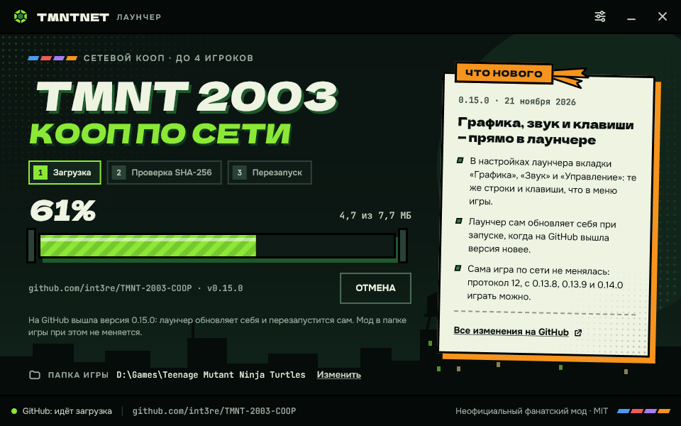
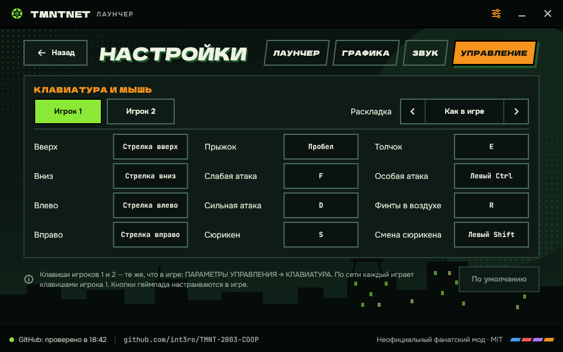

# Лаунчер

[← На главную](../README.md)

`tmntnet-launcher.exe` — один файл, с которого игрок начинает: он находит игру, ставит мод,
следит за новыми версиями на GitHub, обновляет мод одной кнопкой, сам обновляет себя, меняет
графику, звук и клавиши игры и запускает её. Появился в версии 0.14.0; страницы «Графика»,
«Звук» и «Управление» и обновление самого себя при запуске — с 0.15.0.


- [Что он делает](#что-он-делает)
- [Первая установка](#первая-установка)
- [Обновление](#обновление)
- [Лаунчер обновляет себя сам](#лаунчер-обновляет-себя-сам)
- [Графика и звук игры](#графика-и-звук-игры)
- [Управление](#управление)
- [Если GitHub не открывается](#если-github-не-открывается)
- [Настройки](#настройки)
- [Что и куда он пишет](#что-и-куда-он-пишет)
- [Как он узнаёт о новой версии](#как-он-узнаёт-о-новой-версии)
- [Для разработчика](#для-разработчика)

## Что он делает

| На экране | Что это значит |
|---|---|
| **УСТАНОВЛЕНО** | версия мода в папке игры (из `tmntnet-install.txt`) или «нет» |
| **НА GITHUB** | последняя версия в [релизах](../../../releases) и её сетевой протокол |
| **В ЛАУНЧЕРЕ** | версия, установщик которой лежит внутри самого лаунчера (показывается, когда GitHub не ответил или там версия старше) |
| строка под версиями | можно ли играть с друзьями, которые ещё не обновились: «протокол тот же» или «обновиться нужно всем» |
| лист справа | что нового в последней версии |
| большая кнопка | **УСТАНОВИТЬ МОД**, **ОБНОВИТЬ ДО …** или **ИГРАТЬ** — смотря что сейчас нужно |
| нижняя строка | состояние связи с GitHub и время последней проверки |

Файлы игры лаунчер не меняет и с собой не приносит: нужна своя копия Teenage Mutant Ninja
Turtles (2003).

## Первая установка

1. Скачайте `tmntnet-launcher.exe` со страницы [последнего релиза](../../../releases/latest) и
   запустите его. Положить файл можно куда угодно.
2. Папку игры лаунчер находит сам (по записи об установке в Windows; или если он лежит рядом с
   `TMNT.EXE`). Не нашёл — кнопка **ВЫБРАТЬ ПАПКУ ИГРЫ**.
3. Нажмите **УСТАНОВИТЬ МОД**. Интернет для этого не нужен: установщик своей версии лежит
   внутри лаунчера.
4. Когда мод встал, большая кнопка становится **ИГРАТЬ**.

| Первый запуск | Мод на месте |
|---|---|
|  |  |

Если игра запущена, лаунчер подождёт, пока вы её закроете, и продолжит сам. Если игра стоит в
`Program Files`, Windows попросит разрешение администратора.

> [!NOTE]
> Лаунчер не подписан сертификатом, поэтому Windows может показать окно «Система Windows
> защитила ваш компьютер». Нажмите **«Подробнее» → «Выполнить в любом случае»**. Контрольная
> сумма SHA-256 файла указана в описании каждого релиза; исходный код — в `src/launcher`.

## Обновление

При каждом запуске лаунчер спрашивает GitHub о последней версии. Если она новее установленной,
большая кнопка становится **ОБНОВИТЬ ДО …**:

1. скачивается лаунчер новой версии (в нём лежит и установщик) — около 7,5 МБ;
2. сверяется его SHA-256 с указанным в релизе; файл с другой суммой не запускается и
   удаляется;
3. новый лаунчер встаёт на место старого, запускается и ставит мод.


Настройки мода, клавиши и сохранения при обновлении остаются. Кнопка **ИГРАТЬ НА …** рядом
запускает игру на текущей версии, не обновляясь: обновление никогда не обязательно само по
себе. Обязательно оно только для совместной игры, когда у новой версии другой сетевой протокол,
— об этом и говорит строка под версиями.

Если лаунчер лежит в папке, куда нельзя писать, заменить сам себя он не сможет. Тогда он
скачает установщик новой версии (`tmntnet-setup.exe`), проверит и запустит его — мод
обновится, а лаунчер останется прежним.

## Лаунчер обновляет себя сам

С версии 0.15.0 лаунчер не ждёт кнопки, чтобы обновить **себя**. Если при запуске (или после
кнопки **ПРОВЕРИТЬ ОБНОВЛЕНИЯ**) GitHub отвечает, что вышла версия новее, лаунчер сразу
скачивает новый `tmntnet-launcher.exe`, сверяет его SHA-256, встаёт на его место и
перезапускается. Это несколько секунд.



- **Мод в папке игры при этом не меняется.** Новый лаунчер покажет кнопку **ОБНОВИТЬ ДО …** —
  установщик новой версии уже у него внутри, скачивать больше ничего не нужно. Обновлять ли мод
  сейчас, решаете вы: если у новой версии другой сетевой протокол, обновляться стоит вместе с
  друзьями.
- **ОТМЕНА** останавливает загрузку: лаунчер остаётся прежним до следующего запуска.
- За один запуск он пробует один раз. Не получилось (нет связи с сервером загрузок, файл с
  другой суммой, папка лаунчера закрыта для записи) — всё остальное работает как раньше.
- Выключается в настройках: **ЛАУНЧЕР → Обновлять лаунчер при запуске**. Тогда новая версия
  ставится кнопкой, как описано выше.
- Вместе с **Ставить обновления мода без вопроса** лаунчер за один раз обновит и себя, и мод.
- Лаунчер 0.14.0 сам себя ещё не обновляет: в нём нажмите **ОБНОВИТЬ ДО …** один раз.

## Графика и звук игры

В настройках лаунчера (значок в правом верхнем углу) четыре вкладки: **ЛАУНЧЕР**, **ГРАФИКА**,
**ЗВУК** и **УПРАВЛЕНИЕ**. На вкладках графики и звука — те же строки, что в меню самой игры
(**ПАРАМЕТРЫ → ПАРАМЕТРЫ ГРАФИКИ** и **ОПЦИИ ЗВУКА**), только игру для этого запускать не
нужно. Изменение записывается сразу и действует со следующего запуска игры.

| ГРАФИКА | ЗВУК |
|---|---|
|  |  |

| Строка | Значения | Где хранится |
|---|---|---|
| **Окно игры** | полный экран, без рамки, в окне | `tmntnet.ini`, `[video] display` |
| **Разрешение** | рабочего стола или одно из разрешений монитора | `[video] resolution` |
| **Широкий формат** | вкл / выкл | `[video] widescreen` |
| **По бокам от 4:3** | что по бокам от картинок 4:3: размыто, темно, растянуть фон, растянуть всё | `[video] fullscreen_images`, `hud`, `side_bars` |
| **Игра идёт в фоне** | не вставать на паузу, когда окно не активно | `[video] background` |
| **Обзор камеры** | как в игре, 110 … 150 % | `[video] fov` |
| **Панели игроков** | как в игре, 90 … 50 % | `[video] hud_size` |
| **Качество** | как в игре, высокое (сглаживание 4x, текстуры 16x), максимум (8x) | `[video] antialiasing`, `anisotropy` |
| **Лимит кадров** | нет, 30, 60, 120, 144 | `[video] fps_limit` |
| **Синхронизация** | вертикальная синхронизация: как в игре, включена, выключена | `[video] vsync` |
| **Музыка, Звуки, Голоса** | пять ступеней, как ползунки игры | `savesetting.dat` игры |
| **Ролики** | как музыка или своя громкость, 1 … 5 | `tmntnet.ini`, `[audio] movie_level` |
| **Режим аудио** | стерео / моно | `savesetting.dat` игры |
| **Заставка** | показывать или пропускать при запуске | `[audio] intro` |

Кнопка **По умолчанию** возвращает строки открытой вкладки к настройкам мода и игры «из
коробки»; вторую вкладку она не трогает.

Когда строки серые и не нажимаются, под ними написано почему:

- **Игра запущена.** Игра читает настройки при запуске и записывает свои при выходе, поэтому
  менять их под ней бессмысленно. Закройте игру — вкладка оживёт сама.
- **Мод не установлен.** Настройки графики, «Ролики» и «Заставка» — настройки мода: они
  появляются вместе с `tmntnet.ini`.
- **Игра ещё не сохраняла свои настройки.** Громкость и режим аудио игра хранит в
  `savesetting.dat`, а создаёт его при первом выходе. Запустите игру один раз.
- **Игра хранит настройки в защищённой папке.** Игра стоит в `Program Files` и запускается от
  имени администратора: запустите так же лаунчер.

> Если игра стоит в `Program Files`, а запускается как обычно, Windows показывает ей не сами
> файлы этой папки, а её личные копии (`%LOCALAPPDATA%\VirtualStore\…`). Лаунчер читает и
> меняет те файлы, которые увидит игра, — в таком случае эти копии.

## Управление

Вкладка **УПРАВЛЕНИЕ** — таблица клавиш игры (**ПАРАМЕТРЫ → ПАРАМЕТРЫ УПРАВЛЕНИЯ →
КЛАВИАТУРА**) для игроков 1 и 2: двенадцать действий и клавиша каждого. По сети каждый играет
клавишами игрока 1.



- **Поменять клавишу:** щёлкните по её ячейке (в ней появится «нажмите…») и нажмите новую
  клавишу. **Esc** или щелчок в стороне — отмена.
- **Кнопка мыши:** щёлкните по ячейке, а затем по ней же — нужной кнопкой мыши: левой, правой,
  средней или боковой. В ячейке будет ЛКМ, ПКМ, СКМ, Мышь 4 или Мышь 5. Кнопки мыши в игре
  нажимает мод, поэтому ставятся они, только когда мод установлен.
- **Клавиша уже занята** другим действием (у любого из двух игроков) — действия меняются
  клавишами, как в таблице самой игры.
- **Не всякая клавиша годится:** Enter (это «старт»), Esc (пауза) и несколько других игра в
  таблицу не берёт; лаунчер скажет об этом и будет ждать другую.
- **Раскладка** — обе таблицы разом: **Как в игре**, **Два игрока** (двое за одной клавиатурой:
  игрок 1 на WASD, игрок 2 на стрелках и цифровом блоке) или **Своя**. Свои клавиши
  запоминаются: переключились на готовую раскладку и обратно — они вернутся (и в игре, в
  строке РАСКЛАДКА, тоже).
- **По умолчанию** — раскладка «Как в игре».
- Кнопки геймпада и то, каким геймпадом играет каждый игрок, настраиваются в самой игре.

Клавиши хранятся в `savesetting.dat` игры, поэтому вкладка, как и громкость, оживает после
первого запуска игры и замирает, пока игра запущена. Подробнее о самих клавишах:
[«Управление»](CONTROLS.md).

## Если GitHub не открывается

Лаунчер напишет «GitHub: нет ответа» внизу. Играть и ставить мод из самого лаунчера это не
мешает: вместо «НА GITHUB» он покажет версию, которую несёт сам, — «В ЛАУНЧЕРЕ».


Чтобы проверка и загрузка заработали:

- **Прокси.** Настройки (значок в правом верхнем углу) → **СЕТЬ**:
  - **Системный** — как в настройках Windows («Параметры → Сеть и Интернет → Прокси»); так по
    умолчанию;
  - **Свой** — адрес вида `127.0.0.1:8080`: порт HTTP-прокси вашей программы обхода;
  - **Нет** — всегда напрямую.
- **Без лаунчера.** Скачайте новый `tmntnet-launcher.exe` в браузере со страницы релиза и
  запустите его вместо старого: установщик своей версии у него внутри.

Сайт github.com и сервер, с которого GitHub отдаёт файлы релизов, — разные адреса. Бывает,
что первый открывается, а второй нет: тогда версия видна, а загрузка заканчивается ошибкой
«Сервер загрузок GitHub не отвечает». Лечится тем же прокси.

## Настройки

Вкладка **ЛАУНЧЕР** — настройки самого лаунчера; о вкладках **ГРАФИКА** и **ЗВУК** —
[выше](#графика-и-звук-игры), об **УПРАВЛЕНИИ** — [там же](#управление).


| Настройка | Что делает |
|---|---|
| **Проверять при запуске** | спрашивать GitHub о новой версии при каждом запуске; выключено — только по кнопке **ПРОВЕРИТЬ ОБНОВЛЕНИЯ** |
| **Обновлять лаунчер при запуске** | найдя на GitHub лаунчер новее, сразу взять его и перезапуститься ([подробнее](#лаунчер-обновляет-себя-сам)). По умолчанию включено |
| **Ставить обновления мода без вопроса** | найдя новую версию, сразу скачать и поставить её в папку игры (если игра не запущена). По умолчанию выключено |
| **Прокси** | см. [выше](#если-github-не-открывается) |
| **Папка игры** | другая папка с `TMNT.EXE` |
| **Открыть журнал** | показать `tmntnet.log` в папке игры (его просят прислать, когда что-то не так) |
| **Удалить мод** | два нажатия: убирает мод из папки игры тем же установщиком; игра остаётся как до установки, сохранения не трогаются |
| **Цвет повязки** | цвет акцентов лаунчера: синий, красный, фиолетовый или оранжевый |


## Что и куда он пишет

| Где | Что |
|---|---|
| `%APPDATA%\tmntnet\launcher.ini` | его настройки: папка игры, прокси, цвет |
| `%LOCALAPPDATA%\tmntnet\cache\` | установщик, которым ставился мод (нужен для удаления), временные файлы загрузки и копии `tmntnet.ini` и `savesetting.dat`, какими они были до первого изменения с вкладок настроек игры (`*.before-launcher`) |
| папка игры | то, что ставит установщик (см. [Установка](INSTALL.md#что-появляется-в-папке-игры)), и изменения с вкладок «Графика», «Звук» и «Управление»: строки `[video]` и `[audio]` в `tmntnet.ini` (остальные строки и комментарии остаются как были; свои клавиши на время готовой раскладки — в `[mod] custom_keys_1`, `custom_keys_2`), четыре числа громкости и клавиши игроков 1 и 2 в `savesetting.dat` |
| рядом с собой | при обновлении — новый файл вместо себя; старый на время переименовывается в `.old` и удаляется при следующем запуске |

В реестр лаунчер ничего не пишет, в автозагрузку не встаёт, в фоне не работает: после запуска
игры он закрывается.

## Как он узнаёт о новой версии

Только с сайта **github.com**, двумя запросами:

1. `…/releases/latest` — GitHub отвечает переадресацией на страницу последнего релиза; из её
   адреса берётся номер версии;
2. `…/releases.atom` — лента релизов; из описания нужного релиза берутся дата, заголовок,
   короткие заметки, сетевой протокол, размеры и SHA-256 файлов.

Программный интерфейс GitHub (`api.github.com`) не используется: в некоторых сетях он закрыт,
хотя сам сайт открывается. О себе лаунчер сообщает серверу только название и версию
(`tmntnet-launcher/0.15.0`); ничего о компьютере, игроке или папках он не отправляет.

Описание релиза, сделанного вместе с лаунчером, заканчивается блоком «Данные для лаунчера» —
строки `ключ=значение`. Релизы до 0.14.0 такого блока не имеют: для них лаунчер берёт
заголовок и заметки из текста описания, а SHA-256 установщика — из таблицы файлов в нём.

Сами файлы скачиваются по адресу `…/releases/download/<версия>/<файл>`, который GitHub
переадресует на свой сервер загрузок. Соединение везде HTTPS с проверкой сертификата
средствами Windows.

## Для разработчика

| Файл | Что в нём |
|---|---|
| `src/launcher/launcher.cpp` | окно, состояния, фоновые задачи (проверка, загрузка, установка), лабораторные ключи |
| `src/launcher/paint.cpp`, `view.h` | весь рисунок окна по структуре `View`; о сети и файлах не знает |
| `src/launcher/gfx.cpp` | Direct2D / DirectWrite, шрифты из ресурсов, запись картинки в PNG |
| `src/launcher/update.cpp` | последняя версия на GitHub, разбор ленты, версия мода в папке игры, SHA-256, запуск установщика |
| `src/launcher/game_settings.cpp` | строки вкладок «Графика», «Звук» и «Управление»: чтение и запись `tmntnet.ini` (тем же кодом, что у мода, `common/config.cpp`), громкости и клавиш в `savesetting.dat`; готовые раскладки; копии файлов в VirtualStore |
| `src/launcher/net.cpp` | HTTP через WinINet: напрямую, через прокси Windows или через заданный |
| `third_party/fonts/` | три шрифта окна (SIL Open Font License) и их лицензии |
| `tools/release_notes.py`, `dist/release.txt` | блок «Данные для лаунчера» для описания релиза |

Окно рисуется в единицах макета 960×600 и масштабируется под монитор. Внешний вид согласован
с автором проекта отдельно; меняя его, сверяйтесь со снимками в этой странице.

**Картинки для документации** рисует сам лаунчер: `python tools/launcher_images.py --was 0.14.0`
(версия, которая была до релиза) обновляет `docs/images/launcher*.png`. На них показан
собираемый релиз — его версия и заметки из `dist/release.txt`, поэтому перед каждым релизом
их стоит перерисовать.

**Проверка без окна.** Лаунчер умеет рисовать себя в файл и «нажимать» свои кнопки по
расписанию, не показываясь на экране:

```text
tmntnet-launcher.exe /shot out.png /state update     готовое состояние в PNG (update, install, downloading,
                                                     ready, nogame, offline, settings, graphics, sound,
                                                     selfupdate, updated, error, bundle, …)
tmntnet-launcher.exe /ini lab.ini /log lab.log /do primary@2500 /snap out.png /after 9000
                                                     настоящий прогон без окна: нажать большую кнопку
                                                     через 2,5 с, снять картинку через 9 с и выйти
tmntnet-launcher.exe … /do settings@1500 /do tab_graphics@1800 /do display.next@2100 /do music.b2@2400
                                                     вкладки и строки настроек игры: <строка>.prev / .next /
                                                     .switch / .b<номер> (display, resolution, wide, sides,
                                                     background, fov, hud, quality, fps, vsync, music,
                                                     effects, voices, movies, stereo, intro)
tmntnet-launcher.exe … /do tab_controls@1800 /do key.jump@2100 /do press.1E@2400 /do layout.next@2700
                                                     клавиши: key.<действие> — ячейка (up, down, left,
                                                     right, jump, attack, strong, shuriken, dash, special,
                                                     juggle, change), затем press.<код DirectInput, hex>
                                                     или mouse.<кнопка 0..4>; player1 / player2,
                                                     layout.prev / layout.next
```

`tests/run_launcher_lab.ps1` прогоняет так двадцать три сценария против подставного GitHub
(`tests/launcher_lab_server.py`) и подставной папки игры: установка из встроенного
установщика, «ничего нового», релиз без блока, неверная контрольная сумма, обновление через
новый лаунчер, лаунчер без права заменить себя, ожидание закрытия игры, отмена загрузки,
обновление одного лаунчера, удаление, установка без сервера, запуск нового лаунчера старым;
лаунчер сам берёт новый при запуске (и не берёт второй раз, и не берёт выключенный), новый
лаунчер с неверной суммой; вкладки «Графика» и «Звук» пишут `tmntnet.ini` и `savesetting.dat`
(меняются только нужные строки и четыре числа, комментарии и контрольная сумма на месте),
«По умолчанию» возвращает файлы байт в байт, запущенная игра, игра без `savesetting.dat`,
копия в VirtualStore, закрытая для записи папка (обычная игра и игра от администратора);
вкладка «Управление»: клавиша для действия, обмен с действием, у которого она была (своим и
другого игрока), кнопка мыши, клавиша, которую игра не берёт, готовые раскладки и возврат
своей. Игра при этом не запускается, настройки и кэш настоящего лаунчера не трогаются.

**Релиз.** Напишите строки для листа «Что нового» в `dist/release.txt`, соберите проект и
сделайте описание релиза:

```text
python tools/release_notes.py заметки.md > описание.md
gh release create v0.14.0 build/Release/tmntnet-launcher.exe build/Release/tmntnet-setup.exe --notes-file описание.md
```

В релиз кладутся оба файла из одной сборки: лаунчер (его скачивают игроки и старые лаунчеры)
и установщик (для лаунчера, который не может заменить себя, и для установки из командной
строки).
