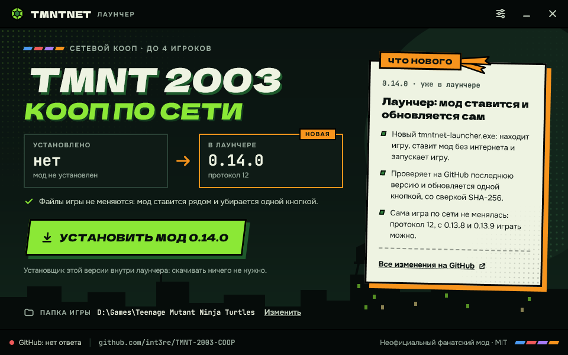
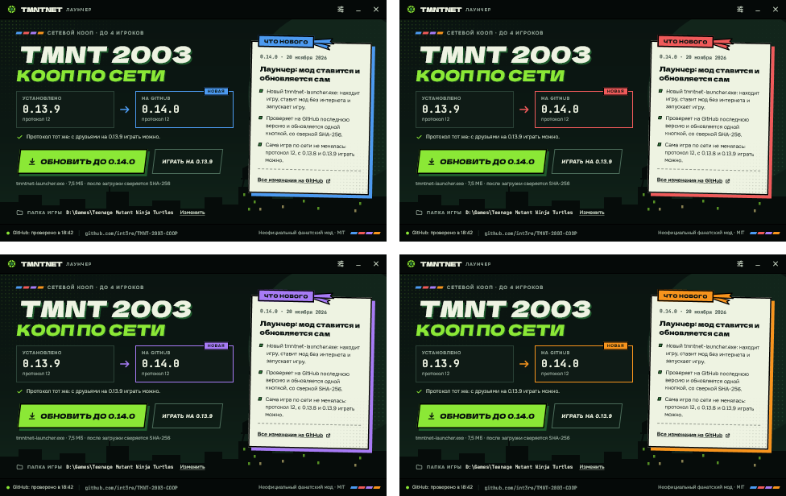

# Лаунчер

[← На главную](../README.md)

`tmntnet-launcher.exe` — один файл, с которого игрок начинает: он находит игру, ставит мод,
следит за новыми версиями на GitHub, обновляет мод одной кнопкой и запускает игру. Появился в
версии 0.14.0.


- [Что он делает](#что-он-делает)
- [Первая установка](#первая-установка)
- [Обновление](#обновление)
- [Если GitHub не открывается](#если-github-не-открывается)
- [Настройки](#настройки)
- [Что и куда он пишет](#что-и-куда-он-пишет)
- [Как он узнаёт о новой версии](#как-он-узнаёт-о-новой-версии)
- [Для разработчика](#для-разработчика)

## Что он делает

| На экране | Что это значит |
|---|---|
| **УСТАНОВЛЕНО** | версия мода в папке игры (из `tmntnet-install.txt`) или «нет» |
| **НА GITHUB** | последняя версия в [релизах](../../../releases) и её сетевой протокол |
| **В ЛАУНЧЕРЕ** | версия, установщик которой лежит внутри самого лаунчера (показывается, когда GitHub не ответил или там версия старше) |
| строка под версиями | можно ли играть с друзьями, которые ещё не обновились: «протокол тот же» или «обновиться нужно всем» |
| лист справа | что нового в последней версии |
| большая кнопка | **УСТАНОВИТЬ МОД**, **ОБНОВИТЬ ДО …** или **ИГРАТЬ** — смотря что сейчас нужно |
| нижняя строка | состояние связи с GitHub и время последней проверки |

Файлы игры лаунчер не меняет и с собой не приносит: нужна своя копия Teenage Mutant Ninja
Turtles (2003).

## Первая установка

1. Скачайте `tmntnet-launcher.exe` со страницы [последнего релиза](../../../releases/latest) и
   запустите его. Положить файл можно куда угодно.
2. Папку игры лаунчер находит сам (по записи об установке в Windows; или если он лежит рядом с
   `TMNT.EXE`). Не нашёл — кнопка **ВЫБРАТЬ ПАПКУ ИГРЫ**.
3. Нажмите **УСТАНОВИТЬ МОД**. Интернет для этого не нужен: установщик своей версии лежит
   внутри лаунчера.
4. Когда мод встал, большая кнопка становится **ИГРАТЬ**.

| Первый запуск | Мод на месте |
|---|---|
|  |  |

Если игра запущена, лаунчер подождёт, пока вы её закроете, и продолжит сам. Если игра стоит в
`Program Files`, Windows попросит разрешение администратора.

> [!NOTE]
> Лаунчер не подписан сертификатом, поэтому Windows может показать окно «Система Windows
> защитила ваш компьютер». Нажмите **«Подробнее» → «Выполнить в любом случае»**. Контрольная
> сумма SHA-256 файла указана в описании каждого релиза; исходный код — в `src/launcher`.

## Обновление

При каждом запуске лаунчер спрашивает GitHub о последней версии. Если она новее установленной,
большая кнопка становится **ОБНОВИТЬ ДО …**:

1. скачивается лаунчер новой версии (в нём лежит и установщик) — около 7,5 МБ;
2. сверяется его SHA-256 с указанным в релизе; файл с другой суммой не запускается и
   удаляется;
3. новый лаунчер встаёт на место старого, запускается и ставит мод.


Настройки мода, клавиши и сохранения при обновлении остаются. Кнопка **ИГРАТЬ НА …** рядом
запускает игру на текущей версии, не обновляясь: обновление никогда не обязательно само по
себе. Обязательно оно только для совместной игры, когда у новой версии другой сетевой протокол,
— об этом и говорит строка под версиями.

Если лаунчер лежит в папке, куда нельзя писать, заменить сам себя он не сможет. Тогда он
скачает установщик новой версии (`tmntnet-setup.exe`), проверит и запустит его — мод
обновится, а лаунчер останется прежним.

## Если GitHub не открывается

Лаунчер напишет «GitHub: нет ответа» внизу. Играть и ставить мод из самого лаунчера это не
мешает: вместо «НА GITHUB» он покажет версию, которую несёт сам, — «В ЛАУНЧЕРЕ».



Чтобы проверка и загрузка заработали:

- **Прокси.** Настройки (значок в правом верхнем углу) → **СЕТЬ**:
  - **Системный** — как в настройках Windows («Параметры → Сеть и Интернет → Прокси»); так по
    умолчанию;
  - **Свой** — адрес вида `127.0.0.1:8080`: порт HTTP-прокси вашей программы обхода;
  - **Нет** — всегда напрямую.
- **Без лаунчера.** Скачайте новый `tmntnet-launcher.exe` в браузере со страницы релиза и
  запустите его вместо старого: установщик своей версии у него внутри.

Сайт github.com и сервер, с которого GitHub отдаёт файлы релизов, — разные адреса. Бывает,
что первый открывается, а второй нет: тогда версия видна, а загрузка заканчивается ошибкой
«Сервер загрузок GitHub не отвечает». Лечится тем же прокси.

## Настройки


| Настройка | Что делает |
|---|---|
| **Проверять при запуске** | спрашивать GitHub о новой версии при каждом запуске; выключено — только по кнопке **ПРОВЕРИТЬ ОБНОВЛЕНИЯ** |
| **Ставить обновления без вопроса** | найдя новую версию, сразу скачать и поставить её (если игра не запущена). По умолчанию выключено |
| **Прокси** | см. [выше](#если-github-не-открывается) |
| **Папка игры** | другая папка с `TMNT.EXE` |
| **Открыть журнал** | показать `tmntnet.log` в папке игры (его просят прислать, когда что-то не так) |
| **Удалить мод** | два нажатия: убирает мод из папки игры тем же установщиком; игра остаётся как до установки, сохранения не трогаются |
| **Цвет повязки** | цвет акцентов лаунчера: синий, красный, фиолетовый или оранжевый |



## Что и куда он пишет

| Где | Что |
|---|---|
| `%APPDATA%\tmntnet\launcher.ini` | его настройки: папка игры, прокси, цвет |
| `%LOCALAPPDATA%\tmntnet\cache\` | установщик, которым ставился мод (нужен для удаления), и временные файлы загрузки |
| папка игры | только то, что ставит установщик (см. [Установка](INSTALL.md#что-появляется-в-папке-игры)) |
| рядом с собой | при обновлении — новый файл вместо себя; старый на время переименовывается в `.old` и удаляется при следующем запуске |

В реестр лаунчер ничего не пишет, в автозагрузку не встаёт, в фоне не работает: после запуска
игры он закрывается.

## Как он узнаёт о новой версии

Только с сайта **github.com**, двумя запросами:

1. `…/releases/latest` — GitHub отвечает переадресацией на страницу последнего релиза; из её
   адреса берётся номер версии;
2. `…/releases.atom` — лента релизов; из описания нужного релиза берутся дата, заголовок,
   короткие заметки, сетевой протокол, размеры и SHA-256 файлов.

Программный интерфейс GitHub (`api.github.com`) не используется: в некоторых сетях он закрыт,
хотя сам сайт открывается. О себе лаунчер сообщает серверу только название и версию
(`tmntnet-launcher/0.14.0`); ничего о компьютере, игроке или папках он не отправляет.

Описание релиза, сделанного вместе с лаунчером, заканчивается блоком «Данные для лаунчера» —
строки `ключ=значение`. Релизы до 0.14.0 такого блока не имеют: для них лаунчер берёт
заголовок и заметки из текста описания, а SHA-256 установщика — из таблицы файлов в нём.

Сами файлы скачиваются по адресу `…/releases/download/<версия>/<файл>`, который GitHub
переадресует на свой сервер загрузок. Соединение везде HTTPS с проверкой сертификата
средствами Windows.

## Для разработчика

| Файл | Что в нём |
|---|---|
| `src/launcher/launcher.cpp` | окно, состояния, фоновые задачи (проверка, загрузка, установка), лабораторные ключи |
| `src/launcher/paint.cpp`, `view.h` | весь рисунок окна по структуре `View`; о сети и файлах не знает |
| `src/launcher/gfx.cpp` | Direct2D / DirectWrite, шрифты из ресурсов, запись картинки в PNG |
| `src/launcher/update.cpp` | последняя версия на GitHub, разбор ленты, версия мода в папке игры, SHA-256, запуск установщика |
| `src/launcher/net.cpp` | HTTP через WinINet: напрямую, через прокси Windows или через заданный |
| `third_party/fonts/` | три шрифта окна (SIL Open Font License) и их лицензии |
| `tools/release_notes.py`, `dist/release.txt` | блок «Данные для лаунчера» для описания релиза |

Окно рисуется в единицах макета 960×600 и масштабируется под монитор. Внешний вид согласован
с автором проекта отдельно; меняя его, сверяйтесь со снимками в этой странице.

**Картинки для документации** рисует сам лаунчер: `python tools/launcher_images.py --was 0.13.9`
(версия, которая была до релиза) обновляет `docs/images/launcher*.png`. На них показан
собираемый релиз — его версия и заметки из `dist/release.txt`, поэтому перед каждым релизом
их стоит перерисовать.

**Проверка без окна.** Лаунчер умеет рисовать себя в файл и «нажимать» свои кнопки по
расписанию, не показываясь на экране:

```text
tmntnet-launcher.exe /shot out.png /state update     готовое состояние в PNG (update, install, downloading,
                                                     ready, nogame, offline, settings, error, bundle, …)
tmntnet-launcher.exe /ini lab.ini /log lab.log /do primary@2500 /snap out.png /after 9000
                                                     настоящий прогон без окна: нажать большую кнопку
                                                     через 2,5 с, снять картинку через 9 с и выйти
```

`tests/run_launcher_lab.ps1` прогоняет так двенадцать сценариев против подставного GitHub
(`tests/launcher_lab_server.py`) и подставной папки игры: установка из встроенного
установщика, «ничего нового», релиз без блока, неверная контрольная сумма, обновление через
новый лаунчер, лаунчер без права заменить себя, ожидание закрытия игры, отмена загрузки,
обновление одного лаунчера, удаление, установка без сервера, запуск нового лаунчера старым.
Игра при этом не запускается, настройки и кэш настоящего лаунчера не трогаются.

**Релиз.** Напишите строки для листа «Что нового» в `dist/release.txt`, соберите проект и
сделайте описание релиза:

```text
python tools/release_notes.py заметки.md > описание.md
gh release create v0.14.0 build/Release/tmntnet-launcher.exe build/Release/tmntnet-setup.exe --notes-file описание.md
```

В релиз кладутся оба файла из одной сборки: лаунчер (его скачивают игроки и старые лаунчеры)
и установщик (для лаунчера, который не может заменить себя, и для установки из командной
строки).
