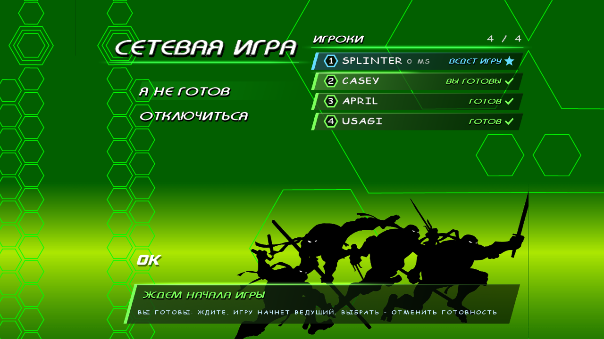

# Как играть по сети

[← На главную](../README.md) · [English](en/PLAY.md)

**Содержание:** [Коротко](#коротко) · [Хосту](#хосту) · [Друзьям](#друзьям) ·
[Выбор черепах и костюмов](#выбор-черепах-и-костюмов) · [В уровне](#в-уровне) ·
[Пауза](#пауза) · [Вышел и вернулся](#вышел-и-вернулся) · [Чей прогресс](#чей-прогресс-и-настройки) ·
[Без Steam](#без-steam-локальная-сеть-и-vpn) · [За одним ПК](#втроём-и-вчетвером-за-одним-пк) ·
[Игра только у хоста](#режим-игра-только-у-хоста)

## Коротко

1. У каждого установлен мод одной версии ([установка](INSTALL.md)) и запущен Steam; вы друзья
   в Steam.
2. Все запускают игру и остаются в главном меню.
3. Хост: **СЕТЕВАЯ ИГРА → ПРИГЛАСИТЬ ДРУГА**. Друзья принимают приглашение и нажимают **Я ГОТОВ**.
4. Хост: **НАЧАТЬ ИГРУ**. У всех открывается выбор черепах.

Каждый играет в своей копии игры и видит свою картинку. По сети идут только нажатия кнопок.


## Хосту

Главное меню → **СЕТЕВАЯ ИГРА**. Справа панель **ИГРОКИ**: вы — игрок 1, три места свободны.
Внизу написано, что сейчас происходит, и подсказка к выбранной строке.

| Строка | Что делает |
|---|---|
| **НАЧАТЬ ИГРУ** | Становится зелёной, когда готовы все. Начинает игру вместе и сразу открывает у всех выбор черепах на нужное число игроков. |
| **ПРИГЛАСИТЬ ДРУГА** | Список друзей Steam (сначала те, у кого игра запущена). Можно позвать до трёх; страница остаётся открытой. |
| **ВОЙТИ К ДРУГУ** | Играть в игре друга вместо своей. |
| **КОДЫ** | Код сети, ваш Steam ID и номер лобби — для входа без приглашения. |
| **ВЫГНАТЬ ИГРОКА** | Появляется, когда есть игроки: список, кого убрать. |


Кто вошёл первым — игрок 2, вторым — игрок 3, третьим — игрок 4. У каждого в панели видно
состояние: **НЕ ГОТОВ** жёлтым или **ГОТОВ** зелёным, и пинг.

Главное меню, меню сюжета и карту уровней во время игры вместе ведёт **только хост**. Черепаху и
костюм каждый выбирает сам.

Если Steam не запущен, на странице будет написано «СТИМ: ВЫКЛЮЧЕН — ЗАПУСТИТЕ СТИМ». Запустите
Steam — мод подхватит его сам.

**Забыли кого-то позвать?** Вернитесь в главное меню (пауза → ВЕРНУТЬСЯ В МЕНЮ) и снова
откройте СЕТЕВАЯ ИГРА: игра вместе приостановится у всех и начнётся заново, когда вы закроете
страницу.

## Друзьям

1. Запустите Steam и игру **до** приглашения и оставайтесь в главном меню.
2. Примите приглашение в Steam и вернитесь в окно игры. Или сами: **СЕТЕВАЯ ИГРА → ВОЙТИ К
   ДРУГУ** → игра хоста.
3. Откроется страница игры друга: справа все игроки, слева строка **Я ГОТОВ**. Выберите её.
   Страницу закрывать не нужно — она закроется сама, когда хост начнёт игру.
4. Дальше меню ведёт хост, а вы управляете своей черепахой своими клавишами, геймпадом или
   мышью.



На снимке гость уже готов: строка сменилась на **Я НЕ ГОТОВ** (отменить готовность), в панели
напротив его имени — «ВЫ ГОТОВЫ», а звёздочкой отмечен хост. **ОТКЛЮЧИТЬСЯ** — выйти из игры
друга.

Пока игра не началась, вверху экрана написано, чего ждём:

| Надпись | Что значит |
|---|---|
| ЖДЁМ ДРУГА | друг ещё не в главном меню (идёт заставка, открыта страница) |
| ДРУГ НЕ В ГЛАВНОМ МЕНЮ | он в уровне или в параметрах |
| ИГРА ДРУГА НА ПАУЗЕ | его игра свёрнута из полного экрана: пусть вернётся в неё |
| ВЫЙДИТЕ В ГЛАВНОЕ МЕНЮ | это вам: вы в уровне или на другом экране |

## Выбор черепах и костюмов


- Выбирают **по очереди**: игрок 1, игрок 2, затем игрок 3 и игрок 4 — из оставшихся.
- В центре экрана написано, чей ход, и имя того, кто выбирает. Занятые черепахи темнеют, под
  табличкой — имя игрока цветом маски его черепахи.
- Выбрав черепаху, игрок выбирает **костюм**: в центре открывается КОСТЮМ. Влево и вправо —
  другой костюм, «выбрать» — дальше, «отмена» — назад к черепахам.
- Костюмов шесть: обычный, особый, новогодний, хэллоуин, особый новогодний и особый хэллоуин.
  Все открыты сразу. Костюмы друг друга видят все игроки.
- «Отмена» у игроков 3 и 4 возвращает ход предыдущему игроку.


После выбора открывается карта уровней. На ней стоит вся команда — в выбранных костюмах и с
именами игроков; уровень выбирает хост.


## В уровне


- **Своя камера.** Вы видите мир вокруг своей черепахи, как в игре на одного, и можете уходить
  от остальных как угодно далеко. Над каждой черепахой — имя игрока. В роликах и диалогах камера
  общая. Если хочется одну камеру на всех, как в оригинале: **ПАРАМЕТРЫ → ДРУГИЕ ПАРАМЕТРЫ →
  КАМЕРА ПО СЕТИ → КАК В ИГРЕ** (у каждого своя настройка).
- **Сердечек вверху нет.** Черепаха, у которой кончилась жизнь, не погибает, пока кто-то ещё на
  ногах: она лежит оглушённая со звёздочками, враги её не трогают.
- **Чтобы поднять товарища,** встаньте рядом и держите кнопку **«смена сюрикена»** (у игрока 1
  по умолчанию Left Shift) 4 секунды — над упавшим растёт зелёная полоска. Атаковать в это время
  нельзя; если по вам попадут, подъём начнётся заново. Поднятая черепаха встаёт с пятой частью
  жизни.
- **Уровень проигран, только когда упали все.**
- **В додзё участвуют все.** В оригинале уровни-додзё (между картами) проходит одна черепаха
  первого игрока; в игре вместе туда попадает вся команда, и на заставке додзё вместо «Только
  для Игрока 1» написано «Для всей команды».
- **Ролики заканчиваются у всех одновременно.** Пропустить ролик могут игроки 1 и 2 («выбрать»
  или «старт»); если его смотрят до конца, игра дожидается, пока он доиграет на всех ПК.
- **Игра ждёт каждого.** Если чья-то игра замерла (плохая связь, занят компьютер), у остальных
  картинка стоит и ждёт. После долгого ожидания вверху написано, кого ждали: «ЖДАЛИ ИГРОКА 2:
  8 С». Больше 10 секунд — этот игрок выбывает, остальные играют дальше.
- Окно игры можно сворачивать и переключаться в Discord или Steam: игра в фоне не
  останавливается. Для этого режим окна должен быть **БЕЗ РАМКИ** (так ставит установщик), а не
  ПОЛНЫЙ ЭКРАН.

## Пауза


- **Esc у любого игрока** ставит игру на паузу сразу у всех. Вверху написано, чья пауза.
- Меню паузы ведёт тот, кто её поставил. **Esc любого игрока ещё раз** — игра продолжается.
- **ВЕРНУТЬСЯ В МЕНЮ** уводит с уровня всю команду в главное меню; игра вместе при этом не
  заканчивается. Этот пункт слушается только хоста.
- **УЙТИ** закрывает игру только того, кто его выбрал. Остальные играют дальше.
- На вопрос «ТЫ УВЕРЕН?» сначала выбрано НЕТ: влево — ДА.

## Вышел и вернулся

Если игрок вышел посреди уровня (или у него упала игра), остальные играют дальше, а его
черепаха стоит. Чтобы вернуться, он снова запускает игру и входит в игру хоста — по приглашению
или через **СЕТЕВАЯ ИГРА → ВОЙТИ К ДРУГУ**.


Его игра **догоняет** остальных: на экране «ПОДКЛЮЧЕНИЕ К ИГРЕ» и проценты, звука в это время
нет. Три минуты игры догоняются примерно за пять секунд, полчаса — примерно за полминуты. Когда
догонит, вверху появится «СНОВА В ИГРЕ», и черепаха снова его.

Почему нельзя войти мгновенно: у игры нет сохранения посреди уровня, поэтому входящий ПК сам
быстро просчитывает ту же игру по нажатиям всех игроков.

Так может вернуться только тот, кто уже участвовал в этой игре. Нового игрока хост приглашает
из главного меню.

## Чей прогресс и настройки

- На время общей игры у всех действуют **прогресс сюжета и сложность хоста**.
- Своё сохранение гостя не трогается: его копия лежит рядом как `savegame.dat.netplay`, и после
  игры (в главном меню или при выходе) прогресс и настройки гостя возвращаются. Прогресс общей
  игры остаётся у гостя отдельным файлом `savegame-netplay.dat`.
- Если игра гостя упала, его сохранение вернётся при следующем запуске.
- Командные правила (подъём упавших, кнопка подъёма) берутся у хоста.

## Без Steam: локальная сеть и VPN

Мод умеет соединяться и напрямую по UDP (порт 7777), без Steam. Список игр в меню
**ВОЙТИ К ДРУГУ** — это игры друзей Steam, поэтому без Steam адрес хоста гость прописывает в
настройках:

1. **Хост** ничего не меняет (`role=host` стоит по умолчанию) и запускает игру.
2. **Гость** открывает `tmntnet.ini` рядом с `TMNT.EXE` и в разделе `[net]` пишет:
   ```ini
   role=client
   peer=192.168.0.12      ; адрес ПК хоста (можно с портом: 192.168.0.12:7777)
   ```
   После этого его игра при запуске сама подключается к хосту, а на странице СЕТЕВАЯ ИГРА
   видно состояние подключения.
3. Дальше всё как со Steam: гости нажимают **Я ГОТОВ**, хост — **НАЧАТЬ ИГРУ**.

Адрес — это IP хоста в локальной сети либо в VPN (Radmin VPN, ZeroTier, Tailscale), если вы
играете через интернет. Можно и без VPN: хост пробрасывает UDP 7777 на роутере, гость пишет его
внешний адрес.

При первом запуске Windows спросит, разрешить ли `tmnt.exe` доступ к сети: разрешите для
частных сетей.

## Втроём и вчетвером за одним ПК

**РЕЖИМ СЮЖЕТА → 1 ИГРОК / 2 ИГРОКА / ТРИ ИГРОКА / ЧЕТЫРЕ ИГРОКА** работает и без сети. Игроки 3
и 4 управляются геймпадами или клавишами из `tmntnet.ini` (`p3_keys`, `p4_keys`): подробности
в [«Управлении»](CONTROLS.md#игроки-3-и-4-за-одним-пк).


## Режим «игра только у хоста»

Старый режим, с которого мод начинался: игра запущена только у хоста, второй игрок смотрит
стрим (Sunshine / Moonlight, Discord) и управляет вторым героем через маленькую программу
`tmntnet-client.exe`. Годится, когда у друга нет игры. Только для двоих.

1. Хост запускает игру, открывает **СЕТЕВАЯ ИГРА** и сообщает другу код (или приглашает через
   Steam).
2. Друг запускает `tmntnet-client.exe`: игра хоста появится в списке, либо вводится код, IP или
   Steam ID.
3. В Story Mode на двоих игрок 2 выбирает черепаху сам, со своего ПК.

Пока второй игрок подключён, клавиши и геймпад игрока 2 на ПК хоста ничего не делают — случайно
сдвинуть чужого героя нельзя.

> [!WARNING]
> При стриминге ввод второго игрока должен идти **только** через tmntnet. В Sunshine отключите
> проброс геймпада и клавиатуры (Configuration → Input), иначе геймпад друга попадёт в игру
> дважды.

Клавиши и кнопки клиента: [«Управление»](CONTROLS.md#клиент-режима-игра-только-у-хоста).

## Что нужно знать про Steam

- В Steam у всех будет статус **«Играет в Spacewar»**. Это бесплатное тестовое приложение Valve
  (AppID 480), через которое такие моды пользуются сетью Steam. Устанавливать его не нужно.
- Оверлей Steam (Shift+Tab) в игре отключён.
- Посторонние подключиться не могут: хост принимает только участников своего лобби, а лобби
  видно только друзьям. Сделать игру видимой всем: `lobby_type=public` в `tmntnet.ini`.
- Steam сначала соединяет через свои серверы и через несколько секунд находит прямой путь.
  Задержка нажатий подбирается по пингу автоматически.
