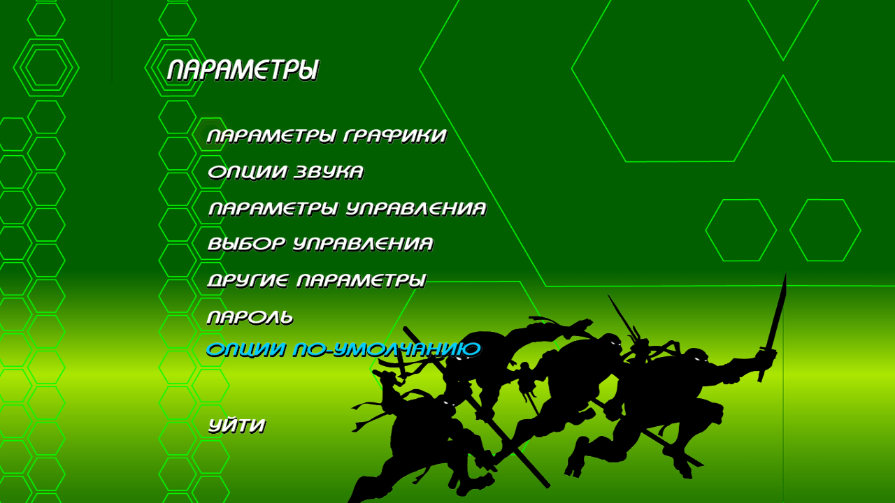

# Настройки

[← На главную](../README.md) · [English](en/SETTINGS.md)

Почти всё настраивается **в меню самой игры**. Файл `tmntnet.ini` рядом с `TMNT.EXE` нужен для
редких параметров; изменения из меню записываются в него же. Графику, звук и клавиши можно
менять и не запуская игру — на вкладках **ГРАФИКА**, **ЗВУК** и **УПРАВЛЕНИЕ** в настройках
[лаунчера](LAUNCHER.md#графика-и-звук-игры): там те же строки.

**Содержание:** [В меню игры](#в-меню-игры) · [`[net]`](#net--сеть) · [`[mod]`](#mod--игра) ·
[`[video]`](#video--экран) · [`[audio]`](#audio--звук) · [`[mouse]`](#mouse--мышь) ·
[`[ui]`](#ui--интерфейс) · [`[log]`](#log--журнал) · [Клиент](#client-pad-keys--клиент)

## В меню игры

Строки мода стоят на родных страницах **ПАРАМЕТРОВ** среди строк самой игры и работают так же:
вверх и вниз — строки, влево и вправо — значение, **OK** сохраняет, «отмена» возвращает как
было, «По умолчанию» сбрасывает. Если что-то вступит в силу только после перезапуска, вверху
появится «НУЖЕН ПЕРЕЗАПУСК ИГРЫ».

На снимках **оранжевой рамкой** обведены строки мода; в таблицах они выделены жирным. Тот же
обзор с пояснениями «было и стало» — в [экскурсии в картинках](TOUR.md).

### ПАРАМЕТРЫ ГРАФИКИ

| Строка | Значения |
|---|---|
| РАЗРЕШЕНИЕ | видно прямо в строке; «выбрать» открывает список игры |
| **ОКНО ИГРЫ** | полный экран, без рамки, в окне |
| **ШИРОКИЙ ФОРМАТ** | вкл / выкл (после перезапуска) |
| **ПО БОКАМ** | что по бокам от картинок 4:3 (ролики, выбор персонажа): размыто, темно, растянуть фон, растянуть всё |
| **ОБЗОР** | камера видит шире: как в игре, 110 … 150 %. Только картинка: у друзей по сети может стоять разный |
| **ПАНЕЛИ** | панели жизни и счёта меньше: как в игре, 90 … 50 % |
| **КАЧЕСТВО** | как в игре; ВЫСОКОЕ — сглаживание 4x и чёткие текстуры (16x); МАКСИМУМ — сглаживание 8x. Меняется сразу |
| **ЛИМИТ КАДРОВ** | нет, 30, 60, 120, 144 |
| **ИГРА В ФОНЕ** | не вставать на паузу, когда окно не активно (после перезапуска). В сетевой игре игра в фоне идёт всегда |

### ПАРАМЕТРЫ ЗВУКА

В списке параметров эта страница называется **ОПЦИИ ЗВУКА**.

| Строка | Значения |
|---|---|
| **РОЛИКИ** | громкость роликов; пока ползунок не трогали, ролики звучат как музыка. В оригинале заставка гремит громче всей игры |
| **ЗАСТАВКА** | показывать или пропускать при запуске |

### ПРОЧИЕ ПАРАМЕТРЫ

В списке параметров — **ДРУГИЕ ПАРАМЕТРЫ**.

| Строка | Значения |
|---|---|
| АВТОЗАПИСЬ | с модом — запись после каждого пройденного уровня |
| **ВЫБОР ЗА ИГРОКА 2** | за одним ПК: выбирать черепаху за второго игрока, если он сам не выбирает |
| **ГЕРОЙ ИГРОКА 2** | какую: наугад или первую свободную |
| **ИГРОК 2 ПО СЕТИ** | в режиме «игра только у хоста» клавиши игрока 2 на ПК хоста не работают |
| **КАМЕРА ПО СЕТИ** | СВОЯ — у каждого своя камера; КАК В ИГРЕ — одна на всех |

### ПАРАМЕТРЫ УПРАВЛЕНИЯ

**РАСКЛАДКА** — как в игре или «два игрока» за одной клавиатурой. В таблице **КЛАВИАТУРА**
можно ставить кнопки мыши. Подробнее: [«Управление»](CONTROLS.md).

### СЕТЕВАЯ ИГРА

Пункт главного меню; описан в [«Как играть по сети»](PLAY.md#хосту).

---

## Справочник `tmntnet.ini`

Файл в кодировке UTF-8. Комментарий — после `;`. Жирным выделены значения по умолчанию.

### `[net]` — сеть

| Ключ | Значения | Что делает |
|---|---|---|
| `role` | **`host`**, `client` | `client` — эта игра сама подключается к хосту по адресу `peer` (игра без Steam) |
| `peer` | адрес | для `client`: IP хоста, можно с портом. Для `host`: если задан, принимать подключения только с этого IP |
| `port` | **`7777`** | порт UDP |
| `discovery_port` | **`7778`** | порт поиска хоста в локальной сети (для клиента режима «игра только у хоста») |
| `input_delay` | **`2`** | наименьшая задержка нажатий в кадрах; настоящая подбирается по пингу и меньше этой не бывает |
| `timeout_ms` | **`1000`** | режим «игра только у хоста»: через сколько без связи герой игрока 2 отпускает кнопки |
| `name` | текст | имя над вашей черепахой. Пусто — имя в Steam, без Steam — имя компьютера |
| `transport` | **`auto`**, `steam`, `enet` | `auto` — Steam и прямое соединение одновременно; `steam` — только Steam; `enet` — только прямое, Steam не трогать |
| `lobby_type` | **`friends`**, `public` | кому видно лобби хоста в Steam |
| `host_steamid` | SteamID64 или ссылка на профиль | для `client`: подключиться к хосту через Steam напрямую |
| `allow_steamid` | SteamID64 через запятую | хост: кого пускать без лобби |

### `[mod]` — игра

| Ключ | Значения | Что делает |
|---|---|---|
| `players` | **`2`**, `3`, `4` | сколько играют сюжет за одним ПК. Выбор в меню РЕЖИМ СЮЖЕТА главнее этой строки |
| `revive` | **`1`**, `0` | командные правила: упавшая черепаха оглушена, её можно поднять; `0` — как в игре (сердечки, гибель) |
| `revive_button` | **`shuriken_change`**, `dash`, `juggle`, `special`, `shuriken`, `jump`, `attack`, `strong` | кнопка подъёма товарища |
| `autosave` | **`1`**, `0` | запись после каждого пройденного уровня; `0` — как в игре |
| `p3_keys`, `p4_keys` | 16 кодов DIK | клавиши игроков 3 и 4 за этой клавиатурой, см. [«Управление»](CONTROLS.md#игроки-3-и-4-за-одним-пк) |
| `p3_pad`, `p4_pad` | **`auto`**, `0`, номер | геймпады игроков 3 и 4 |
| `p2_binds` | **`auto`**, `ini` | откуда брать клавиши игрока 2 для режима «игра только у хоста»: из игры или из `p2_keys` |
| `p2_keys` | 16 кодов DIK | клавиши игрока 2 для `p2_binds=ini` |
| `p2_lock` | **`1`**, `0` | режим «игра только у хоста»: пока друг подключён, клавиши и геймпад игрока 2 на ПК хоста не работают |
| `p2_autopick` | **`1`**, `0` | за одним ПК: выбирать черепаху за игрока 2, если он не трогал курсор |
| `p2_autopick_delay_ms` | **`1500`** | через сколько выбирать |
| `p2_character` | **`auto`**, `first` | случайная свободная черепаха или первая свободная |

### `[video]` — экран

| Ключ | Значения | Что делает |
|---|---|---|
| `display` | **`borderless`**, `fullscreen`, `windowed` | режим окна. `borderless` рекомендуется: выглядит как полный экран, Alt+Tab мгновенный, сетевая игра не замирает |
| `window_size` | например `1280x720` | размер картинки в окне; пусто — по разрешению |
| `window_resize` | **`1`**, `0` | окно можно растягивать мышью, пропорции сохраняются |
| `background` | **`pause`**, `run` | `run` — игра идёт и когда окно не активно |
| `widescreen` | **`1`**, `0` | `0` — оригинальные 4:3 |
| `resolution` | **`desktop`**, `game`, `1920x1080` | разрешение рабочего стола, из меню игры или заданное |
| `refresh` | **`60`** | желаемая частота, Гц; `0` — как у рабочего стола |
| `hud` | **`center`**, `stretch` | интерфейс в центре 4:3 без искажений или растянут |
| `hud_corners` | **`1`**, `0` | на широком экране панели игроков и радар стоят по углам экрана |
| `hud_size` | **`100`** … `50` | размер панелей сверху, % |
| `fullscreen_images` | **`pillarbox`**, `stretch` | картинки 4:3 (ролики, выбор персонажа): по центру или растянуть |
| `side_bars` | **`blur`**, `black` | что по бокам от картинок 4:3 |
| `wide_menus` | **`1`**, `0` | фон главного меню, параметров и выбора уровней продолжается до краёв экрана |
| `fov` | **`100`** … `150` | обзор камеры, % от обзора игры |
| `own_camera` | **`1`**, `0` | в сетевой игре камера следует за своей черепахой; `0` — одна на всех |
| `antialiasing` | `0`, `2`, **`4`**, `8` | сглаживание краёв (MSAA) |
| `anisotropy` | `0`, `2` … **`16`** | анизотропная фильтрация текстур; `0` — как в игре |
| `vsync` | **`game`**, `on`, `off` | вертикальная синхронизация |
| `fps_limit` | **`0`** | ограничение кадров в секунду; `0` — нет |

> Настройки картинки у каждого игрока свои и на сетевую игру не влияют: у друзей могут быть
> разные разрешение, обзор и качество.

### `[audio]` — звук

| Ключ | Значения | Что делает |
|---|---|---|
| `movie_follow` | **`1`**, `0` | ролики звучат как музыка по настройкам игры; `0` — на полную, как в оригинале |
| `movie_level` | **`-1`**, `0` … `4` | своя громкость роликов; `-1` — как музыка |
| `movie_volume` | **`100`** | и ещё тише: % от этого |
| `intro` | **`play`**, `skip` | заставка при запуске |

### `[mouse]` — мышь

Кнопки мыши проще назначать в игре (см. [«Управление»](CONTROLS.md#мышь)). Здесь можно
**добавить** кнопку к клавише, чтобы работали обе.

| Ключ | Значения | Что делает |
|---|---|---|
| `player` | **`1`**, `2`, `0` | чьи кнопки по умолчанию; `0` — добавки выключены |
| `left`, `right`, `middle`, `x1`, `x2` | действие | `attack`, `strong`, `jump`, `shuriken`, `shuriken_change`, `dash`, `juggle`, `special`, `start`, `pause`, `move_up`, `move_down`, `move_left`, `move_right`; `2:attack` — атака игрока 2 |

### `[ui]` — интерфейс

| Ключ | Значения | Что делает |
|---|---|---|
| `nametags` | **`1`**, `0` | имена игроков над черепахами в сетевой игре |
| `menu_label` | текст | надпись пункта в главном меню; пусто — СЕТЕВАЯ ИГРА |
| `debug_window` | **`0`**, `1` | F2 открывает служебное окно мода поверх игры |

### `[log]` — журнал

| Ключ | Значения | Что делает |
|---|---|---|
| `log_level` | `error`, `warn`, **`info`**, `debug` | подробность `tmntnet.log` |

### `[client]`, `[pad]`, `[keys]` — клиент

Только для `tmntnet-client.exe` ([режим «игра только у хоста»](PLAY.md#режим-игра-только-у-хоста)).

| Ключ | Значения | Что делает |
|---|---|---|
| `pad` | **`-1`**, номер | какой геймпад читать; `-1` — первый подключённый |
| `keyboard` | **`1`**, `0` | читать клавиатуру |
| `send_hz` | **`120`** | частота отправки нажатий |
| `stick_deadzone` | **`16000`** | порог стика (из 32767) |

В `[pad]` и `[keys]` каждому действию (`jump`, `attack`, `strong`, `shuriken`, `dash`,
`shuriken_change`, `special`, `juggle`, `start`, `pause`, а в `[keys]` ещё `up`, `down`, `left`,
`right`) сопоставляются кнопки геймпада по раскладке Xbox (`A`, `B`, `X`, `Y`, `LB`, `RB`, `LT`,
`RT`, `BACK`, `START`) или клавиши (`Z`, `SPACE`, `NUMPAD4`, `0x41`…).
