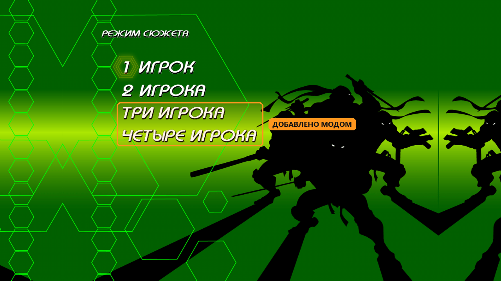
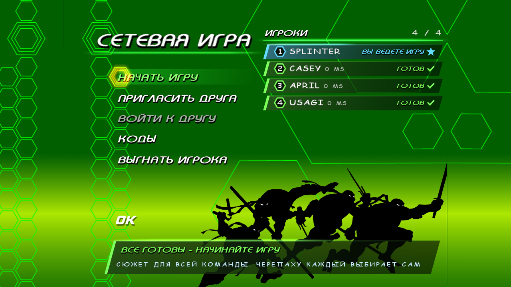
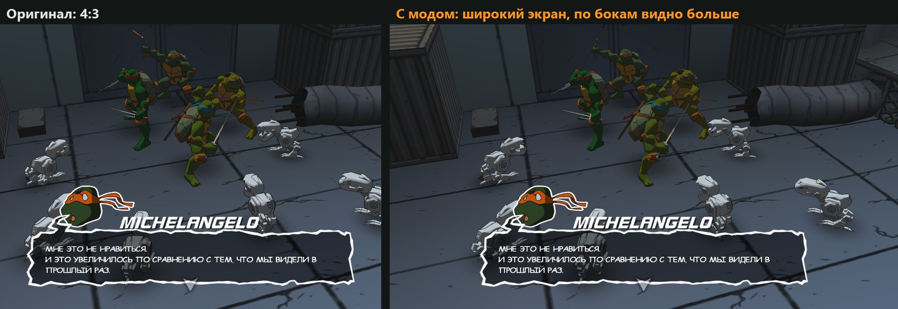
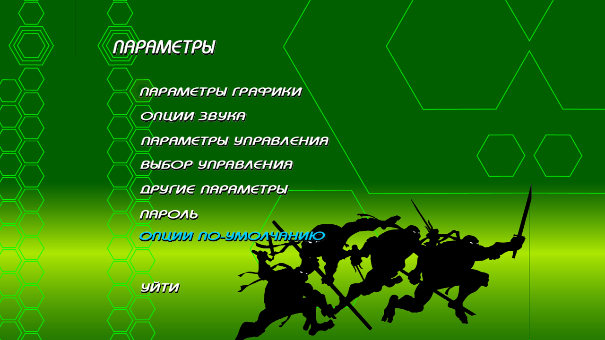
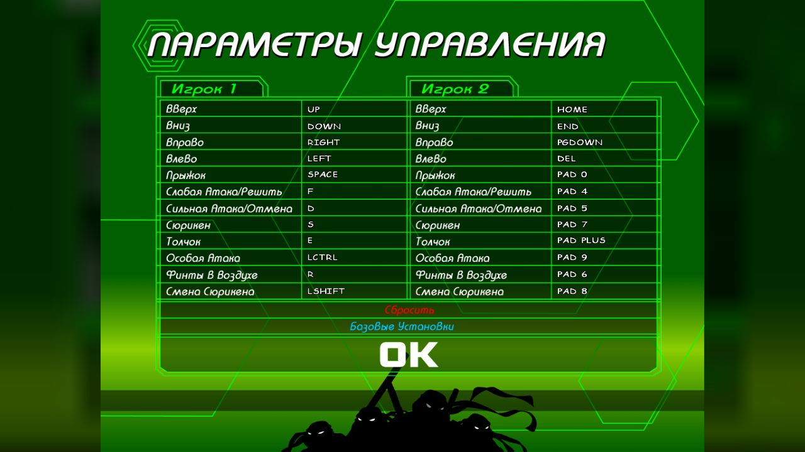

# Что добавлено и изменено — в картинках

[← На главную](../README.md)

Все снимки сделаны в самой игре с установленным модом. На снимках меню **оранжевой рамкой**
обведено то, что добавил мод; всё остальное на этих страницах — родное, от игры. Страницы
раздела «Сетевая игра» добавлены модом целиком.

**Содержание:** [Было и стало](#было-и-стало) · [Лаунчер](#лаунчер) · [Главное меню](#главное-меню) ·
[Режим сюжета](#режим-сюжета-трое-и-четверо) · [Сетевая игра](#сетевая-игра) ·
[Выбор черепах](#выбор-черепах) · [Костюмы](#костюмы) · [Карта уровней](#карта-уровней) ·
[В уровне](#в-уровне) · [Пауза](#пауза) · [Вход в идущую игру](#вход-в-идущую-игру) ·
[Широкий экран](#широкий-экран) · [Параметры](#параметры) · [Чего не видно на снимках](#чего-не-видно-на-снимках)

## Было и стало

| | В оригинальной игре | С модом |
|---|---|---|
| Кооператив | двое за одним компьютером | до четырёх, каждый за своим ПК, через Steam или локальную сеть |
| Режим сюжета | 1 игрок, 2 игрока | + **три игрока**, **четыре игрока** |
| Камера | одна на всех, игроков держит рядом «невидимая стена» | у каждого своя, можно расходиться |
| Упавший игрок | теряет жизнь-сердечко, потом выбывает | лежит оглушённый, товарищ поднимает его |
| Пауза по сети | — | Esc у любого игрока, у всех сразу |
| Уровни-додзё | проходит одна черепаха первого игрока | участвует вся команда |
| Костюмы | открываются прохождением, секретной кнопкой и по календарю | все шесть открыты, выбираются на экране выбора |
| Экран | только 4:3 | широкий экран (по бокам видно больше), без рамки, сглаживание до 8x |
| Меню | рассчитаны на 4:3 | главное меню, параметры и выбор уровней — на всю ширину экрана, без полос |
| Мышь | кнопки мыши назначить нельзя | назначаются в таблице клавиш, как обычные клавиши |
| Сохранение | в конце главы, с вопросом | после каждого уровня, без вопросов |
| Заставка | гремит громче всей игры | своя громкость, можно пропускать |
| Установка и обновление | — | лаунчер: одна кнопка, новые версии с GitHub |

## Лаунчер

Отдельное окно, с которого начинает игрок (с версии 0.14.0). Это единственная часть мода,
которая живёт вне игры, поэтому и выглядит по-своему: ночные крыши, тушь и полутон, четыре
цвета повязок. Логотипа и персонажей игры в нём нет.

| Первый запуск: мод ставится одной кнопкой | Вышла новая версия |
|---|---|
|  |  |

| Загрузка обновления | Мод на месте: играть |
|---|---|
|  |  |

| Настройки | Цвет повязки — цвет акцентов |
|---|---|
|  |  |

| Графика игры — в настройках лаунчера | И звук |
|---|---|
|  |  |

| Клавиши и кнопки мыши — там же | Свою новую версию лаунчер берёт сам |
|---|---|
|  |  |

- **УСТАНОВЛЕНО** и **НА GITHUB** — версия мода в папке игры и последняя вышедшая; под ними
  написано, можно ли играть с теми, кто ещё не обновился.
- Лист справа — что нового в последней версии.
- Большая кнопка одна: **УСТАНОВИТЬ МОД**, **ОБНОВИТЬ ДО …** или **ИГРАТЬ** — смотря что
  сейчас нужно.
- Полоса загрузки — труба, которая наполняется: файл обновления при этом сверяется по SHA-256.
- Вкладки **ГРАФИКА**, **ЗВУК** и **УПРАВЛЕНИЕ** (с версии 0.15.0) — те же строки и клавиши, что
  на страницах параметров игры ниже, только игру запускать не нужно. Свою новую версию лаунчер
  берёт при запуске сам.

Подробно: [Лаунчер](LAUNCHER.md).

## Главное меню

Вторая строка — вход во всё сетевое.

Остальные пункты — родные. Надпись СЕТЕВАЯ ИГРА собрана из букв самой игры, тем же шрифтом,
что и соседние.

## Режим сюжета: трое и четверо

В игре было только «1 ИГРОК» и «2 ИГРОКА». Режимы на троих и четверых работают и по сети, и за
одним ПК. По сети это меню открывать не нужно: НАЧАТЬ ИГРУ на странице «Сетевая игра» сразу
ведёт всех к выбору черепах на нужное число игроков.

## Сетевая игра

Эти страницы добавлены модом целиком и оформлены как страницы параметров игры.

**Страница хоста.** Справа — игроки с пингом и готовностью, внизу — что происходит сейчас и
подсказка к выбранной строке.

**Приглашение друзей Steam** — прямо из игры, до трёх человек.

**Страница гостя.** После подключения открывается сама; гость отмечает готовность и ждёт, пока
хост начнёт игру.

Подробно о каждой строке: [«Как играть по сети»](PLAY.md).

## Выбор черепах

Экран выбора — родной, но в игре он рассчитан на двоих. Мод добавил ход игроков 3 и 4, их
таблички и **имена игроков**: под табличкой занятой черепахи — кто её взял, в центре — чей
сейчас ход.

## Костюмы

После выбора черепахи открывается новый шаг — **КОСТЮМ**. Все шесть костюмов открыты сразу.

## Карта уровней

В игре на карте стоит только черепаха первого игрока. С модом — вся команда, в своих костюмах и
с именами.

## В уровне

Что на этом снимке от мода:

- **Панели игроков 3 и 4** — под панелями первых двух (в игре панелей две).
- **Имена над черепахами**, цветом маски черепахи.
- **Своя камера:** это снимок с ПК игрока CASEY. У остальных троих в тот же момент картинка
  своя — камера каждого следит за его черепахой.
- **Панели по углам экрана** и радар в правом нижнем углу: на широком экране интерфейс не
  растянут и не сбит в середину.
- **Сердечек-жизней нет:** в команде действуют [другие правила](PLAY.md#в-уровне).

## Пауза

Меню паузы — родное. Раньше в сетевой игре оно не открывалось вообще; теперь пауза ставится у
всех игроков одновременно.

## Вход в идущую игру

Новый экран: его видит игрок, который вышел посреди уровня и вернулся, пока его игра догоняет
остальных.

## Широкий экран

Один и тот же момент игры. Слева — как рисует оригинал, справа — с модом: картинка не
растянута, по бокам видно больше, а окно диалога осталось своего размера.

## Параметры

В списке **ПАРАМЕТРЫ** пункты те же, что в игре; строки мода стоят внутри страниц.

### Параметры графики

В игре здесь две строки: РАЗРЕШЕНИЕ и ТЕНИ.

| Строка | Что делает |
|---|---|
| ОКНО ИГРЫ | полный экран, без рамки, в окне |
| ШИРОКИЙ ФОРМАТ | широкий экран вместо 4:3 |
| ПО БОКАМ | что рисовать по бокам от картинок 4:3 (ролики, выбор персонажа) |
| ОБЗОР | камера видит шире: до 150 % |
| ПАНЕЛИ | размер панелей жизни и счёта |
| КАЧЕСТВО | сглаживание 4x / 8x и чёткие текстуры |
| ЛИМИТ КАДРОВ | 30, 60, 120, 144 или без лимита |
| ИГРА В ФОНЕ | не вставать на паузу, когда окно не активно |

Ещё одно изменение: выбранное разрешение теперь написано прямо в строке РАЗРЕШЕНИЕ.

### Параметры звука

В списке параметров эта страница называется ОПЦИИ ЗВУКА.

| Строка | Что делает |
|---|---|
| РОЛИКИ | громкость роликов — такой же ползунок, как у музыки |
| ЗАСТАВКА | показывать заставку при запуске или пропускать |

### Прочие параметры

В списке параметров — ДРУГИЕ ПАРАМЕТРЫ.

| Строка | Что делает |
|---|---|
| ВЫБОР ЗА ИГРОКА 2 | за одним ПК: выбрать черепаху за второго игрока, если он сам не выбирает |
| ГЕРОЙ ИГРОКА 2 | какую: наугад или первую свободную |
| ИГРОК 2 ПО СЕТИ | в режиме «игра только у хоста» клавиши второго игрока на ПК хоста отключены |
| КАМЕРА ПО СЕТИ | своя камера или одна на всех, как в игре |

Строка АВТОЗАПИСЬ — родная, но работает иначе: с модом игра сохраняется после каждого
пройденного уровня.

### Параметры управления

**РАСКЛАДКА** переключает готовые наборы клавиш: как в игре или «двое за одной клавиатурой».

Таблица клавиш — родная, но в неё теперь можно ставить **кнопки мыши**: выберите действие и
щёлкните кнопкой — в ячейке появится ЛКМ, ПКМ, СКМ, М4 или М5.

Подробно: [«Управление»](CONTROLS.md).

## Чего не видно на снимках

- **Игра по сети кадр в кадр.** Картинку никто не стримит: каждая копия игры считает одно и то
  же, по сети идут только нажатия. Подробности — [«Как это устроено»](ARCHITECTURE.md).
- **Оглушённая черепаха.** Упавший игрок лежит со звёздочками над головой; товарищ поднимает
  его, удерживая кнопку 4 секунды. Уровень проигран, только когда упали все.
- **Нет «невидимой стены».** В оригинале игроков держит рядом невидимый круг вокруг общей
  камеры; в сетевой игре он снят.
- **Автосохранение** после каждого уровня и запасная копия прошлого сохранения.
- **Игра не замирает в фоне** во время сетевой игры: можно переключаться в Discord и Steam.
- **Журналы.** Мод пишет, что происходит, и хранит журналы десяти последних запусков — это
  помогает разобраться, если что-то пошло не так.

Полный список изменений по версиям — в [истории версий](CHANGELOG.md).
