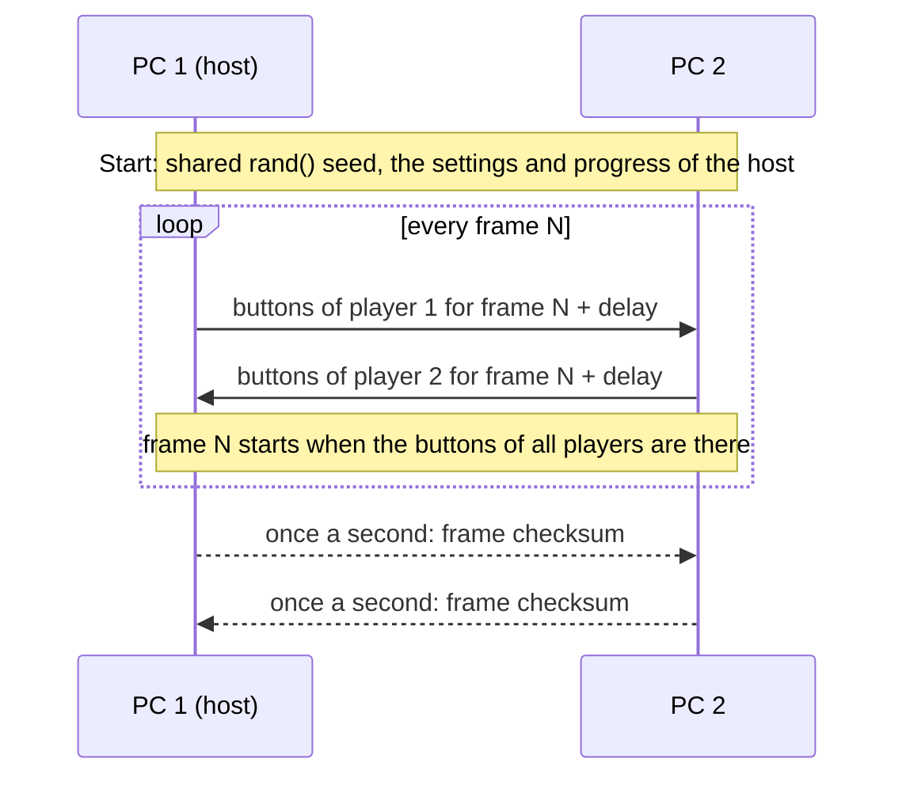

# How it works

[← Home](../../README.en.md) · [Русский](../ARCHITECTURE.md)

This document is for those who want to understand or change the mod. It gives the overall picture;
the addresses, structures and the course of the `TMNT.EXE` research are in
[re/notes.md](../../re/notes.md) (in English), the signatures are in [re/signatures.md](../../re/signatures.md).

**Contents:** [What it is made of](#what-it-is-made-of) · [How the mod gets into the game](#how-the-mod-gets-into-the-game) ·
[Lockstep](#lockstep-the-game-on-every-pc) · [Game on the host only](#the-game-on-the-host-only-mode) · [Determinism](#determinism-what-had-to-be-found) ·
[Four players](#four-players-in-a-game-for-two) · [Own camera](#own-camera-for-each-player) ·
[Menus](#menus-in-the-style-of-the-game) · [Network](#network) · [Protocol](#protocol) · [Modules](#module-map) ·
[How it is tested](#how-it-is-tested)

## What it is made of

| File | What it is | Sources |
|---|---|---|
| `tmntnet.asi` | the mod: a DLL that is loaded into the game's process | `src/mod`, `src/common` |
| `winmm.dll` | Ultimate ASI Loader: loads `.asi` files when the game starts | `third_party/ultimate-asi-loader` |
| `dinput8.dll` | a fallback loader (our own, small) | `src/loader` |
| `tmntnet-client.exe` | the second player's client for the "game on the host only" mode | `src/client` |
| `tmntnet-setup.exe` | the installer: all files are embedded in its resources | `src/setup` |
| `tmntnet-launcher.exe` | [launcher](LAUNCHER.md): versions, updates from GitHub (of itself too), the game's graphics, sound and keys, starting the game; the installer is embedded in its resources | `src/launcher` |

The game is a 32-bit process with no anti-cheat and no ASLR, the engine is RenderWare 3.5
(Direct3D 9), input goes through DirectInput 8, sound through DirectSound and CRI ADX. Everything
is built for **x86**.

## How the mod gets into the game

1. **Loading.** The game imports `winmm.dll`; Ultimate ASI Loader lies next to `TMNT.EXE` under
   that name and loads `tmntnet.asi`. All the setup is done in `InitializeASI`, not in `DllMain`
   (under the loader lock one can neither install hooks nor open sockets).
2. **Finding code by signatures.** The mod does not store "bare" addresses: every place in the
   game's code is found by a byte pattern (`patch::find`). If a pattern is not found or is found
   twice, that feature of the mod is turned off and this is written to the log — the game then
   works as usual.
3. **Three kinds of patches, all in memory:**
   - a hook at the start of a function (MinHook);
   - redirecting a single call (`E8 rel32`) — when the behaviour has to change in one place only
     or when a function cannot be hooked at its start;
   - replacing an import (`GetClientRect`, `IsIconic`).

   The `TMNT.EXE` file on disk is never changed.

## Lockstep: the game on every PC

The mod does not transmit the game state and does not stream the picture. Every copy of the game
computes **the same thing**, getting the same input:



- **One pass of the game's main loop = one logic tick.** There is no `dt` in the game's logic:
  everything is tied to frames. This is what makes lockstep possible.
- **The meeting point** is right after the game has collected the button "masks" of its players
  (`lockstep.cpp`, `hkMasks`). The mod sends its own player's buttons for frame `N + delay`,
  waits for the buttons of all the others for frame `N` and gives them to the game in place of
  its own.
- **The input delay** (2 frames or more) is chosen from the ping when a session starts: this way
  presses arrive before they are needed.
- **Losses do no harm:** every packet carries the buttons of the last 16 frames.
- **Checking.** Once every 60 frames the games exchange a hash (the `rand()` state and the
  buttons). A desync is a `DESYNC` line in the log.
- **Star.** With three and four PCs the host forwards each guest's buttons to the others.
- **Session start.** Everybody stands in the main menu. The host sends out the seed, its
  difficulty settings, the save image and a piece of game data that is not in the save. Starting
  the story is not "pressing buttons for the player": the host puts a service bit into its
  buttons of one frame, and in that same frame every game itself sends its menu the message that
  the "2 ИГРОКА" (2 players) item sends.

### A player left and came back

The host keeps the buttons of all players for every frame of the session. A PC that comes back
starts the session from frame zero with the same initial data and **replays the whole history**
as fast as it can: without waiting for the frame, without sound, without output to the video card
(the rendering itself is still executed — see below why it cannot be skipped), showing the
"ПОДКЛЮЧЕНИЕ К ИГРЕ" (Connecting to the game) screen. When it has almost caught up, the host
announces to everybody the frame from which this player's buttons are its own again.

Skipping the levels already played did not work out: a measurement showed that one level changes
about 360 KB of the game's static data in hundreds of places, and two thirds of them are different
on every PC (pointers, buffers, clocks). Picking "what matters" out of them without the risk of a
desync is impossible.

## The "game on the host only" mode

The mod's first mode, without lockstep: the game runs only on the host, and `tmntnet-client.exe`
on the second player's PC reads their gamepad (SDL2) or keyboard and sends the presses 120 times a
second. The mod on the host hooks `IDirectInputDevice8A::GetDeviceState` and, in the 256-byte
keyboard state, sets player 2's keys taken from the game's live key table (so a rebinding made in
the game's menu is picked up). The game thread does not wait for the network: the hook reads the
latest presses from an atomic buffer, and short presses are held for at least one frame. If the
connection is lost, after a second the hero releases the buttons and stands still.

## Determinism: what had to be found

For two copies to compute the same thing, **everything** the logic depends on must be the same.
In a 2003 game written with no thought of networking there turned out to be many such
dependencies. Every row of the table is a desync found in the lab or in a real game.

| What desynced | Why | What was done |
|---|---|---|
| Random numbers | `rand()` from the CRT, a state of its own per thread; 1050 call sites | a shared seed at the start of a session; the hash includes the `rand()` state |
| Level loading | reading files and sound banks took a different number of frames | loads are carried through to the end inside the frame, the same on all PCs |
| Voices | the end of a line was determined by the real time of the sound | in a session a line ends by a frame counter |
| Frame skipping | on a slow PC the game itself skips the rendering of a frame | in a session skipping is turned off |
| Data outside the save | the "splashes on water" flag lies in memory outside the save image: the host had it, the guest did not | this piece of data is sent at the start of a session |
| **Rendering plays the game** | a character's rendering function checks whether it is visible and only then draws the shadow, and a shadow on water rolls dice for a splash and creates an object | see below |
| Different screen aspect ratio | at 16:9 more gets into the frame than at 4:3 → different `rand()` calls | in a session the "is it visible" question gets one answer on all PCs |
| Own camera | every PC draws its own view | "visible" = visible to the shared camera **or** to the camera of any player |
| Window repaint | on `WM_PAINT` the game draws an extra frame outside its loop | in a session the mod answers `WM_PAINT` itself |
| Minimized window | RenderWare does not draw at all for a minimized window | in a session the game is told that the window is not minimized |
| Reading the keyboard directly | pause and key capture read the device past the players' "masks" | the raw buffers are zeroed in a session; pause goes as a bit in the player's buttons |
| Character auto-select | ran by the wall clock | turned off in a session |
| Menus | both players moved the cursor, each in their own game | the main menu, the story menu and the map are led by the host only |

### "Rendering plays the game"

The main surprise of this game. The character rendering function (`0x4a5012`) first checks whether
the character falls inside the view frustum of the camera that is drawing now, sets its "on
screen" flag (enemy AI reads it later) and only then calls its draw function. And that one draws
the shadow; a shadow on water calls `rand()` and may create a splash — a new game object and
several more `rand()` calls.

The consequence: **whatever got into the frame has affected the game.** Two PCs with a different
picture — another aspect ratio, another field of view, an own camera, a minimized window, an extra
repaint — desync within a few seconds.

The solution (`own_camera.cpp`, `widescreen.cpp`, `display.cpp`):

- The visibility check is hooked. In a session it answers not by what is drawn on this PC but by
  a rule that is the same for everybody: an object "is drawn" if it is visible to the game's
  shared camera or to the camera of any of the players with a large margin in width, and is "on
  screen" if it is visible in a 16:9 window.
- The PC's real picture (its resolution, field of view, own camera) is put into the camera only
  for the time of outputting the frame and is removed right after — the game does not see it.
- The rendering cannot fail to run: neither because of a minimized window nor because of frame
  skipping, and it cannot run an extra time.

## Four players in a game for two

The game has two player slots: two entries in the table, two "pads", two places in the interface.
The mod does not extend the game's tables (they are static and used in hundreds of places) but
adds its own:

- All accesses to the player table and to the input slots go through small accessor functions in
  the game. They are hooked: for players 1 and 2 the game answers, for 3 and 4 the mod's tables
  do (`four_players.cpp`).
- The turtles of players 3 and 4 are created by the same game function as the first two.
- The camera, enemy AI, collisions and hits check "is this a player?" — these checks are
  extended.
- The health panels of players 3 and 4 are drawn from the same pictures of the game
  (`four_hud.cpp`), the character select screen repeats the second player's states for them
  (`csel.cpp`), all four stand on the level map (`map_turtles.cpp`).
- Team rules (`revive.cpp`): a fallen turtle is stunned, not killed; it is raised by holding a
  button.
- Team progress (`team_progress.cpp`): the game keeps its progress by character and writes it for
  the first player's character alone — the dojo's prize (`0x4109bf`, `0x4109e6`, `0x410a0d`), the
  stage played (`0x410bae`) and everything a stage opens (`0x40f939`: the "story cleared" mark,
  the costume, the notices). The mod repeats the game's own calls for every turtle that played the
  stage; for the third of them the game hears that turtle's character in place of the first
  player's meanwhile.
- The game keeps the players near the shared camera with an "invisible circle"; in a session the
  circle is removed.

## Own camera for each player

The game has one camera for all, and it takes part in the logic (the movement direction and
"visibility" depend on it), so it stays shared and the same on all PCs. In addition, every frame
the game's native "follow" camera is run once more **for each player alone** — the way the game
would show the level to that player alone. These views are the same on all PCs (they are needed
for the visibility rule), and the view of the player whose PC this is gets put into the frame. On
a level change the views are reset.

## Menus in the style of the game

The mod does not draw a window of its own over the game. Its settings are rows added to the native
options pages (the game's item tables are extended; the cursor, the sounds and "По умолчанию"
(Default) work as they do for the game's rows), and the **СЕТЕВАЯ ИГРА** (Network game) page is
assembled from the same backgrounds, plates and fonts
(`native_menu.cpp`, `option_pages.cpp`, `main_menu.cpp`).

The labels in the game's menus are not text but pictures. So the mod's Russian words are
**composed of letters cut out of the game's own pictures** (`game_text.cpp`): every menu font has
its own set, and the missing letters are assembled from parts of the existing ones.

## Network

The network runs in its own thread; the transport is hidden behind the `ITransport` interface
(`src/common/transport.h`) with two channels: a reliable one (control) and an unreliable one (input).

| Transport | When | Notes |
|---|---|---|
| **Steam** | over the internet | `ISteamNetworkingMessages`, a "friends only" lobby, invites. AppID 480 (Spacewar) is used. `steam_api.dll` is delay-loaded: without it the mod works over ENet |
| **ENet** | LAN, VPN, direct IP | UDP 7777; host discovery — broadcast UDP 7778 |
| **Steam mock** | lab | lobby and session logic without Steam and accounts: messages over localhost, lobbies are files |

The host accepts Steam sessions only from the members of its lobby and from the `allow_steamid`
list. On connecting, the protocol version and the SHA-256 of the `TMNT.EXE` file are compared.

## Protocol

The packet format is in [src/common/protocol.h](../../src/common/protocol.h): little-endian,
packed structures, no pointers. The version number (`kVersion`) is increased on any change of the
format **or of the meaning** — including when behaviour that must be the same on all PCs
changes.

| Packet | Direction | Purpose |
|---|---|---|
| `Hello` / `HelloAck` / `Reject` | guest ↔ host | introduction: version, exe hash, name |
| `Barrier` | both | "my game is ready to start" and where it is now (in a menu, in a level, paused) |
| `LsStart`, `LsSave` | host → guests | session start: seed, delay, settings, save image |
| `LsInput` | all | the buttons of one's own player for the last 16 frames |
| `LsHash` | all | frame checksum |
| `LsNames` | host → guests | player names |
| `LsLeave` | host → guests | a player left: from such-and-such frame there are no buttons of theirs |
| `LsHistory`, `LsCatchup`, `LsReturn` | host ↔ returning player | button history, catch-up progress, return frame |
| `Input` | client → host | "game on the host only" mode: player 2's buttons |

## Module map

```text
src/common/   protocol, config (tmntnet.ini), log, sha256, transports (ENet, Steam, mock), lobby
src/mod/      tmntnet.asi
  dllmain          startup, crash log, hang watchdog, log keeping
  patch            signature search, in-memory patches, MinHook
  lockstep         session: buttons by frame, waiting, hashes, history, catch-up
  net_host / net_peer / ls_guest   host, guest, packet exchange
  four_players     players 3 and 4: entries, input slots, creating the turtles
  own_camera       own cameras and the shared "what is on screen" rule
  widescreen       Hor+, 4:3 interface, full-width menus
  display          window modes, focus, WM_PAINT, minimized window
  csel / csel_art / costume        turtle and costume select
  revive           stunned turtles and raising them
  team_progress    the dojo's prizes, the story's progress and what a stage opens, for every turtle of the team
  net_pause        pause in a network game
  native_menu / main_menu / option_pages / net_pages / game_text   menus in the style of the game
  four_hud / nametags / map_turtles   panels, names, level map
  dinput_hook / binds / keyconf    input, key table, mouse
  audio / voice_sync               movie volume, voices by frame
  ending_guard     an ending ended before its own end (the window closed) takes its tasks with it
  autosave / load_guard / quality / ambient / overlay   the rest
src/client/   tmntnet-client.exe (SDL2, ImGui)
src/setup/    tmntnet-setup.exe
src/launcher/ tmntnet-launcher.exe (Direct2D, WinINet)
src/loader/   fallback loader dinput8.dll
tests/        stand-in game and tests without the game
re/           reverse-engineering notes, signatures
```

## How it is tested

Network bugs in lockstep are insidious: the game keeps going, only what the players see on their
screens gradually becomes different. So every change that touches the logic is checked in the
lab — on several copies of the game on one PC:

- **Frame log.** With `[debug] frame_log=1` every copy writes, for every frame, the `rand()`
  state, the buttons and the number of `rand()` calls. The logs of two to four copies are
  compared: the first differing line is the frame of the desync.
- **Who called `rand()`.** With `rand_trace=1` the return addresses of all the calls of a frame
  go into the log. An extra call on one of the copies shows at once which code ran differently.
- **Scenarios by frame.** Keys are "pressed" by frame number (`frame_keys`), so a run is
  reproducible. A level can be finished with the game's native flag (`stage_over_at`) to get to
  the next one without playing it through.
- **Bad conditions on purpose:** delay and losses in the network mock, a forced repaint and
  minimizing of the window, one of the copies leaving and coming back in the middle of a level.

More about building, tests and the lab keys is in [BUILDING.md](BUILDING.md).
