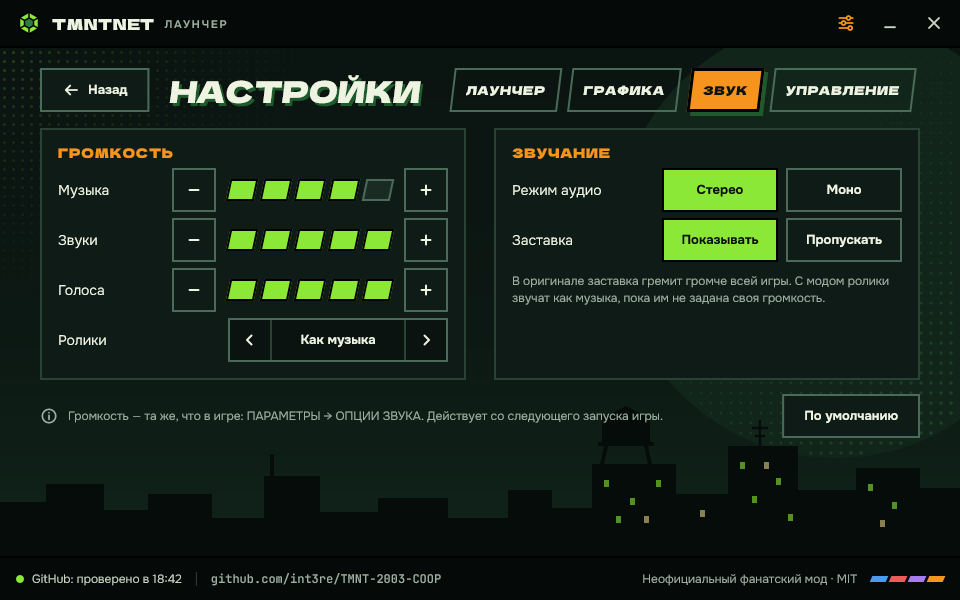
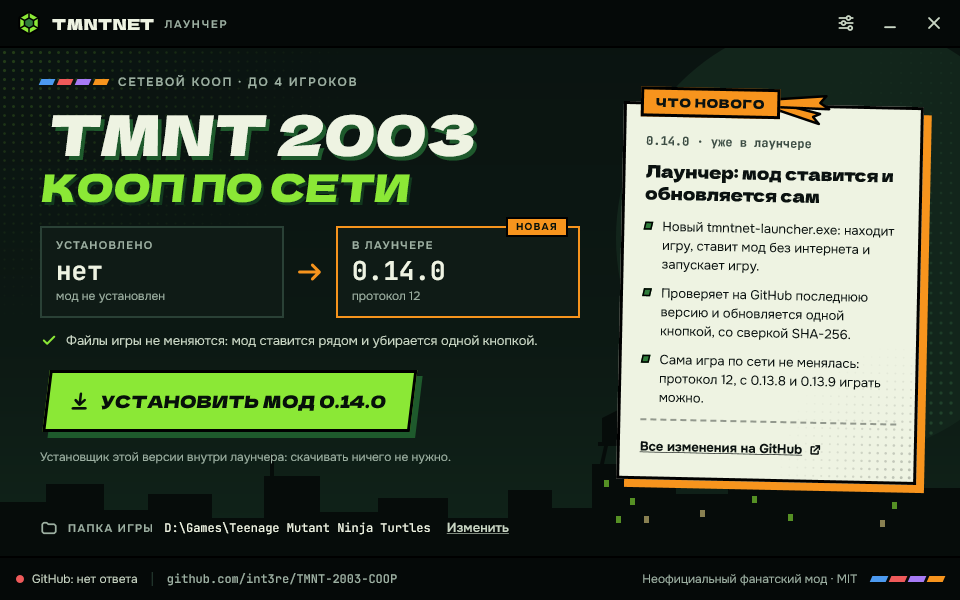
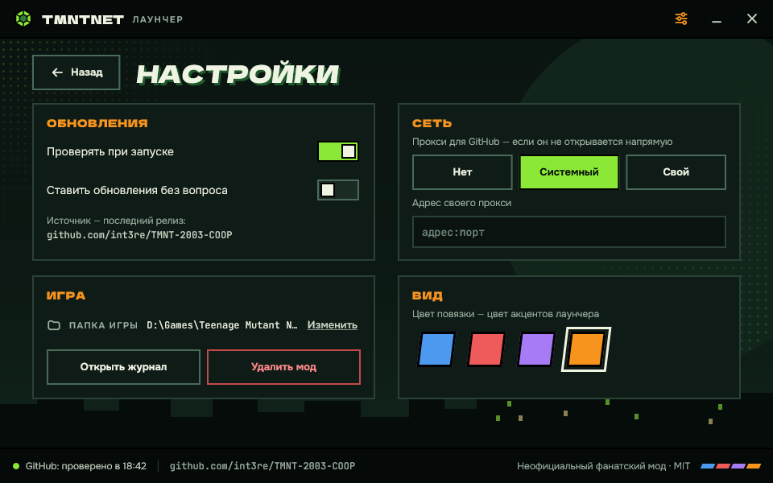

# Launcher

[← Home](../../README.en.md) · [Русский](../LAUNCHER.md)

`tmntnet-launcher.exe` is the one file a player starts with: it finds the game, installs the
mod, watches for new versions on GitHub, updates the mod with one button, updates itself,
changes the game's graphics, sound and keys, and starts the game. It appeared in version 0.14.0;
the «Графика» (Graphics), «Звук» (Sound) and «Управление» (Controls) pages and updating itself
at start came with 0.15.0.


- [What it does](#what-it-does)
- [First installation](#first-installation)
- [Updating](#updating)
- [The launcher updates itself](#the-launcher-updates-itself)
- [Game graphics and sound](#game-graphics-and-sound)
- [Controls](#controls)
- [If GitHub does not open](#if-github-does-not-open)
- [Settings](#settings)
- [What it writes and where](#what-it-writes-and-where)
- [How it learns about a new version](#how-it-learns-about-a-new-version)
- [For developers](#for-developers)

## What it does

| On screen | What it means |
|---|---|
| **УСТАНОВЛЕНО** (Installed) | the mod version in the game folder (from `tmntnet-install.txt`) or «нет» (none) |
| **НА GITHUB** (On GitHub) | the latest version in the [releases](https://github.com/int3re/TMNT-2003-COOP/releases) and its network protocol |
| **В ЛАУНЧЕРЕ** (In the launcher) | the version whose installer lies inside the launcher itself (shown when GitHub did not answer or the version there is older) |
| the line under the versions | whether you can play with friends who have not updated yet: «протокол тот же» (the protocol is the same) or «обновиться нужно всем» (everybody has to update) |
| the sheet on the right | what is new in the latest version |
| the big button | **УСТАНОВИТЬ МОД** (Install the mod), **ОБНОВИТЬ ДО …** (Update to …) or **ИГРАТЬ** (Play) — whichever is needed now |
| the bottom line | the state of the connection to GitHub and the time of the last check |

The launcher does not change the game's files and does not bring them with it: you need your
own copy of Teenage Mutant Ninja Turtles (2003).

## First installation

1. Download `tmntnet-launcher.exe` from the [latest release](https://github.com/int3re/TMNT-2003-COOP/releases/latest)
   page and run it. The file can be put anywhere.
2. The launcher finds the game folder by itself (by the installation record in Windows, or if
   it lies next to `TMNT.EXE`). If it did not find it, use the **ВЫБРАТЬ ПАПКУ ИГРЫ** (Choose
   the game folder) button.
3. Press **УСТАНОВИТЬ МОД** (Install the mod). No internet is needed for this: the installer of
   its own version lies inside the launcher.
4. Once the mod is in place, the big button becomes **ИГРАТЬ** (Play).

| First start | The mod is in place |
|---|---|
|  |  |

If the game is running, the launcher waits until you close it and then continues by itself. If
the game is installed in `Program Files`, Windows asks for administrator permission.

> [!NOTE]
> The launcher is not signed with a certificate, so Windows may show the "Windows protected
> your PC" window. Press **"More info" → "Run anyway"**. The SHA-256 checksum of the file is
> given in the description of every release; the source code is in `src/launcher`.

## Updating

At every start the launcher asks GitHub for the latest version. If it is newer than the
installed one, the big button becomes **ОБНОВИТЬ ДО …** (Update to …):

1. the launcher of the new version is downloaded (the installer lies inside it too) — about
   7.5 MB;
2. its SHA-256 is compared with the one given in the release; a file with a different checksum
   is not run and is deleted;
3. the new launcher takes the place of the old one, starts and installs the mod.


The mod's settings, the keys and the saves are kept through an update. The **ИГРАТЬ НА …**
(Play on …) button next to it starts the game on the current version without updating: an
update is never mandatory in itself. It is mandatory only for playing together, when the new
version has a different network protocol — and that is what the line under the versions says.

If the launcher lies in a folder that cannot be written to, it cannot replace itself. In that
case it downloads the installer of the new version (`tmntnet-setup.exe`), checks it and runs
it — the mod is updated and the launcher stays as it was.

## The launcher updates itself

Since version 0.15.0 the launcher does not wait for a button to update **itself**. If at start
(or after the **ПРОВЕРИТЬ ОБНОВЛЕНИЯ** (Check for updates) button) GitHub answers that a newer
version is out, the launcher at once downloads the new `tmntnet-launcher.exe`, checks its
SHA-256, replaces itself with it and restarts. This takes a few seconds.


- **The mod in the game folder does not change at that.** The new launcher shows the
  **ОБНОВИТЬ ДО …** (Update to …) button — the installer of the new version is already inside
  it, nothing more has to be downloaded. Whether to update the mod now is up to you: if the new
  version has a different network protocol, it is worth updating together with your friends.
- **ОТМЕНА** (Cancel) stops the download: the launcher stays as it was until the next start.
- It tries once per start. If that did not work (no connection to the download server, a file
  with a different checksum, the launcher's folder closed for writing), everything else works
  as before.
- It is switched off in the settings: **ЛАУНЧЕР → Обновлять лаунчер при запуске** (Launcher →
  Update the launcher at start). Then a new version is installed with the button, as described
  above.
- Together with **Ставить обновления мода без вопроса** (Install mod updates without asking)
  the launcher updates both itself and the mod in one go.
- Launcher 0.14.0 does not update itself yet: in it, press **ОБНОВИТЬ ДО …** once.

## Game graphics and sound

The launcher's settings (the icon in the top right corner) have four tabs: **ЛАУНЧЕР**
(Launcher), **ГРАФИКА** (Graphics), **ЗВУК** (Sound) and **УПРАВЛЕНИЕ** (Controls). The
graphics and sound tabs hold the same rows as the menu of the game itself (**ПАРАМЕТРЫ →
ПАРАМЕТРЫ ГРАФИКИ** (Options → Graphics options) and **ОПЦИИ ЗВУКА** (Sound options)), only
the game does not have to be started for that. A change is written at once and takes effect
from the next start of the game.

| ГРАФИКА | ЗВУК |
|---|---|
|  |  |

| Row | Values | Where it is stored |
|---|---|---|
| **Окно игры** (Game window) | full screen, borderless, windowed | `tmntnet.ini`, `[video] display` |
| **Разрешение** (Resolution) | the desktop's or one of the monitor's resolutions | `[video] resolution` |
| **Широкий формат** (Wide screen) | on / off | `[video] widescreen` |
| **По бокам от 4:3** (Beside 4:3 pictures) | what is at the sides of 4:3 pictures: blurred, dark, stretch the background, stretch everything | `[video] fullscreen_images`, `hud`, `side_bars` |
| **Игра идёт в фоне** (Game runs in the background) | do not pause when the window is not active | `[video] background` |
| **Обзор камеры** (Field of view) | as in the game, 110 … 150 % | `[video] fov` |
| **Панели игроков** (Player panels) | as in the game, 90 … 50 % | `[video] hud_size` |
| **Качество** (Quality) | as in the game, high (4x anti-aliasing, 16x textures), maximum (8x) | `[video] antialiasing`, `anisotropy` |
| **Лимит кадров** (Frame limit) | none, 30, 60, 120, 144 | `[video] fps_limit` |
| **Верт. синхронизация** (Vertical sync) | vertical synchronisation (a frame is shown in step with the monitor's refresh: no "tearing" of the picture): as in the game, on, off | `[video] vsync` |
| **Музыка, Звуки, Голоса** (Music, Effects, Voices) | five steps, like the game's sliders | the game's `savesetting.dat` |
| **Ролики** (Movies) | same as the music or a volume of its own, 1 … 5 | `tmntnet.ini`, `[audio] movie_level` |
| **Режим аудио** (Audio mode) | stereo / mono | the game's `savesetting.dat` |
| **Заставка** (Intro) | show or skip at start | `[audio] intro` |

The **По умолчанию** (Defaults) button returns the rows of the open tab to the out-of-the-box
settings of the mod and the game; it does not touch the other tab.

Some rows do not always have an effect — that is how the mod works, and it is the same in the
game's menu. The launcher makes such a row grey and writes the reason under the table:

- **Широкий формат выключен** (Wide screen is off) — the picture stays 4:3, as in the original:
  the resolution is then chosen in the menu of the game itself (**ПАРАМЕТРЫ ГРАФИКИ →
  РАЗРЕШЕНИЕ** (Graphics options → Resolution)), and «По бокам от 4:3» is not needed.
- **Окно игры — полный экран** (Game window is full screen) — the game cannot run in the
  background: «Игра идёт в фоне» works in the «Без рамки» (Borderless) and «В окне» (Windowed)
  modes.

When all the rows of a tab are grey, the reason is written under them too:

- **Игра запущена.** (The game is running.) The game reads its settings at start and writes its
  own at exit, so changing them under it is pointless. Close the game — the tab comes alive by
  itself.
- **Мод не установлен.** (The mod is not installed.) The graphics settings, «Ролики» and
  «Заставка» are settings of the mod: they appear together with `tmntnet.ini`.
- **Игра ещё не сохраняла свои настройки.** (The game has not saved its settings yet.) The game
  keeps the volume and the audio mode in `savesetting.dat` and creates it at its first exit.
  Run the game once.
- **Игра хранит настройки в защищённой папке.** (The game keeps its settings in a protected
  folder.) The game is installed in `Program Files` and is run as administrator: run the
  launcher the same way.

> If the game is installed in `Program Files` but is run the usual way, Windows shows it not
> the files of that folder themselves but its personal copies (`%LOCALAPPDATA%\VirtualStore\…`).
> The launcher reads and changes the files the game will see — in that case, these copies.

## Controls

The **УПРАВЛЕНИЕ** (Controls) tab is the game's key table (**ПАРАМЕТРЫ → ПАРАМЕТРЫ УПРАВЛЕНИЯ →
КЛАВИАТУРА** (Options → Control options → Keyboard)) for players 1 and 2: twelve actions and
the key of each. Over the network everybody plays with player 1's keys.


- **To change a key:** click its cell («нажмите…» (press…) appears in it) and press the new
  key. **Esc** or a click elsewhere cancels.
- **A mouse button:** click the cell and then click it again with the mouse button you want:
  left, right, middle or a side one. The cell will show ЛКМ, ПКМ, СКМ, Мышь 4 or Мышь 5 (left,
  right, middle button, Mouse 4 or Mouse 5). In the game the mouse buttons are pressed by the
  mod, so they can be assigned only when the mod is installed.
- **The key is already taken** by another action (of either of the two players) — the actions
  swap keys, as in the table of the game itself.
- **Not every key will do:** the game does not take Enter (it is "start"), Esc (pause) and a
  few others into the table; the launcher says so and waits for another one.
- **Раскладка** (Layout) — both tables at once: **Как в игре** (As in the game), **Два игрока**
  (Two players — two people at one keyboard: player 1 on WASD, player 2 on the arrows and the
  numeric keypad) or **Своя** (Own). Your own keys are remembered: switch to a ready-made
  layout and back — they return (in the game too, in the РАСКЛАДКА row).
- **По умолчанию** (Defaults) — the «Как в игре» layout.
- Gamepad buttons, and which gamepad each player plays with, are set up in the game itself.

The keys are stored in the game's `savesetting.dat`, so the tab, like the volume, comes alive
after the first run of the game and freezes while the game is running. More about the keys
themselves: ["Controls"](CONTROLS.md).

## If GitHub does not open

The launcher writes «GitHub: нет ответа» (GitHub: no answer) at the bottom. This does not
prevent playing or installing the mod from the launcher itself: instead of «НА GITHUB» (On
GitHub) it shows the version it carries itself — «В ЛАУНЧЕРЕ» (In the launcher).



To get the check and the download working:

- **Proxy.** Settings (the icon in the top right corner) → **СЕТЬ** (Network):
  - **Системный** (System) — as in the Windows settings ("Settings → Network & Internet →
    Proxy"); this is the default;
  - **Свой** (Own) — an address of the form `127.0.0.1:8080`: the HTTP proxy port of your
    circumvention program;
  - **Нет** (None) — always directly.
- **Without the launcher.** Download the new `tmntnet-launcher.exe` in a browser from the
  release page and run it instead of the old one: the installer of its own version is inside
  it.

The github.com site and the server from which GitHub serves the release files are different
addresses. Sometimes the first opens and the second does not: then the version is visible, but
the download ends with the error «Сервер загрузок GitHub не отвечает» (GitHub's download server
does not answer). The same proxy cures it.

## Settings

The **ЛАУНЧЕР** (Launcher) tab holds the settings of the launcher itself; the **ГРАФИКА**
(Graphics) and **ЗВУК** (Sound) tabs are described [above](#game-graphics-and-sound),
**УПРАВЛЕНИЕ** (Controls) — [there as well](#controls).



| Setting | What it does |
|---|---|
| **Проверять при запуске** (Check at start) | ask GitHub about a new version at every start; switched off — only by the **ПРОВЕРИТЬ ОБНОВЛЕНИЯ** (Check for updates) button |
| **Обновлять лаунчер при запуске** (Update the launcher at start) | on finding a newer launcher on GitHub, take it at once and restart ([more](#the-launcher-updates-itself)). On by default |
| **Ставить обновления мода без вопроса** (Install mod updates without asking) | on finding a new version, download it at once and install it into the game folder (if the game is not running). Off by default |
| **Прокси** (Proxy) | see [above](#if-github-does-not-open) |
| **Папка игры** (Game folder) | another folder with `TMNT.EXE` |
| **Открыть журнал** (Open the log) | show `tmntnet.log` in the game folder (you are asked to send it when something is wrong) |
| **Удалить мод** (Remove the mod) | two presses: removes the mod from the game folder with the same installer; the game stays as it was before the installation, the saves are not touched |
| **Цвет повязки** (Headband colour) | the colour of the launcher's accents: blue, red, purple or orange |


## What it writes and where

| Where | What |
|---|---|
| `%APPDATA%\tmntnet\launcher.ini` | its settings: game folder, proxy, colour |
| `%LOCALAPPDATA%\tmntnet\cache\` | the installer the mod was installed with (needed for removal), temporary download files, and copies of `tmntnet.ini` and `savesetting.dat` as they were before the first change from the game settings tabs (`*.before-launcher`) |
| the game folder | what the installer puts there (see [Installation](INSTALL.md#what-appears-in-the-game-folder)), and the changes from the «Графика» (Graphics), «Звук» (Sound) and «Управление» (Controls) tabs: the `[video]` and `[audio]` lines in `tmntnet.ini` (the other lines and the comments stay as they were; your own keys, for the time a ready-made layout is on, go to `[mod] custom_keys_1`, `custom_keys_2`), the four volume numbers and the keys of players 1 and 2 in `savesetting.dat` |
| next to itself | at an update — the new file instead of itself; the old one is renamed to `.old` for the time being and deleted at the next start |

The launcher writes nothing to the registry, does not add itself to startup and does not run in
the background: after starting the game it closes.

## How it learns about a new version

Only from the **github.com** site, with two requests:

1. `…/releases/latest` — GitHub answers with a redirect to the page of the latest release; the
   version number is taken from its address;
2. `…/releases.atom` — the release feed; the date, the title, the short notes, the network
   protocol, the sizes and the SHA-256 of the files are taken from the description of the
   release in question.

GitHub's programming interface (`api.github.com`) is not used: in some networks it is blocked
although the site itself opens. About itself the launcher tells the server only its name and
version (`tmntnet-launcher/0.15.1`); it sends nothing about the computer, the player or the
folders.

The description of a release made together with the launcher ends with the «Данные для
лаунчера» (Data for the launcher) block — `key=value` lines. Releases before 0.14.0 have no
such block: for them the launcher takes the title and the notes from the text of the
description, and the installer's SHA-256 from the table of files in it.

The files themselves are downloaded from the address `…/releases/download/<version>/<file>`,
which GitHub redirects to its download server. The connection is HTTPS everywhere, with the
certificate checked by the means of Windows.

## For developers

| File | What is in it |
|---|---|
| `src/launcher/launcher.cpp` | the window, the states, the background tasks (check, download, installation), the lab switches |
| `src/launcher/paint.cpp`, `view.h` | the whole drawing of the window from the `View` structure; knows nothing about the network or files |
| `src/launcher/gfx.cpp` | Direct2D / DirectWrite, fonts from resources, writing a picture to PNG |
| `src/launcher/update.cpp` | the latest version on GitHub, parsing the feed, the mod version in the game folder, SHA-256, running the installer |
| `src/launcher/game_settings.cpp` | the rows of the «Графика» (Graphics), «Звук» (Sound) and «Управление» (Controls) tabs: reading and writing `tmntnet.ini` (with the same code as the mod's, `common/config.cpp`), the volume and the keys in `savesetting.dat`; the ready-made layouts; the copies of the files in VirtualStore |
| `src/launcher/net.cpp` | HTTP through WinINet: directly, through the Windows proxy or through a given one |
| `third_party/fonts/` | the window's three fonts (SIL Open Font License) and their licences |
| `tools/release_notes.py`, `dist/release.txt` | the «Данные для лаунчера» (Data for the launcher) block for the release description |

The window is drawn in the units of a 960×600 mock-up and scaled to the monitor. The look was
agreed with the project's author separately; when changing it, check against the screenshots
on this page.

**The pictures for the documentation** are drawn by the launcher itself:
`python tools/launcher_images.py --was 0.14.0` (the version that was there before the release)
refreshes `docs/images/launcher*.png`. They show the release being built — its version and the
notes from `dist/release.txt` — so it is worth redrawing them before every release.

**Checking without a window.** The launcher can draw itself into a file and "press" its own
buttons on a schedule without showing up on the screen:

```text
tmntnet-launcher.exe /shot out.png /state update     a ready-made state into a PNG (update, install, downloading,
                                                     ready, nogame, offline, settings, graphics, sound,
                                                     selfupdate, updated, error, bundle, …)
tmntnet-launcher.exe /ini lab.ini /log lab.log /do primary@2500 /snap out.png /after 9000
                                                     a real run without a window: press the big button
                                                     after 2.5 s, take a picture after 9 s and exit
tmntnet-launcher.exe … /do settings@1500 /do tab_graphics@1800 /do display.next@2100 /do music.b2@2400
                                                     the tabs and rows of the game settings: <row>.prev / .next /
                                                     .switch / .b<number> (display, resolution, wide, sides,
                                                     background, fov, hud, quality, fps, vsync, music,
                                                     effects, voices, movies, stereo, intro)
tmntnet-launcher.exe … /do tab_controls@1800 /do key.jump@2100 /do press.1E@2400 /do layout.next@2700
                                                     keys: key.<action> is a cell (up, down, left,
                                                     right, jump, attack, strong, shuriken, dash, special,
                                                     juggle, change), then press.<DirectInput code, hex>
                                                     or mouse.<button 0..4>; player1 / player2,
                                                     layout.prev / layout.next
```

`tests/run_launcher_lab.ps1` runs twenty-five scenarios this way against a stand-in GitHub
(`tests/launcher_lab_server.py`) and a stand-in game folder: installation from the built-in
installer, "nothing new", a release without the block, a wrong checksum, an update through the
new launcher, a launcher with no right to replace itself, waiting for the game to be closed,
cancelling a download, an update of the launcher alone, removal, installation without a server,
the old launcher starting the new one; the launcher takes the new one by itself at start (and
does not take it a second time, and does not take it when that is switched off), a new launcher
with a wrong checksum; the «Графика» and «Звук» tabs write `tmntnet.ini` and `savesetting.dat`
(only the needed lines and the four numbers change, the comments and the checksum stay in
place), «По умолчанию» (Defaults) returns the files byte for byte, a running game, a game
without `savesetting.dat`, a copy in VirtualStore, a folder closed for writing (an ordinary
game and a game run as administrator); the «Управление» tab: a key for an action, a swap with
the action that had it (the player's own and the other player's), a mouse button, a key the
game does not take, the ready-made layouts and the return of the own one; and an exhaustive
check, `tmntnet-launcher.exe /check "<game folder>"`: every value of every row is written and
read back (`tmntnet.ini` — with the same code the mod reads it with), every action of both
players gets a key and then its own one back, the files stay the same byte for byte. The game
is not started during all this, and the settings and the cache of the real launcher are not
touched.

**Release.** Write the lines for the «Что нового» (What's new) sheet in `dist/release.txt`,
build the project and make the release description:

```text
python tools/release_notes.py заметки.md > описание.md
gh release create v0.14.0 build/Release/tmntnet-launcher.exe build/Release/tmntnet-setup.exe --notes-file описание.md
```

Both files from one build go into a release: the launcher (players and old launchers download
it) and the installer (for a launcher that cannot replace itself and for installing from the
command line).
