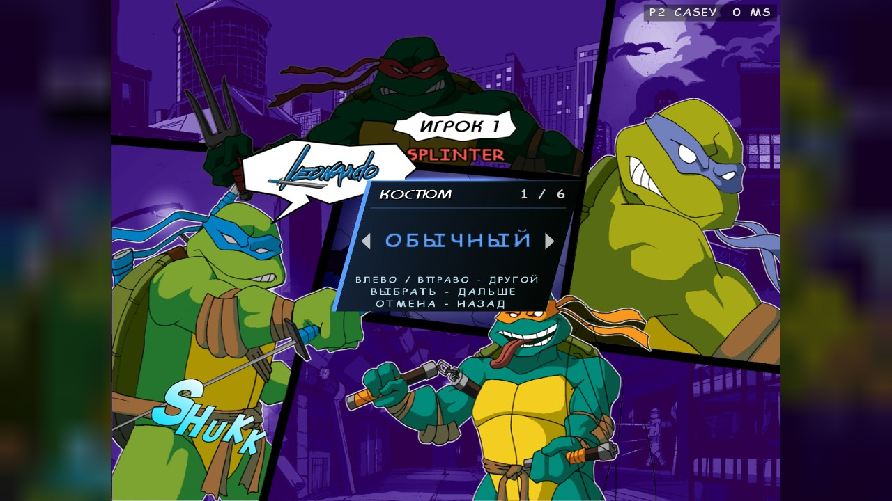
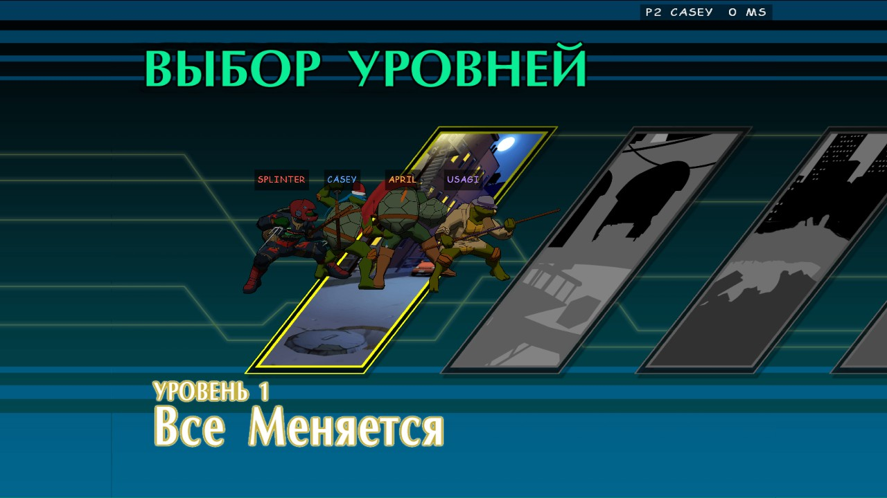

# How to play over the network

[← Home](../../README.en.md) · [Русский](../PLAY.md)

**Contents:** [In short](#in-short) · [For the host](#for-the-host) · [For friends](#for-friends) ·
[Choosing turtles and costumes](#choosing-turtles-and-costumes) · [In a level](#in-a-level) ·
[Pause](#pause) · [Left and came back](#left-and-came-back) · [Whose progress](#whose-progress-and-settings) ·
[Without Steam](#without-steam-local-network-and-vpn) · [At one PC](#three-and-four-players-at-one-pc) ·
[Host-only game](#host-only-game-mode)

## In short

1. Everybody has the same version of the mod installed ([installation](INSTALL.md)) and Steam
   running; you are friends on Steam.
2. Everybody starts the game and stays in the main menu.
3. The host: **СЕТЕВАЯ ИГРА → ПРИГЛАСИТЬ ДРУГА** (Network game → Invite a friend). The friends
   accept the invitation and press **Я ГОТОВ** (I'm ready).
4. The host: **НАЧАТЬ ИГРУ** (Start the game). Turtle select opens for everybody.

Everybody plays in their own copy of the game and sees their own picture. Only button presses go
over the network.


## For the host

Main menu → **СЕТЕВАЯ ИГРА** (Network game). On the right is the **ИГРОКИ** (Players) panel: you
are player 1, three places are free. At the bottom it says what is happening now, plus a hint for
the selected row.

| Row | What it does |
|---|---|
| **НАЧАТЬ ИГРУ** (Start the game) | Turns green when everybody is ready. Starts the shared game and at once opens turtle select for everybody, for the right number of players. |
| **ПРИГЛАСИТЬ ДРУГА** (Invite a friend) | The list of Steam friends (those who have the game running come first). You can invite up to three; the page stays open. |
| **ВОЙТИ К ДРУГУ** (Join a friend) | Play in a friend's game instead of your own. |
| **КОДЫ** (Codes) | The network code, your Steam ID and the lobby number — for joining without an invitation. |
| **ВЫГНАТЬ ИГРОКА** (Kick a player) | Appears when there are players: a list of whom to remove. |


Whoever joined first is player 2, second is player 3, third is player 4. The panel shows each
player's state: **НЕ ГОТОВ** (Not ready) in yellow or **ГОТОВ** (Ready) in green, and the ping.

During a shared game the main menu, the story menu and the level map are led by **the host
only**. Everybody chooses their own turtle and costume.

If Steam is not running, the page will say «СТИМ: ВЫКЛЮЧЕН — ЗАПУСТИТЕ СТИМ» (Steam: off — start
Steam). Start Steam — the mod will pick it up by itself.

**Forgot to invite somebody?** Go back to the main menu (pause → ВЕРНУТЬСЯ В МЕНЮ (Back to menu))
and open СЕТЕВАЯ ИГРА again: the shared game is suspended for everybody and starts anew when you
close the page.

## For friends

1. Start Steam and the game **before** the invitation and stay in the main menu.
2. Accept the invitation in Steam and return to the game window. Or do it yourself: **СЕТЕВАЯ
   ИГРА → ВОЙТИ К ДРУГУ** (Network game → Join a friend) → the host's game.
3. The page of the friend's game opens: all the players on the right, the row **Я ГОТОВ** (I'm
   ready) on the left. Select it. There is no need to close the page — it closes by itself when
   the host starts the game.
4. From then on the host leads the menus, and you control your turtle with your own keys, gamepad
   or mouse.


In the screenshot the guest is already ready: the row has changed to **Я НЕ ГОТОВ** (I'm not
ready; it cancels the readiness), the panel says «ВЫ ГОТОВЫ» (You are ready) next to the guest's
name, and the host is marked with an asterisk. **ОТКЛЮЧИТЬСЯ** (Disconnect) leaves the friend's
game.

Until the game has started, the top of the screen says what is being waited for:

| Message | What it means |
|---|---|
| ЖДЁМ ДРУГА (Waiting for the friend) | the friend is not in the main menu yet (the intro is playing, a page is open) |
| ДРУГ НЕ В ГЛАВНОМ МЕНЮ (The friend is not in the main menu) | the friend is in a level or in the options |
| ИГРА ДРУГА НА ПАУЗЕ (The friend's game is paused) | the friend's game is minimized from full screen: they should return to it |
| ВЫЙДИТЕ В ГЛАВНОЕ МЕНЮ (Go to the main menu) | this one is for you: you are in a level or on another screen |

## Choosing turtles and costumes


- Players choose **in turn**: player 1, player 2, then player 3 and player 4 — from the turtles
  that are left.
- The centre of the screen says whose turn it is and the name of the player who is choosing.
  Taken turtles go dark; under the plate is the player's name in the colour of their turtle's
  mask.
- Having chosen a turtle, the player chooses a **costume**: КОСТЮМ (Costume) opens in the centre.
  Left and right — another costume, "select" — go on, "cancel" — back to the turtles.
- There are six costumes: normal, special, New Year, Halloween, special New Year and special
  Halloween. All of them are unlocked from the start. All players see each other's costumes.
- "Cancel" by players 3 and 4 returns the turn to the previous player.



After the choice the level map opens. The whole team stands on it — in the chosen costumes and
with the players' names; the host chooses the level.



## In a level


- **Own camera.** You see the world around your own turtle, as in a single-player game, and can
  go as far from the others as you like. Above each turtle is the player's name. In movies and
  dialogues the camera is shared. If you want one camera for everybody, as in the original:
  **ПАРАМЕТРЫ → ДРУГИЕ ПАРАМЕТРЫ → КАМЕРА ПО СЕТИ → КАК В ИГРЕ** (Options → Other options →
  Camera in netplay → As in the game); everybody has their own setting.
- **There are no hearts at the top.** A turtle that has run out of life does not die while
  somebody else is still on their feet: it lies stunned with little stars, and the enemies do not
  touch it.
- **To revive a teammate,** stand next to them and hold the **"shuriken change"** button (Left
  Shift by default for player 1) for 4 seconds — a green bar grows above the fallen turtle. You
  cannot attack during that time; if you get hit, the revive starts over. A revived turtle gets
  up with one fifth of its life.
- **The level is lost only when everybody has fallen.**
- **Everybody takes part in the dojo.** In the original the dojo levels (between the maps) are
  played by the first player's turtle alone; in a shared game the whole team gets there, and the
  dojo's intro screen says «Для всей команды» (For the whole team) instead of «Только для
  Игрока 1» (For Player 1 only).
- **Rewards and progress go to the whole team.** In the original everything a cleared level gives
  goes to the first player's turtle alone: the dojo's prize (the jump attack after the first dojo,
  more attack power after the second and the third), the "story cleared" mark, the levels opened.
  In a shared game every turtle that played the level gets it, and the host's save keeps it for
  each of them. The "unlocked…" notices after a level are shown for the whole team, one after
  another.
- **The last boss in one playthrough of four.** The game lets you to Oroku Saki only when the
  story has been cleared by all four turtles: four playthroughs in the original. A team of four
  gets to him right after the last level. A team of two or three has to clear the story once more
  with the turtles that are left. «Гэмбу» (Genbu), the strongest attack, opens the same way: when
  all four turtles have passed the third dojo.
- **Movies end for everybody at the same time.** Players 1 and 2 can skip a movie ("select" or
  "start"); if it is watched to the end, the game waits until it has finished playing on every
  PC.
- **The game waits for everyone.** If somebody's game has frozen (bad connection, a busy
  computer), the picture of the others stands still and waits. After a long wait the top of the
  screen says who was waited for: «ЖДАЛИ ИГРОКА 2: 8 С» (Waited for player 2: 8 s). More than 10
  seconds — that player drops out, the others play on.
- The game window can be minimized, and you can switch to Discord or Steam: the game does not
  stop in the background. For this the window mode must be **БЕЗ РАМКИ** (Borderless; this is
  what the installer sets), not ПОЛНЫЙ ЭКРАН (Full screen).

## Pause


- **Esc by any player** pauses the game for everybody at once. The top of the screen says whose
  pause it is.
- The pause menu is led by the player who paused. **Esc by any player once more** — the game
  continues.
- **ВЕРНУТЬСЯ В МЕНЮ** (Back to menu) takes the whole team from the level to the main menu; the
  shared game does not end by that. This item obeys the host only.
- **УЙТИ** (Leave) closes the game only of the player who chose it. The others play on.
- At the question «ТЫ УВЕРЕН?» (Are you sure?) НЕТ (No) is selected at first: left — ДА (Yes).

## Left and came back

If a player left in the middle of a level (or their game crashed), the others play on, and that
player's turtle stands still. To come back, the player starts the game again and joins the host's
game — by an invitation or through **СЕТЕВАЯ ИГРА → ВОЙТИ К ДРУГУ** (Network game → Join a
friend).


Their game **catches up** with the others: the screen shows «ПОДКЛЮЧЕНИЕ К ИГРЕ» (Connecting to
the game) and a percentage, and there is no sound during that time. Three minutes of play are
caught up in about five seconds, half an hour in about half a minute. When it has caught up,
«СНОВА В ИГРЕ» (Back in the game) appears at the top, and the turtle is theirs again.

Why joining instantly is impossible: the game has no save in the middle of a level, so the
joining PC quickly computes the same game by itself from the button presses of all the players.

Only a player who already took part in this game can come back this way. A new player is invited
by the host from the main menu.

## Whose progress and settings

- For the time of the shared game, **the host's story progress and difficulty** apply to
  everybody.
- The guest's own save is not touched: its copy lies alongside as `savegame.dat.netplay`, and
  after the game (in the main menu or on exit) the guest's progress and settings come back. The
  progress of the shared game stays with the guest as a separate file, `savegame-netplay.dat`.
- If the guest's game crashed, the guest's save comes back at the next start.
- The team rules (reviving the fallen, the revive button) are taken from the host.

## Without Steam: local network and VPN

The mod can also connect directly over UDP (port 7777), without Steam. The list of games in the
**ВОЙТИ К ДРУГУ** (Join a friend) menu is the games of Steam friends, so without Steam the guest
writes the host's address in the settings:

1. **The host** changes nothing (`role=host` is the default) and starts the game.
2. **The guest** opens `tmntnet.ini` next to `TMNT.EXE` and writes in the `[net]` section:
   ```ini
   role=client
   peer=192.168.0.12      ; the host PC's address (a port may be added: 192.168.0.12:7777)
   ```
   After that the guest's game connects to the host by itself at start, and the СЕТЕВАЯ ИГРА
   (Network game) page shows the state of the connection.
3. From there everything is as with Steam: the guests press **Я ГОТОВ** (I'm ready), the host —
   **НАЧАТЬ ИГРУ** (Start the game).

The address is the host's IP in the local network or in a VPN (Radmin VPN, ZeroTier, Tailscale)
if you play over the internet. It also works without a VPN: the host forwards UDP 7777 on the
router, and the guest writes the host's external address.

At the first start Windows will ask whether to allow `tmnt.exe` to access the network: allow it
for private networks.

## Three and four players at one PC

**РЕЖИМ СЮЖЕТА → 1 ИГРОК / 2 ИГРОКА / ТРИ ИГРОКА / ЧЕТЫРЕ ИГРОКА** (Story mode → 1 player /
2 players / Three players / Four players) works without a network too. Players 3 and 4 are
controlled by gamepads or by keys from `tmntnet.ini` (`p3_keys`, `p4_keys`): details are
in ["Controls"](CONTROLS.md#players-3-and-4-at-one-pc).


## "Host-only game" mode

The old mode the mod started with: the game runs only on the host's PC, the second player watches
a stream (Sunshine / Moonlight, Discord) and controls the second hero through a small program,
`tmntnet-client.exe`. It suits the case when the friend does not have the game. For two players
only.

1. The host starts the game, opens **СЕТЕВАЯ ИГРА** (Network game) and tells the friend the code
   (or invites the friend through Steam).
2. The friend starts `tmntnet-client.exe`: the host's game appears in the list, or else the code,
   the IP or the Steam ID is entered.
3. In Story Mode for two, player 2 chooses the turtle on their own, from their own PC.

While the second player is connected, the keys and the gamepad of player 2 on the host's PC do
nothing — somebody else's hero cannot be moved by accident.

> [!WARNING]
> When streaming, the second player's input must go **only** through tmntnet. In Sunshine, turn
> off gamepad and keyboard passthrough (Configuration → Input), otherwise the friend's gamepad
> will get into the game twice.

The client's keys and buttons: ["Controls"](CONTROLS.md#client-of-the-host-only-game-mode).

## What to know about Steam

- On Steam everybody will have the status **"Playing Spacewar"**. It is Valve's free test
  application (AppID 480) through which such mods use the Steam network. There is no need to
  install it.
- The Steam overlay (Shift+Tab) is disabled in the game.
- Outsiders cannot connect: the host accepts only the members of its own lobby, and the lobby is
  visible to friends only. To make the game visible to everybody: `lobby_type=public` in
  `tmntnet.ini`.
- Steam first connects through its own servers and finds a direct route a few seconds later.
  The input delay is chosen by the ping automatically.
