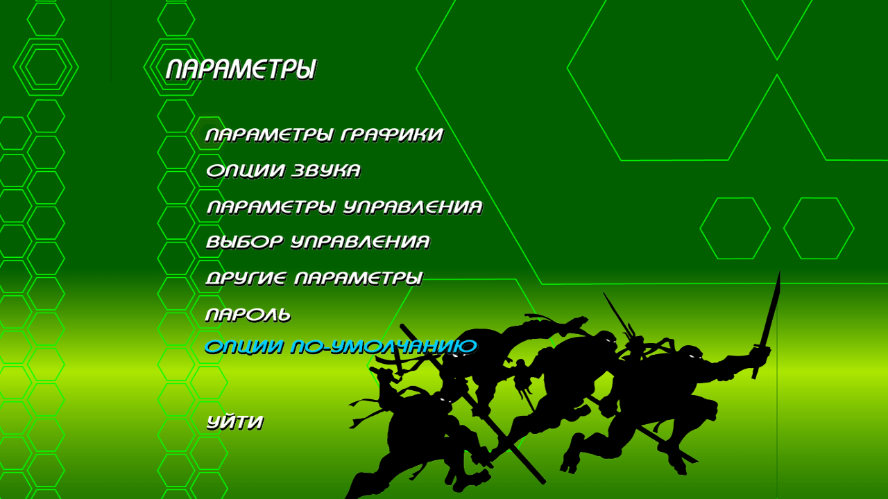
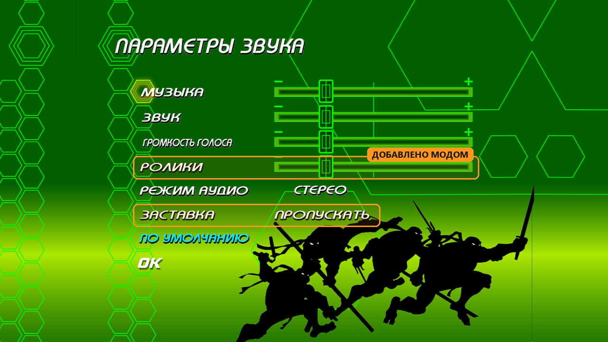
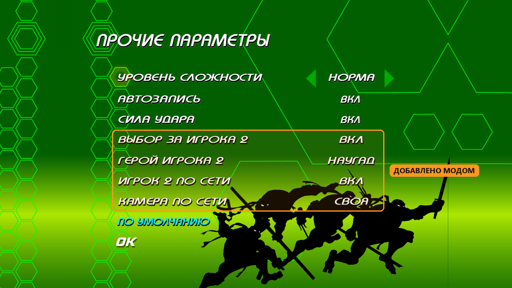
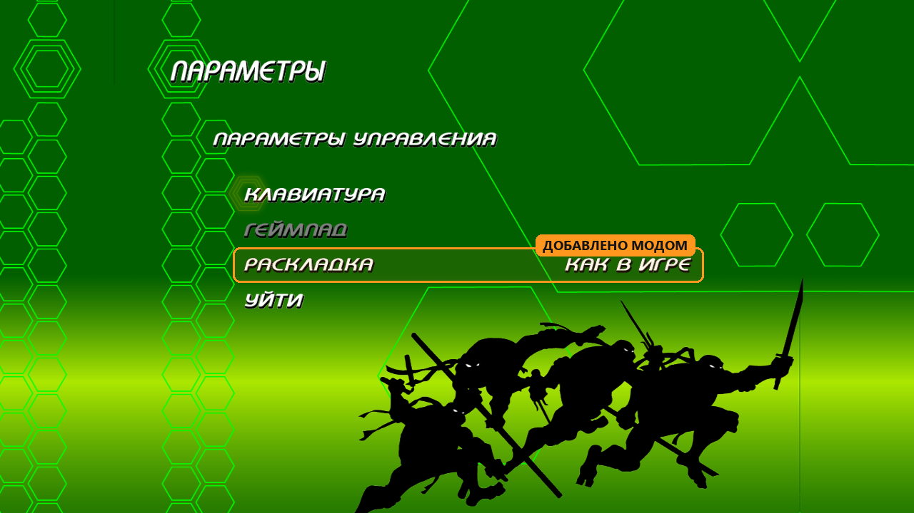

# Settings

[← Home](../../README.en.md) · [Русский](../SETTINGS.md)

Almost everything is set up **in the game's own menu**. The `tmntnet.ini` file next to `TMNT.EXE` is
needed for rarely used parameters; changes made in the menu are written to the same file. Graphics,
sound and keys can also be changed without starting the game — on the **ГРАФИКА** (Graphics),
**ЗВУК** (Sound) and **УПРАВЛЕНИЕ** (Controls) tabs in the settings of the [launcher](LAUNCHER.md#game-graphics-and-sound):
the rows there are the same.

**Contents:** [In the game menu](#in-the-game-menu) · [`[net]`](#net--network) · [`[mod]`](#mod--game) ·
[`[video]`](#video--screen) · [`[audio]`](#audio--sound) · [`[mouse]`](#mouse--mouse) ·
[`[ui]`](#ui--interface) · [`[log]`](#log--log) · [Client](#client-pad-keys--client)

## In the game menu

The mod's rows sit on the game's native **ПАРАМЕТРЫ** (Options) pages among the game's own rows and
work the same way: up and down — rows, left and right — the value, **OK** saves, «отмена» (Cancel)
restores what was there, «По умолчанию» (Defaults) resets. If something takes effect only after a
restart, «НУЖЕН ПЕРЕЗАПУСК ИГРЫ» (The game must be restarted) appears at the top.

In the screenshots the mod's rows are outlined with an **orange frame**; in the tables they are in
bold. The same overview with "before and after" notes is in the [tour in pictures](TOUR.md).

### ПАРАМЕТРЫ ГРАФИКИ (Graphics options)

| Row | Values |
|---|---|
| РАЗРЕШЕНИЕ (Resolution) | shown right in the row; «выбрать» (Select) opens the game's list |
| **ОКНО ИГРЫ** (Game window) | full screen, borderless, windowed |
| **ШИРОКИЙ ФОРМАТ** (Wide screen) | on / off (after a restart) |
| **ПО БОКАМ** (Sides) | what is at the sides of 4:3 pictures (movies, character select): blurred, dark, stretch the background, stretch everything |
| **ОБЗОР** (Field of view) | the camera sees wider: as in the game, 110 … 150 %. Picture only: friends in a network game may have different values |
| **ПАНЕЛИ** (Panels) | the life and score panels are smaller: as in the game, 90 … 50 % |
| **КАЧЕСТВО** (Quality) | as in the game; ВЫСОКОЕ (High) — 4x anti-aliasing and sharp textures (16x); МАКСИМУМ (Maximum) — 8x anti-aliasing. Changes at once |
| **ЛИМИТ КАДРОВ** (Frame limit) | none, 30, 60, 120, 144 |
| **ИГРА В ФОНЕ** (Run in background) | do not pause when the window is not active (after a restart). In a network game the game always runs in the background |

### ПАРАМЕТРЫ ЗВУКА (Sound options)

In the list of options this page is called **ОПЦИИ ЗВУКА** (Sound options).

| Row | Values |
|---|---|
| **РОЛИКИ** (Movies) | movie volume; until the slider has been touched, movies sound like the music. In the original the intro blares louder than the whole game |
| **ЗАСТАВКА** (Intro) | show or skip at start-up |

### ПРОЧИЕ ПАРАМЕТРЫ (Other options)

In the list of options — **ДРУГИЕ ПАРАМЕТРЫ** (Other options).

| Row | Values |
|---|---|
| АВТОЗАПИСЬ (Autosave) | with the mod — a save after every completed level |
| **ВЫБОР ЗА ИГРОКА 2** (Pick for player 2) | on one PC: pick a turtle for the second player if they do not pick one themselves |
| **ГЕРОЙ ИГРОКА 2** (Player 2's hero) | which one: at random or the first free one |
| **ИГРОК 2 ПО СЕТИ** (Player 2 over the network) | in the "host-only game" mode player 2's keys on the host's PC do not work |
| **КАМЕРА ПО СЕТИ** (Camera in netplay) | СВОЯ (Own) — everyone has their own camera; КАК В ИГРЕ (As in the game) — one for all |

### ПАРАМЕТРЫ УПРАВЛЕНИЯ (Control options)

**РАСКЛАДКА** (Layout) — as in the game or "two players" on one keyboard. In the **КЛАВИАТУРА**
(Keyboard) table mouse buttons can be assigned. More: ["Controls"](CONTROLS.md).

### СЕТЕВАЯ ИГРА (Network game)

A main menu item; described in ["How to play over the network"](PLAY.md#for-the-host).

---

## `tmntnet.ini` reference

The file is in UTF-8 encoding. A comment follows `;`. Default values are in bold.

### `[net]` — network

| Key | Values | What it does |
|---|---|---|
| `role` | **`host`**, `client` | `client` — this game connects to the host itself at the `peer` address (play without Steam) |
| `peer` | address | for `client`: the host's IP, optionally with a port. For `host`: if set, accept connections only from this IP |
| `port` | **`7777`** | UDP port |
| `discovery_port` | **`7778`** | port for finding the host on the local network (for the client of the "host-only game" mode) |
| `input_delay` | **`2`** | the smallest input delay in frames; the real one is chosen by the ping and is never less than this |
| `timeout_ms` | **`1000`** | "host-only game" mode: after how long without a connection player 2's hero releases the buttons |
| `name` | text | the name above your turtle. Empty — the Steam name; without Steam — the computer's name |
| `transport` | **`auto`**, `steam`, `enet` | `auto` — Steam and a direct connection at the same time; `steam` — Steam only; `enet` — direct only, do not touch Steam |
| `lobby_type` | **`friends`**, `public` | who can see the host's lobby in Steam |
| `host_steamid` | SteamID64 or a profile link | for `client`: connect to the host through Steam directly |
| `allow_steamid` | SteamID64s separated by commas | host: whom to let in without a lobby |

### `[mod]` — game

| Key | Values | What it does |
|---|---|---|
| `players` | **`2`**, `3`, `4` | how many play the story on one PC. The choice in the РЕЖИМ СЮЖЕТА (Story mode) menu overrides this line |
| `revive` | **`1`**, `0` | team rules: a fallen turtle is stunned and can be revived; `0` — as in the game (hearts, death) |
| `revive_button` | **`shuriken_change`**, `dash`, `juggle`, `special`, `shuriken`, `jump`, `attack`, `strong` | the button that revives a teammate |
| `autosave` | **`1`**, `0` | a save after every completed level; `0` — as in the game |
| `p3_keys`, `p4_keys` | 16 DIK codes | keys of players 3 and 4 on this keyboard, see ["Controls"](CONTROLS.md#players-3-and-4-at-one-pc) |
| `p3_pad`, `p4_pad` | **`auto`**, `0`, number | gamepads of players 3 and 4 |
| `p2_binds` | **`auto`**, `ini` | where to take player 2's keys from for the "host-only game" mode: from the game or from `p2_keys` |
| `p2_keys` | 16 DIK codes | player 2's keys for `p2_binds=ini` |
| `p2_lock` | **`1`**, `0` | "host-only game" mode: while a friend is connected, player 2's keys and gamepad on the host's PC do not work |
| `p2_autopick` | **`1`**, `0` | on one PC: pick a turtle for player 2 if they have not touched the cursor |
| `p2_autopick_delay_ms` | **`1500`** | after how long to pick |
| `p2_character` | **`auto`**, `first` | a random free turtle or the first free one |

### `[video]` — screen

| Key | Values | What it does |
|---|---|---|
| `display` | **`borderless`**, `fullscreen`, `windowed` | window mode. `borderless` is recommended: it looks like full screen, Alt+Tab is instant, the network game does not freeze |
| `window_size` | for example `1280x720` | size of the picture in a window; empty — by the resolution |
| `window_resize` | **`1`**, `0` | the window can be stretched with the mouse, the proportions are kept |
| `background` | **`pause`**, `run` | `run` — the game runs even when the window is not active |
| `widescreen` | **`1`**, `0` | `0` — the original 4:3 |
| `resolution` | **`desktop`**, `game`, `1920x1080` | the desktop's resolution, the one from the game's menu, or a given one |
| `refresh` | **`60`** | desired refresh rate, Hz; `0` — as the desktop's |
| `hud` | **`center`**, `stretch` | the interface in the 4:3 centre without distortion, or stretched |
| `hud_corners` | **`1`**, `0` | on a wide screen the players' panels and the radar stand in the corners of the screen |
| `hud_size` | **`100`** … `50` | size of the panels at the top, % |
| `fullscreen_images` | **`pillarbox`**, `stretch` | 4:3 pictures (movies, character select): centred or stretched |
| `side_bars` | **`blur`**, `black` | what is at the sides of 4:3 pictures |
| `wide_menus` | **`1`**, `0` | the background of the main menu, the options and the level select goes on to the edges of the screen |
| `fov` | **`100`** … `150` | the camera's field of view, % of the game's field of view |
| `own_camera` | **`1`**, `0` | in a network game the camera follows your own turtle; `0` — one for all |
| `antialiasing` | `0`, `2`, **`4`**, `8` | edge anti-aliasing (MSAA) |
| `anisotropy` | `0`, `2` … **`16`** | anisotropic texture filtering; `0` — as in the game |
| `vsync` | **`game`**, `on`, `off` | vertical synchronisation |
| `fps_limit` | **`0`** | limit of frames per second; `0` — none |

> Picture settings are each player's own and do not affect the network game: friends may have
> different resolution, field of view and quality.

### `[audio]` — sound

| Key | Values | What it does |
|---|---|---|
| `movie_follow` | **`1`**, `0` | movies sound like the music, by the game's settings; `0` — at full volume, as in the original |
| `movie_level` | **`-1`**, `0` … `4` | the movies' own volume; `-1` — like the music |
| `movie_volume` | **`100`** | and quieter still: % of that |
| `intro` | **`play`**, `skip` | the intro at start-up |

### `[mouse]` — mouse

Mouse buttons are easier to assign in the game (see ["Controls"](CONTROLS.md#mouse)). Here a button can be
**added** to a key so that both work.

| Key | Values | What it does |
|---|---|---|
| `player` | **`1`**, `2`, `0` | whose buttons by default; `0` — the additions are off |
| `left`, `right`, `middle`, `x1`, `x2` | action | `attack`, `strong`, `jump`, `shuriken`, `shuriken_change`, `dash`, `juggle`, `special`, `start`, `pause`, `move_up`, `move_down`, `move_left`, `move_right`; `2:attack` — player 2's attack |

### `[ui]` — interface

| Key | Values | What it does |
|---|---|---|
| `nametags` | **`1`**, `0` | players' names above the turtles in a network game |
| `menu_label` | text | the label of the item in the main menu; empty — СЕТЕВАЯ ИГРА (Network game) |
| `debug_window` | **`0`**, `1` | F2 opens the mod's service window on top of the game |

### `[log]` — log

| Key | Values | What it does |
|---|---|---|
| `log_level` | `error`, `warn`, **`info`**, `debug` | how detailed `tmntnet.log` is |

### `[client]`, `[pad]`, `[keys]` — client

Only for `tmntnet-client.exe` (the ["host-only game" mode](PLAY.md#host-only-game-mode)).

| Key | Values | What it does |
|---|---|---|
| `pad` | **`-1`**, number | which gamepad to read; `-1` — the first connected one |
| `keyboard` | **`1`**, `0` | read the keyboard |
| `send_hz` | **`120`** | how often button presses are sent |
| `stick_deadzone` | **`16000`** | stick threshold (out of 32767) |

In `[pad]` and `[keys]` each action (`jump`, `attack`, `strong`, `shuriken`, `dash`,
`shuriken_change`, `special`, `juggle`, `start`, `pause`, and in `[keys]` also `up`, `down`, `left`,
`right`) is mapped to gamepad buttons in the Xbox layout (`A`, `B`, `X`, `Y`, `LB`, `RB`, `LT`,
`RT`, `BACK`, `START`) or to keys (`Z`, `SPACE`, `NUMPAD4`, `0x41`…).
