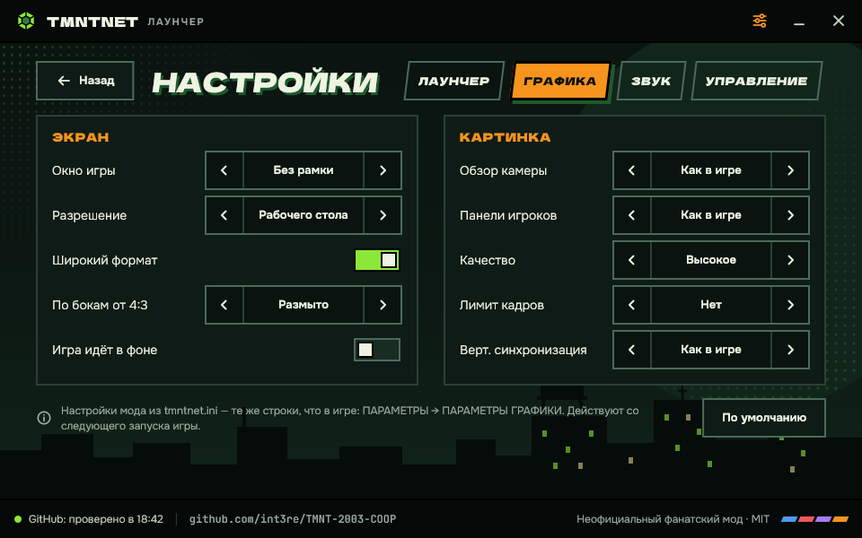
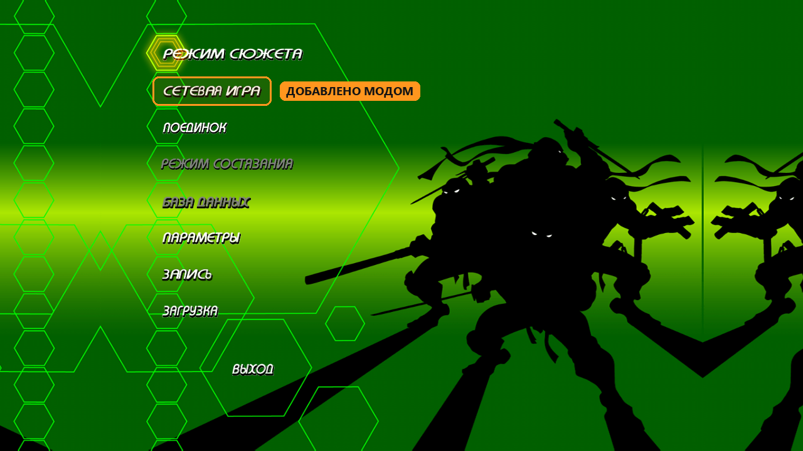
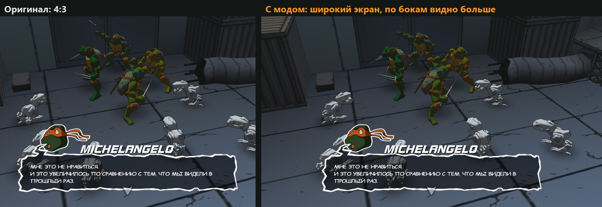
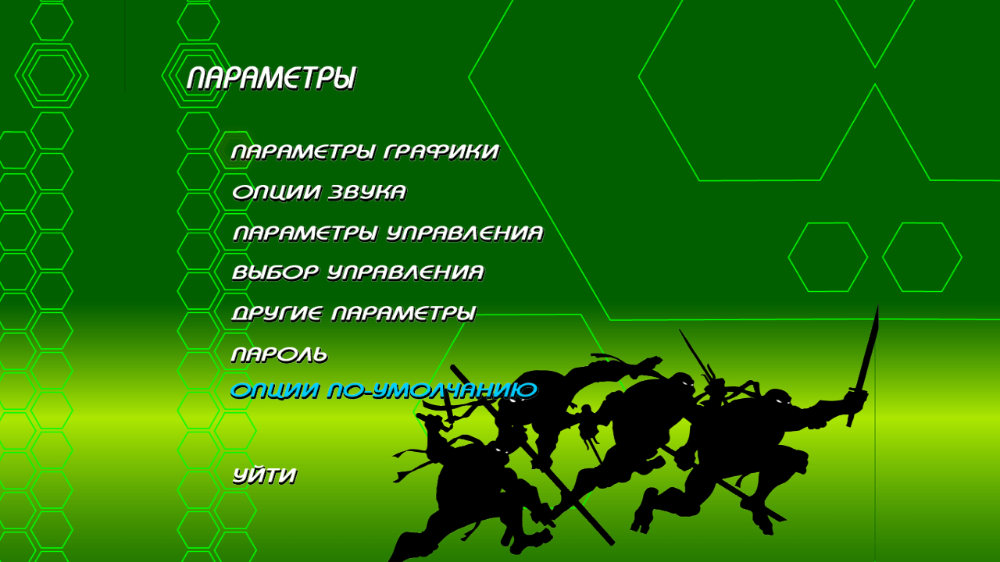

# What is added and changed — in pictures

[← Home](../../README.en.md) · [Русский](../TOUR.md)

All screenshots were taken in the game itself with the mod installed. In the menu screenshots an
**orange frame** outlines what the mod added; everything else on these pages is native, from the
game. The pages of the «Сетевая игра» (Network game) section are added by the mod entirely.

**Contents:** [Before and after](#before-and-after) · [Launcher](#launcher) · [Main menu](#main-menu) ·
[Story mode](#story-mode-three-and-four-players) · [Network game](#network-game) ·
[Turtle selection](#turtle-selection) · [Costumes](#costumes) · [Level map](#level-map) ·
[In a level](#in-a-level) · [Pause](#pause) · [Joining a running game](#joining-a-running-game) ·
[Wide screen](#wide-screen) · [Options](#options) · [What the screenshots do not show](#what-the-screenshots-do-not-show)

## Before and after

| | In the original game | With the mod |
|---|---|---|
| Co-op | two players on one computer | up to four, each on their own PC, over Steam or a local network |
| Story mode | 1 player, 2 players | + **three players**, **four players** |
| Camera | one for all, an "invisible wall" keeps the players close | everyone has their own, players can go separate ways |
| A fallen player | loses a life heart, then drops out | lies stunned, a teammate revives them |
| Pause over the network | — | Esc by any player, for everyone at once |
| Dojo levels | played by one turtle of the first player | the whole team takes part |
| Costumes | unlocked by playing through, by a secret button and by the calendar | all six are unlocked, picked on the select screen |
| Screen | 4:3 only | wide screen (more is visible at the sides), borderless, anti-aliasing up to 8x |
| Menus | designed for 4:3 | the main menu, the options and the level select span the full width of the screen, without bars |
| Mouse | mouse buttons cannot be assigned | assigned in the key table, like ordinary keys |
| Saving | at the end of a chapter, with a question | after every level, without questions |
| Intro | blares louder than the whole game | its own volume, can be skipped |
| Installing and updating | — | a launcher: one button, new versions from GitHub |

## Launcher

A separate window the player starts from (since version 0.14.0). It is the only part of the mod
that lives outside the game, which is why it has a look of its own: night rooftops, ink and
halftone, four headband colours. It has neither the game's logo nor its characters.

| First start: the mod is installed with one button | A new version is out |
|---|---|
|  |  |

| Downloading an update | The mod is in place: play |
|---|---|
|  |  |

| Settings | The headband colour is the accent colour |
|---|---|
|  |  |

| The game's graphics — in the launcher's settings | And the sound |
|---|---|
|  |  |

| Keys and mouse buttons — in the same place | The launcher takes its own new version by itself |
|---|---|
|  |  |

- **УСТАНОВЛЕНО** (Installed) and **НА GITHUB** (On GitHub) — the mod's version in the game folder
  and the latest released one; below them it says whether you can play with those who have not
  updated yet.
- The sheet on the right — what is new in the latest version.
- There is one big button: **УСТАНОВИТЬ МОД** (Install the mod), **ОБНОВИТЬ ДО …** (Update to …) or
  **ИГРАТЬ** (Play) — depending on what is needed now.
- The download bar is a pipe that fills up: meanwhile the update file is checked by SHA-256.
- The **ГРАФИКА** (Graphics), **ЗВУК** (Sound) and **УПРАВЛЕНИЕ** (Controls) tabs (since version
  0.15.0) — the same rows and keys as on the game's options pages below, only the game does not
  have to be started. The launcher takes its own new version by itself at start-up.

Details: [Launcher](LAUNCHER.md).

## Main menu

The second row is the entrance to everything networked.

The other items are native. The СЕТЕВАЯ ИГРА (Network game) label is assembled from the game's own
letters, in the same font as its neighbours.

## Story mode: three and four players

The game had only «1 ИГРОК» (1 player) and «2 ИГРОКА» (2 players). The modes for three and four work
both over the network and on one PC. Over the network this menu does not have to be opened:
НАЧАТЬ ИГРУ (Start the game) on the «Сетевая игра» (Network game) page takes everyone straight to
the turtle selection for the right number of players.

## Network game

These pages are added by the mod entirely and are styled like the game's options pages.

**The host's page.** On the right — the players with their ping and ready state, at the bottom —
what is happening now and a hint for the selected row.

**Inviting Steam friends** — right from the game, up to three people.

**The guest's page.** It opens by itself after connecting; the guest marks themselves ready and
waits for the host to start the game.

Details on every row: ["How to play over the network"](PLAY.md).

## Turtle selection

The select screen is native, but in the game it is designed for two. The mod added the turns of
players 3 and 4, their plates and the **players' names**: under the plate of a taken turtle — who
took it, in the centre — whose turn it is now.

## Costumes

After a turtle is picked a new step opens — **КОСТЮМ** (Costume). All six costumes are unlocked
from the start.

## Level map

In the game only the first player's turtle stands on the map. With the mod — the whole team, in
their costumes and with names.

## In a level

What in this screenshot comes from the mod:

- **Panels of players 3 and 4** — under the panels of the first two (the game has two panels).
- **Names above the turtles**, in the colour of the turtle's mask.
- **Own camera:** this is a screenshot from the PC of the player CASEY. The other three have their
  own picture at the same moment — each player's camera follows their turtle.
- **Panels in the corners of the screen** and the radar in the bottom right corner: on a wide
  screen the interface is neither stretched nor crowded into the middle.
- **No life hearts:** a team plays by [other rules](PLAY.md#in-a-level).

## Pause

The pause menu is native. It used not to open in a network game at all; now the pause is set for
all players at the same time.

## Joining a running game

A new screen: it is seen by a player who left in the middle of a level and came back, while their
game catches up with the others.

## Wide screen

One and the same moment of the game. On the left — as the original draws it, on the right — with
the mod: the picture is not stretched, more is visible at the sides, and the dialogue box has kept
its size.

## Options

In the **ПАРАМЕТРЫ** (Options) list the items are the same as in the game; the mod's rows are
inside the pages.

### Graphics options

In the game there are two rows here: РАЗРЕШЕНИЕ (Resolution) and ТЕНИ (Shadows).

| Row | What it does |
|---|---|
| ОКНО ИГРЫ (Game window) | full screen, borderless, windowed |
| ШИРОКИЙ ФОРМАТ (Wide screen) | wide screen instead of 4:3 |
| ПО БОКАМ (Sides) | what to draw at the sides of 4:3 pictures (movies, character select) |
| ОБЗОР (Field of view) | the camera sees wider: up to 150 % |
| ПАНЕЛИ (Panels) | size of the life and score panels |
| КАЧЕСТВО (Quality) | 4x / 8x anti-aliasing and sharp textures |
| ЛИМИТ КАДРОВ (Frame limit) | 30, 60, 120, 144 or no limit |
| ИГРА В ФОНЕ (Run in background) | do not pause when the window is not active |

One more change: the chosen resolution is now written right in the РАЗРЕШЕНИЕ row.

### Sound options

In the list of options this page is called ОПЦИИ ЗВУКА (Sound options).

| Row | What it does |
|---|---|
| РОЛИКИ (Movies) | movie volume — the same kind of slider as the music has |
| ЗАСТАВКА (Intro) | show the intro at start-up or skip it |

### Other options

In the list of options — ДРУГИЕ ПАРАМЕТРЫ (Other options).

| Row | What it does |
|---|---|
| ВЫБОР ЗА ИГРОКА 2 (Pick for player 2) | on one PC: pick a turtle for the second player if they do not pick one themselves |
| ГЕРОЙ ИГРОКА 2 (Player 2's hero) | which one: at random or the first free one |
| ИГРОК 2 ПО СЕТИ (Player 2 over the network) | in the "host-only game" mode the second player's keys on the host's PC are disabled |
| КАМЕРА ПО СЕТИ (Camera in netplay) | own camera or one for all, as in the game |

The АВТОЗАПИСЬ (Autosave) row is native but works differently: with the mod the game is saved after
every completed level.

### Control options

**РАСКЛАДКА** (Layout) switches between ready-made key sets: as in the game or "two on one keyboard".

The key table is native, but **mouse buttons** can now be put into it: select an action and click
a button — ЛКМ, ПКМ, СКМ, М4 or М5 (left, right, middle, 4th or 5th button) appears in the cell.

Details: ["Controls"](CONTROLS.md).

## What the screenshots do not show

- **Network play frame for frame.** Nobody streams the picture: every copy of the game computes
  the same thing, only button presses travel over the network. Details — ["How it works"](ARCHITECTURE.md).
- **A stunned turtle.** A fallen player lies with stars above their head; a teammate revives them
  by holding a button for 4 seconds. The level is lost only when everyone has fallen.
- **No "invisible wall".** In the original an invisible circle around the shared camera keeps the
  players close; in a network game it is removed.
- **Autosave** after every level and a backup copy of the previous save.
- **The game does not freeze in the background** during a network game: you can switch to Discord
  and Steam.
- **Logs.** The mod writes down what is happening and keeps the logs of the last ten runs — this
  helps to work out what happened if something went wrong.

The full list of changes by version is in the [version history](CHANGELOG.md).
